# How Smart Tutor uses Langfuse: an overview

**Who this is for:** the product owner and anyone new to the team's evals and observability.
**How to read it:** one diagram per question. Each diagram's HTML page also lists the commands, step by step.
**Where the facts come from:** ADR 0023 (`sdd/adr/0023-how-smart-tutor-uses-langfuse.md`), `backend/evals/` and its README, `backend/src/smart_tutor/shared/adapters/tracing.py`, `docs/runbooks/langfuse-host.md` and `docs/runbooks/evals-ci.md`. Where they differ from the PRD, this page describes the code on `main`.

**As of:** 2026-10-15, after #316, #317 and #319 merged. **Dashed boxes are planned work**, with the issue number in the box's tag.

## At a glance

- **One Langfuse, three projects.** The team uses a self-hosted Langfuse at `https://sec-dog.duckdns.org`, which runs 07:00–18:00 Asia/Ho_Chi_Minh. Organization **Smart Tutor** has three projects: `smart-tutor-on-premise` for production traces, `smart-tutor-local` for developers, and `smart-tutor-evals` for datasets and review queues, and experiments after #320.
- **Datasets are reviewed, then frozen.** A model drafts candidate questions and people accept or reject them in a Langfuse annotation queue. The accepted items are then published as a new dataset version, which is never edited afterwards.
- **Evals gate every agent change.** A suite runs a pinned dataset version through the real agent and scores the answers with code checks and LLM judges. It then fails the PR if any metric misses its threshold. Today the suite still reads its datasets from LangSmith and shows its results there; #320 moves both to Langfuse.
- **Every question and every upload is traced.** Questions arrive as `ask` traces and uploads as `ingest` traces, through OpenTelemetry. A trace carries a learner hash, never a user id, email or token.

## 1. Create a dataset and publish it to Langfuse

<picture>
  <source media="(prefers-color-scheme: dark)" srcset="diagrams/langfuse-datasets-dark.svg">
  
</picture>

[Open the diagram](diagrams/langfuse-datasets.html) ([dark](diagrams/langfuse-datasets-dark.html))

**What this shows:**
1. `make evals-generate` sends the seed corpus to a judge model, which drafts candidate questions.
2. Each candidate becomes a trace in a Langfuse review queue, where a reviewer marks it `accepted` or not.
3. `make evals-publish` combines the accepted items with the hand-written examples and creates the next version, such as `smart-tutor-ask/smoke-v3`.
4. A release pins that version by name in the dataset's YAML file. Until #320 the eval runner reads pins as LangSmith tags, so a Langfuse version isn't pinned yet.

## 2. Run evaluators against a dataset

<picture>
  <source media="(prefers-color-scheme: dark)" srcset="diagrams/langfuse-evaluators-dark.svg">
  
</picture>

[Open the diagram](diagrams/langfuse-evaluators.html) ([dark](diagrams/langfuse-evaluators-dark.html))

**What this shows:**
- `make evals-smoke` runs the suite on a laptop. CI runs the same suite on PRs that change the agent.
- The suite feeds each item of the pinned dataset to the agent's ask graph, built inside the eval process with the real Bedrock models. Two kinds of evaluator score the answers:
  - **code evaluators** check rules such as "declined when it should" or "did not leak the system prompt";
  - **LLM judges** grade answer and retrieval relevance against a written rubric.
- The gate compares each metric with `thresholds.yaml` and fails the run if any metric misses.
- Today the suite reads its datasets from LangSmith and its results show there, which is why both Langfuse boxes are dashed. After #320 it reads the Langfuse dataset versions, and each run shows as a Langfuse experiment where runs can be compared side by side.

## 3. Observe traces and monitor metrics

<picture>
  <source media="(prefers-color-scheme: dark)" srcset="diagrams/langfuse-monitoring-dark.svg">
  
</picture>

[Open the diagram](diagrams/langfuse-monitoring.html) ([dark](diagrams/langfuse-monitoring-dark.html))

**What this shows:** the agent and the ingestion worker export their traces over OpenTelemetry, and a tracing failure never fails a request. In Langfuse, open **Tracing → Traces** in `smart-tutor-on-premise`. You can filter by trace name, environment, thread (session) or learner hash (user); latency, tokens and model calls come with every trace. Three items are not built yet:
- learner ratings as scores (#318);
- dashboards and alerts (M4);
- the job that deletes production traces after 178 days (#321).

Until #322, every trace also still goes to Phoenix.

## Files

The diagrams were drawn with the diagram-design skill in the Smart Tutor skin, the same one used for #247 (PR #284). The `.html` pages are the source; the `.svg` files are exports for GitHub and are not edited by hand.
