# Smart Tutor on-premise: solution architecture

**What "on-premise" means here:** Smart Tutor runs on **one virtual machine (an Amazon EC2 server) in our own AWS account**, in the Region us-east-1 (Northern Virginia), with Docker Compose. It does **not** mean a customer's own servers or data centre. The VM still uses these managed AWS services: S3 for the PDFs, SQS for the upload queue, Bedrock for the AI models, Secrets Manager and SSM Parameter Store for settings and secrets, ECR for the container images, and CloudWatch, Route 53 and SNS for monitoring and alert emails.
**Why this document exists:** the earlier deployment, **native-cloud mode** (Kubernetes on Amazon EKS, described in [`solution-architecture.md`](solution-architecture.md)), was torn down with its data on 2026-10-11 (#156). On-premise mode is now the default and the only deployment that runs. Native-cloud can still be deployed by hand.

**Who this is for:** the product owner and business stakeholders. It assumes no cloud or engineering background.
**How to read it:** start with "At a glance", then read the "What this shows" paragraph under each diagram. The tables add detail, and the glossary at the end explains every technical term. Each diagram is shown inline; the link under it opens the full-size page (light or dark).
**Where the facts come from:** the infrastructure code (`infra/`, the Host stack in `infra/smart_tutor_infra/stacks/host.py`), the files deployed to the VM (`deploy/on-premise/`), application code (`backend/`), GitHub workflows (`.github/workflows/`), and the engineer runbooks ([`on-premise-deploy.md`](../runbooks/on-premise-deploy.md), [`on-premise-backups.md`](../runbooks/on-premise-backups.md), [`on-premise-monitoring.md`](../runbooks/on-premise-monitoring.md)). Where the code and the PRD (`sdd/prd.md`) differ, this document describes the code that runs today.

**As of:** commit `e69c04c` on `main` (2026-10-13).
**Status:** draft. This first version has the framing and "At a glance"; the numbered sections are filled in by the follow-up issues named in each one (parent #145). How the diagrams are drawn: [`diagrams/README.md`](diagrams/README.md).

## At a glance

<picture>
  <source media="(prefers-color-scheme: dark)" srcset="diagrams/on-premise-at-a-glance-dark.svg">
  
</picture>

[Open the diagram](diagrams/on-premise-at-a-glance.html) ([dark](diagrams/on-premise-at-a-glance-dark.html))

- **One server in our AWS account.** All of Smart Tutor's own programs run as containers on one t3.large EC2 virtual machine, with its database on a 50 GB encrypted data volume. AWS still stores the PDFs, runs the AI models, holds the secrets, and watches the server.
- **One public address.** Learners reach it at `https://smart-tutor.duckdns.org`, a free DuckDNS name pointed at the server's fixed address (Elastic IP). Caddy, the web server on the VM, gets the HTTPS certificate from Let's Encrypt. The server accepts only web traffic (ports 80 and 443) and has no SSH; engineers reach it through AWS Session Manager.
- **Each learner sees only their own documents.** The app code is the same as in native-cloud: one access rule, "owner only", is built into the code and into the database query.
- **The PDF processor is fenced in.** The worker, which reads uploaded PDFs, can reach the internet only through an allowlist proxy (ADR 0014).
- **Every merge deploys itself.** While the production switch (the repository variable `PRODUCTION_DEPLOY`) is `true`, a merge to `main` is checked, built, deployed to the VM and smoke-tested automatically, unless `ON_PREMISE_AUTO_DEPLOY` is `false`. With the switch off, nothing deploys to production, not even by hand.
- **Traces stay on our server.** The record of each question and each processed upload (a trace) goes to Phoenix, a trace viewer running on the same VM behind its own sign-in, and is kept 180 days (ADR 0017).
- **Backed up and watched.** A snapshot of the data volume every day (kept 7 days) and a database copy to S3 every night (kept 30 days). Alarms email the team when the server fails its health check, the app stops answering, or a backup fails.
- **Cost:** see section 6 (to come).

## 1. Solution overview

> To be written in #248: diagram 1, where everything runs (the public name and the only way in, the VPC, the VM and its containers, the AWS services it uses, the direct upload to S3), with a table of every box, its number of copies and its resource limits.

## 2. Key user flows

> To be written in #249: diagram 2A, upload a PDF until it is ready, and diagram 2B, ask a question and get a streamed answer, with every access and privacy check marked.

## 3. From merge to live

> To be written in #250: diagram 3, how a merge reaches the VM and how to roll back, with a steps table, real deploy timings, and the rollback limits.

## 4. Security and data isolation

> To be written in #251: how settings and secrets reach the containers (diagram 3b), how each learner sees only their own data, the instance role's permissions, encryption, what is reachable from the internet, and the known gaps.
>
> Diagram 4, the worker's permitted and blocked network paths: #252.

## 5. Operations at a glance

> To be written in #253: diagram 5, backups and restore, plus monitoring and alarms, the weekly patch window, where to look when something breaks, and what a teardown keeps and deletes.

## 6. Cost drivers

> To be written in #270: what runs all the time and what is charged per use, the budget alarm, and a comparison with native-cloud.

## 7. Open points

> To be written in #270.

## 8. Glossary

> To be written in #270: every abbreviation and AWS term the document uses, with one plain sentence each.
