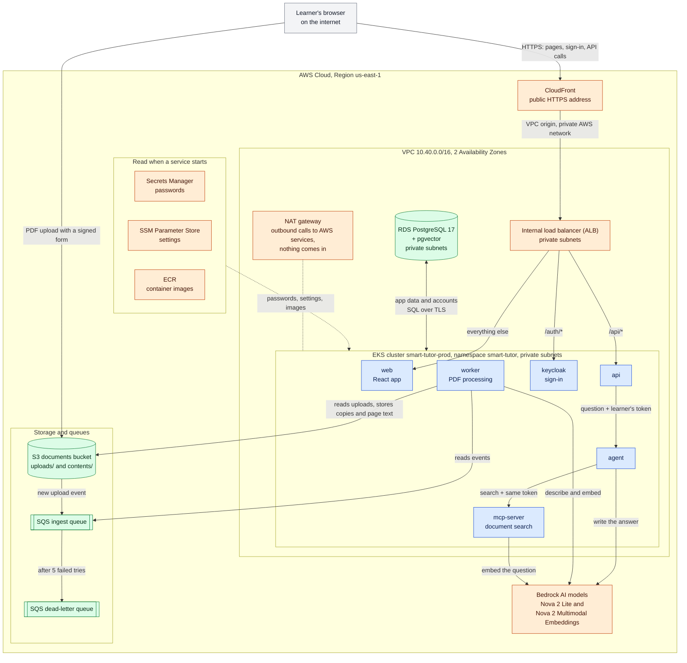
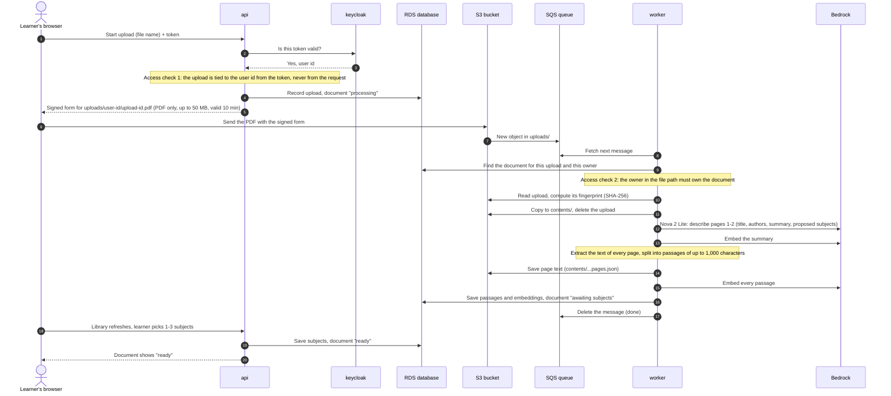
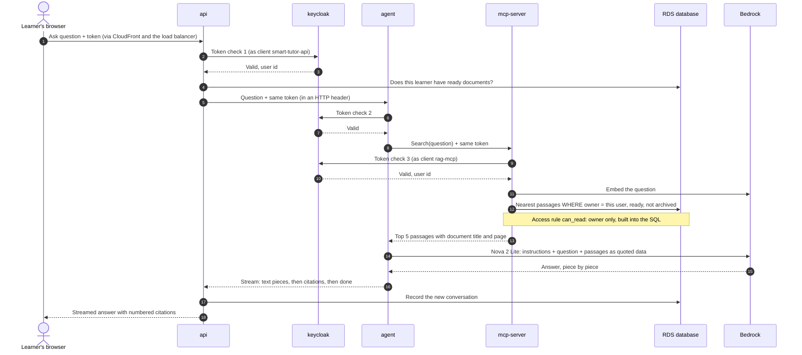
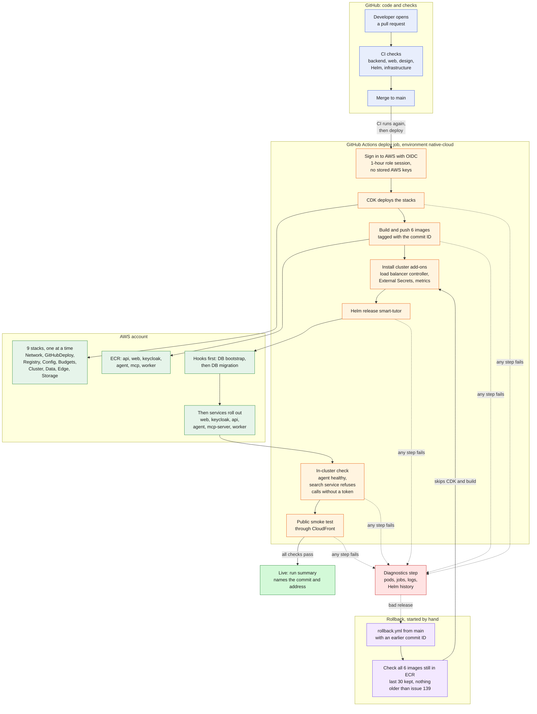
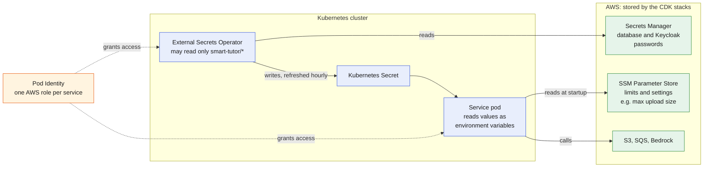

# Smart Tutor pilot on AWS: solution architecture

**Who this is for:** the product owner and business stakeholders. It assumes no cloud or engineering background.
**How to read it:** start with "At a glance", then read the "What this shows" paragraph under each diagram. The tables add detail, and the glossary at the end explains every technical term.
**Where the facts come from:** the infrastructure code (`infra/`), Helm charts (`deploy/helm/`), application code (`backend/`), GitHub workflows (`.github/workflows/`), and the engineer runbooks (`docs/runbooks/`; "runbook §N" means a section of [`pilot-deploy.md`](../runbooks/pilot-deploy.md)). Where the code and the PRD (`sdd/prd.md`) differ, this document describes the code that runs today.

**As of:** commit `4623ea8` on `main` (issue #139 "Upload and ask on the AWS pilot" merged, 2026-10-09).

## At a glance

- **One public address.** Learners reach Smart Tutor only through one HTTPS address (Amazon CloudFront). Everything else runs privately in one AWS Region, us-east-1.
- **Six services, managed AI.** Our six services run on one Kubernetes cluster (Amazon EKS). The AI models run in Amazon Bedrock and are paid per use: Amazon Nova 2 Lite and Amazon Nova 2 Multimodal Embeddings.
- **Each learner sees only their own documents.** One access rule, "owner only", is built into the code and into the database query. Every service on a question's path checks the learner's sign-in token again.
- **Every merge deploys itself.** A merge to `main` is checked, deployed and smoke-tested automatically in about 5 to 11 minutes. GitHub holds no AWS keys, and rollback is a one-click workflow with known limits.
- **About US$250 to 300 a month while idle**, plus Bedrock usage. The budget alarm is set to US$20 a month for the testing phase. Known gaps and open decisions are listed in sections 4.6 and 7.

## 1. Solution overview

Smart Tutor runs in one AWS (Amazon Web Services) account, in the Region us-east-1 (Northern Virginia). All our own programs run as containers on one Amazon EKS (Elastic Kubernetes Service) cluster. Learners reach it through one public address only: an Amazon CloudFront address over HTTPS.

### Diagram 1: Solution overview

Legend: blue = our services (pods we build and run); orange = AWS managed services and network pieces; green = where data is stored or queued; grey = outside AWS. Solid arrows carry requests or data; dotted arrows carry setup (secrets, settings, images, outbound traffic).

**What this shows.** A learner's browser talks to one public address, CloudFront. CloudFront passes requests over AWS's private network to a load balancer that has no public address. The load balancer sends each request to one of three services by its path: sign-in (`/auth/*`), the API (`/api/*`), or the web app (everything else). Everything else (the agent, the search service, the PDF worker, and the database) can only be reached from inside the cluster. The one exception is the upload: the browser sends the PDF straight to the S3 bucket with a short-lived signed form that the API created, so large files never pass through our servers. The worker picks up each upload from a queue, and the AI models run in Amazon Bedrock, a managed AWS service. Passwords come from AWS Secrets Manager when a service starts; none are kept in Git.

To keep the picture readable, some arrows are left out:
- the API, the agent and the search service each ask Keycloak whether the learner's token is valid (diagram 2B);
- the API sends "retry" messages to the queue;
- the API calls Bedrock to embed subject names.

The single arrow to the database stands for the api, mcp-server, worker and keycloak connections (see the permissions table in section 4.2).

| Component | What it is | Why we need it |
|---|---|---|
| Learner's browser | The learner's own web browser. | Runs the Smart Tutor web app; uploads PDFs and shows streamed answers. |
| CloudFront | AWS's content delivery network; our only public address (`https://<id>.cloudfront.net`). | Gives HTTPS to the browser, routes `/`, `/auth/*`, `/api/*`, and adds standard security headers to the web app's pages. It keeps the rest of the system off the internet. |
| Internal load balancer (ALB) | An Application Load Balancer inside the private subnets, with no public address. | Receives traffic from CloudFront (through the VPC origin) and from inside our private network only, and sends it by path to the right pods: `/auth/*` to sign-in, `/api/*` to the API, everything else to the web app. |
| NAT gateway | A one-way exit to the internet, in a public subnet. | Lets pods in private subnets call AWS services (Bedrock, S3, SQS, Secrets Manager, SSM) and lets the servers pull images from ECR; nothing can come in through it. |
| EKS cluster | Managed Kubernetes cluster `smart-tutor-prod`, version 1.36, 2 servers (t3.large), can grow to 3. | Runs all our services, restarts them if they fail, and spreads copies across machines. |
| Namespace `smart-tutor` | The cluster's folder for our application pods. | Groups our services and their AWS permissions. |
| web | The React web app, served by nginx (2 copies). | What the learner sees: library, upload, chat. |
| keycloak | Keycloak, our sign-in service (1 copy), realm `smart-tutor`. | Signs learners in and issues tokens; tells the other services whether a token is still valid. |
| api | Our FastAPI service (2 copies). | The front door for all app actions: checks who the learner is, starts uploads, lists documents, saves subject choices, starts conversations, relays streamed answers. |
| agent | Our LangGraph AI agent (2 copies); not reachable from outside the cluster. | Runs the fixed answer steps: search the learner's documents, then ask the model for an answer with citations. |
| mcp-server | Our document search service ("RAG MCP server", 1 copy); not reachable from outside the cluster. | Finds the passages that best match a question, **only** among the asking learner's own documents. |
| worker | Our PDF processing service (1 copy); no web address at all. | Turns an uploaded PDF into searchable text: reads it, describes it, splits it into passages, and embeds them. |
| RDS PostgreSQL + pgvector | Amazon RDS (Relational Database Service) running PostgreSQL 17 with the pgvector extension; size db.t3.micro, 20 GB disk that can grow to 100 GB, single Availability Zone, 7 days of backups. | Holds two databases: `smart_tutor` (documents, passages and their embeddings, subjects, conversations) and `keycloak` (user accounts). |
| S3 documents bucket | Amazon S3 (Simple Storage Service) bucket `smart-tutor-documents-<account>`, versioned, all public access blocked. | Keeps uploads (`uploads/`, deleted automatically after 1 day) and the stored PDFs with their page text (`contents/`). |
| SQS ingest queue | Amazon SQS (Simple Queue Service) queue `smart-tutor-ingest`. | Holds "a new PDF arrived" and "retry this PDF" messages until the worker handles them, so no upload is lost if the worker is busy or restarting. |
| SQS dead-letter queue | Queue `smart-tutor-ingest-dlq`; keeps messages for 14 days. | Catches a message that failed 5 times, so one bad file cannot block the queue and an engineer can look at it. |
| Bedrock | Amazon Bedrock, AWS's managed AI model service. Models: **Amazon Nova 2 Lite** (`amazon.nova-2-lite-v1:0`, through the US inference profile `us.amazon.nova-2-lite-v1:0`) and **Amazon Nova 2 Multimodal Embeddings** (`amazon.nova-2-multimodal-embeddings-v1:0`, 1024 numbers per text). | Nova 2 Lite writes answers and describes new PDFs; the embeddings model turns text into numbers so we can search by meaning. We pay per use and run no AI servers. |
| Secrets Manager | AWS Secrets Manager. | Stores the database passwords, the Keycloak admin password, and the two Keycloak client secrets (6 secrets, all named `smart-tutor/...`). |
| SSM Parameter Store | AWS Systems Manager Parameter Store. | Stores settings we may change without new code: upload limit 50 MB, 500 pages, 3 processing attempts, and the app time zone (Asia/Ho_Chi_Minh). |
| ECR | Amazon ECR (Elastic Container Registry), one repository per service. | Stores the container images the cluster runs; each image is scanned for known vulnerabilities when pushed; the last 30 are kept. |

## 2. Key user flows

### Diagram 2A: Upload a PDF until it is ready

Legend: `actor` = the learner's browser; each box = one service; dashed arrows = replies; notes = where a privacy check happens.

**What this shows.** The PDF never passes through our API. The API checks who the learner is, records the upload, and hands the browser a signed form. That form only works for 10 minutes, only for a PDF up to 50 MB, and only for one file path that contains the learner's id. S3 then drops a message on the queue, and the worker takes it from there. It describes the first two pages with Nova 2 Lite so the Library can show a real title early. Then it reads all pages and turns each passage into an embedding with Bedrock. The document becomes **ready** once the learner has chosen 1 to 3 subjects for it; from then on chat can search it. If any step fails (for example, Bedrock is briefly unavailable), the message comes back after 15 minutes and the worker tries again. After 5 failed tries the message moves to the dead-letter queue. A file that is too long, unreadable, or scanned without a text layer ends as "failed" with a clear reason, and the learner can retry it up to 3 times in total. A file another learner already uploaded is processed again as the learner's own content; a learner's own duplicate is not processed again, and the upload points to their existing document.

### Diagram 2B: Ask a question and get a streamed answer

Legend: as above. The token travels only in HTTP headers and in the agent's run context, never inside the text sent to the model.

**What this shows.** One question passes through three of our services, and **each one asks Keycloak whether the learner's token is still valid**. So signing out, or an administrator ending a session, stops access on the very next request everywhere. The search service never takes a user id from the request. It reads the user id from the verified token and builds the database query with the rule `can_read` (Release 1: "the learner owns the document"). A question, or a sentence hidden inside a PDF, can't widen that search, because the AI model never decides which documents to read: code and the database do. Passages are handed to the model as quoted material with an instruction to treat them as information, never as instructions. The answer streams back to the browser piece by piece, then the citations (document and page) arrive. CloudFront allows up to 60 seconds between pieces.

Note: in today's code the agent calls the search service twice. The first call picks which of the learner's subjects the question is about, and the second searches within those subjects (`apps/agent/graph.py`). The diagram shows one call. PRD v2.21 drops the subject step (conversations have no subjects; [#121](https://github.com/konica/agent-tutor/issues/121)), after which the search covers all of the learner's ready documents. The access rule is the same either way.

## 3. From merge to live

This section covers how a code change reaches the live pilot and how settings and passwords reach the running services. It comes from `.github/workflows/` (`ci.yml`, `deploy.yml`, `deploy-native-cloud.yml`, `rollback.yml`), `deploy/pilot/smoke_test.py`, `infra/`, `deploy/helm/`, and the runbook.

### Diagram 3: From merge to live

Legend: blue = GitHub, orange = deploy job steps, green = what changes in AWS, bright green = success, red = failure, purple = rollback. Solid arrows are the normal path; dotted arrows are failure and recovery.

**What this shows.** Nobody has to deploy by hand. When a pull request is merged into `main`, the same checks that ran on the pull request run again. If they pass, a separate job (`build-images.yml`) builds the six application images, and the on-premise deploy runs. The native-cloud pilot (the diagram below) deploys only when someone chooses it, by hand or while `NATIVE_CLOUD_AUTO_DEPLOY` is `true`; its job then updates the cloud infrastructure and releases the images to the cluster. The job then checks the app from inside the cluster and from the public internet. The job signs in to AWS with a short-lived identity that only the `main` branch can use, so GitHub holds no AWS passwords or keys. If any step fails, the job prints diagnostics, and the live app keeps running the previous version wherever the failure stopped the release. To go back to an earlier version, someone starts a rollback that redeploys that version's images. Rollback has limits: it can't go back further than issue 139, can't undo infrastructure changes, and can't cross a database change.

#### Steps

| Step | What happens | Why it matters | What protects us if it fails |
|---|---|---|---|
| 1. Pull request | A developer proposes a change on a branch. CI runs `ci.yml`: backend linting, types, architecture rules, unit tests, and a migration run against a real PostgreSQL database; web tests, build, and a check that the generated API client is current; design tooling checks; Helm chart linting; and the infrastructure tests (CDK, chart, workflow, and smoke-test tests). | Problems are caught before they reach `main`. | A red check shows on the pull request, but GitHub can't block the merge on this repository's plan. The deploy is still safe: after the merge, `deploy.yml` runs the same checks again and deploys only if they pass. Nothing is deployed from a pull request, because the AWS role trusts only the `native-cloud` environment and that environment accepts only `main`. |
| 2. Merge to `main` | `deploy.yml` starts on every push to `main`. It runs the CI checks again, builds the images, deploys on-premise (unless `ON_PREMISE_AUTO_DEPLOY` is `false`), and calls `deploy-native-cloud.yml` only when chosen (by hand, or while `NATIVE_CLOUD_AUTO_DEPLOY` is `true`; #150). | The deploy always uses the code as merged, not as it was when the branch was tested. | If the checks fail, the deploy job never starts. |
| 3. Queue | Only one deploy runs at a time (concurrency group `deploy-native-cloud`). A newer merge waits; if several merges arrive, only the newest waits and the ones in between are cancelled. | Two releases never fight over the same cluster. | A running release is never cancelled by a new merge. The 60-minute job timeout stops a run that hangs. |
| 4. Sign in to AWS | The job runs in the GitHub environment `native-cloud` and asks GitHub for an OIDC token. AWS exchanges it for a 1-hour session of the role `smart-tutor-github-deploy`. | No long-lived AWS keys exist on GitHub to leak. | The role trusts only jobs from this repository in the environment `native-cloud`, and that environment accepts only `main`. The role can do five things: use the CDK deploy roles, push to the `smart-tutor/*` ECR repositories, look up the cluster, read this app's stack outputs, and log in to ECR. Inside the cluster the same role is a cluster administrator (an EKS access entry), because it installs the add-ons and the app; the admin users listed in `infra/cdk.json` have the same access. No human approval is required: the `native-cloud` environment's only rule is "deploy from `main` only". |
| 5. Infrastructure (CDK) | `cdk deploy --all` updates the nine stacks through CloudFormation, one at a time, in dependency order (confirmed in the deploy log): Network, GitHubDeploy, Registry, Config, Budgets, Cluster, Data, Edge, Storage (all named `SmartTutor-prod-*`). | The cloud setup is code that has been reviewed and tested, so every environment change goes through a pull request. | CloudFormation rolls a failed stack update back to its last good state. The job stops before any app change. |
| 6. Read stack outputs | The job reads the registry address, CloudFront address, network ID, documents bucket, and ingest queue from the stack outputs. | The release uses the real addresses, not copied values. | The job stops with a clear error if an output is missing. |
| 7. Build and push images | Each mode builds its images in its own job before that mode deploys; `build-images.yml` runs as that job (it skips the build when all six images are already in ECR). Docker builds six images: `api`, `web`, `keycloak`, `agent`, `mcp`, and `worker`. Each is tagged with the full commit ID and pushed to native-cloud's ECR repositories (`smart-tutor/<name>`; on-premise builds into its own `smart-tutor-on-premise/<name>`, #206). When any image is missing, the job first deploys its mode's `GitHubDeploy` and `Registry` stacks so the repositories exist. | Each release can be traced to one exact commit, and rollback can reuse the same images. | ECR scans each image when it is pushed, and keeps the last 30 images per repository. A failed build stops the run before any deploy. |
| 8. Cluster add-ons | Helm installs or updates three add-ons at pinned versions: the AWS Load Balancer Controller, External Secrets Operator, and metrics-server. | The app depends on them to receive traffic and passwords. | Each install waits until it is healthy. Pinned versions mean no surprise upgrades. |
| 9. Helm release | `helm upgrade --install smart-tutor` runs. First its hooks run in order: set up the cluster's link to Secrets Manager, create the databases and their users (`db-bootstrap`), then apply database changes (`migrate`). Then the six services roll out. The job waits up to 15 minutes. | Database changes are applied before the new code that needs them starts. | A failed migration fails the release, so the old API keeps serving. The database admin password is removed from the cluster as soon as `db-bootstrap` succeeds. |
| 10. In-cluster check | From inside an API pod, the job checks that the agent answers its health check and that the search service (mcp-server) refuses a call without a token. | These two services aren't reachable from the internet, so the public test can't see them. It also shows that any pod can reach the search service today: no network rules between pods are deployed yet (see 4.6). | A failure turns the run red and triggers Diagnostics. |
| 11. Public smoke test | `deploy/pilot/smoke_test.py` calls the CloudFront address. It checks that the app page loads, the API health check answers, the API rejects a request without a sign-in, and Keycloak's sign-in address is correct. It retries every 15 seconds for up to 10 minutes, because a new release takes a few minutes to start answering. | It shows that a learner on the internet can actually reach the app. | A failure after 10 minutes turns the run red and triggers Diagnostics. It never sends a real sign-in token. |
| 12a. Success | The run summary records the deployed commit and the public address. | Anyone can see what is live. | Not applicable. |
| 12b. Failure | The Diagnostics step prints the state of pods, jobs, secrets syncs, and load balancer bindings; the logs of `migrate`, `db-bootstrap`, the worker, and the agent; and the Helm release history. | The cause is usually visible in the run without logging in to AWS. | If a cancelled or timed-out run leaves the release stuck "in progress", an admin rolls Helm back to the last good revision from a laptop and re-runs the deploy (runbook §12). |
| 13. Rollback | Someone starts `rollback.yml` from `main` with the full commit ID of an earlier successful deploy, choosing mode `native-cloud` for the pilot (the default mode is on-premise). It checks that all six images for that commit are still in ECR, checks out that commit's chart, and runs the add-ons, Helm release, in-cluster check, and smoke test. It skips CDK and the image build. | Going back to a known good version takes minutes and doesn't need a new build. | Limits: it can't go back to commits from before issue 139 (their images and chart lack the agent and search service), or to images older than the last 30; only commits deployed to native-cloud have images in its repositories. It doesn't undo infrastructure changes. It fails if the database already has a newer migration; in that case the fix is to revert the pull request and merge again ("fix forward"). |

One-time setup outside the pipeline: an AWS admin bootstraps CDK, deploys the `SmartTutor-prod-GitHubDeploy` stack once from a laptop (GitHub can't create the role it signs in with), and creates the `native-cloud` environment on GitHub ([`pilot-aws-prerequisites.md`](../runbooks/pilot-aws-prerequisites.md)). After that, every deploy keeps the role up to date.

### 3b. How configuration and secrets reach the services

Legend: green = AWS services, blue = inside the cluster, orange = identity. Solid arrows carry data; dotted arrows grant permission.

**What this shows.** Passwords are generated by AWS and never appear in code, in GitHub, or in the deploy logs. The External Secrets Operator copies them from AWS Secrets Manager into the cluster, and each service receives only the ones it needs. Non-secret settings, such as the 50 MB upload limit and the 500-page limit, live in SSM Parameter Store, and the services read them directly when they start. To change a limit, you change a parameter, not the code. Each service gets its own narrow AWS role through Pod Identity. For example, the worker may read uploads and write processed copies in the documents bucket, while the search service may only create embeddings. A rotated database password needs three manual steps: a deploy (its `db-bootstrap` hook sets the new password in the database), a forced sync of the cluster's copies, and a restart of every service that uses it (api, agent, mcp-server, worker, keycloak). Runbook §9 has the commands.

## 4. Security and data isolation

### 4.1 Each learner sees only their own data

- **One access rule.** Every read of a document goes through `can_read(user, document)`. In Release 1 it means "owner only". It exists once in the domain code and once as a database condition (`documents.owner_id = <user from token>`). The API, the search service and the worker all use it.
- **Who the user is comes from the token, never from the request.** No endpoint or search tool accepts a user id. Upload paths contain the user id from the token, and the worker checks that the document for an upload belongs to the user in that path.
- **Three token checks per question.** The API, the agent, and the search service each ask Keycloak to confirm the token. They also check that it was issued by our Keycloak and meant for them.
- **Nothing is linked across learners.** An upload is never linked to another learner's document or passages. Another learner's upload of the same file becomes their own content, stored at `contents/<owner_id>/<content_id>.pdf` and processed in full. The same learner's duplicate is not processed again: the upload points to their existing document and no second document appears.
- **Tokens stay out of prompts and logs.** Services log only the reason a token was refused, never the token itself.

### 4.2 Each service gets only the AWS permissions it needs

AWS permissions are given per service through EKS Pod Identity: each service gets its own IAM (Identity and Access Management) role, with no stored keys.

| Service | It may | It may not |
|---|---|---|
| api | Create signed upload forms for `uploads/` only; send messages to the ingest queue (retries); read `smart-tutor` settings; call the embeddings model (subject names). | Read stored PDFs, delete anything in S3, read the queue, call the answer model. |
| worker | Read `uploads/` and `contents/`; write `contents/`; delete from `uploads/`; list the bucket; receive and delete queue messages; read settings; call Nova 2 Lite and the embeddings model. | Write outside `contents/`, delete stored PDFs, send queue messages. |
| agent | Read settings; call Nova 2 Lite (through the US inference profile). | Touch S3, SQS, or the embeddings model. |
| mcp-server | Call the embeddings model. | Touch S3, SQS, or Nova 2 Lite. |
| web, keycloak | No AWS permissions at all. | Anything in AWS. |
| External Secrets Operator (a cluster add-on) | Read secrets named `smart-tutor/*` and copy them into the cluster. | Read any other secret. |
| AWS Load Balancer Controller (a cluster add-on) | Register pod addresses with the load balancer (AWS's standard policy). | Anything outside AWS's published policy for this add-on. |

Each role can only be taken on by pods in this AWS account (a guard against the "confused deputy" problem). Containers run as a non-root user, with a read-only file system and all extra Linux privileges removed. The deploy pipeline's own role is described in section 3, step 4.

### 4.3 Secrets live in Secrets Manager, never in Git

The six secrets are generated by AWS when the infrastructure is created; nobody types or copies them. They are: the database master password, the app and Keycloak database logins, the Keycloak admin login, and the two Keycloak client secrets. The External Secrets Operator copies them into the cluster and refreshes them every hour (diagram 3b). The services read them as environment variables. Settings that aren't secret (limits, time zone) live in SSM Parameter Store.

### 4.4 Encryption

| Where | At rest | In transit |
|---|---|---|
| Browser to CloudFront | n/a | HTTPS only (plain HTTP is redirected to HTTPS). |
| CloudFront to load balancer to pods | n/a | Plain HTTP, but only on AWS's private network inside the VPC origin (there is no custom domain yet, so no certificate for the load balancer). |
| Browser to S3 (upload) | S3-managed encryption. | HTTPS; the bucket refuses any non-TLS request. |
| Database | RDS storage encryption on. | Every connection requires TLS (`sslmode=require`). |
| SQS queues | SQS-managed encryption. | HTTPS (AWS SDK). |
| Secrets Manager | Encrypted by AWS. | HTTPS (AWS SDK). |
| Bedrock calls | Not stored by our system beyond the answer and passages we save. | HTTPS (AWS SDK). Nova 2 Lite requests may be served in us-east-1, us-east-2 or us-west-2, all in the US. |

### 4.5 What is reachable from the internet

- **CloudFront** is the only address for the app. It has no direct route to anything else.
- The **load balancer** is internal: it has no public address and accepts traffic only from CloudFront and from inside our private network.
- The **database** has no public address and accepts connections only from the cluster's pods.
- The **agent, search service and worker** have no route from outside the cluster at all.
- Two exceptions are deliberate and protected:
  - the **S3 upload**: the browser posts directly to S3, but only with a signed form that the API issues for one file path, PDF only, up to 50 MB, for 10 minutes; public access to the bucket is blocked;
  - the **Kubernetes control endpoint** of the EKS cluster is reachable over the internet so engineers and the deploy pipeline can manage the cluster; it accepts only named AWS identities (the admin users and the deploy role).

### 4.6 Known gaps in the pilot

These come from the code as it is today. None of them lets one learner read another learner's documents, but stakeholders should know them.

- **No network rules between pods.** The PRD (§9.3) says only the API may call the agent and only the agent may call the search service. No NetworkPolicy exists in `deploy/helm/`, and the deploy pipeline's own check calls the search service directly from an api pod. Every call still needs a valid learner token, and the database rule still applies. No ticket yet.
- **The worker has no extra isolation yet.** It has the same container hardening as every service. The PRD's extra worker isolation isn't built: outbound traffic limited to AWS and the database, a time limit per file, and fair turns between learners. It handles one message at a time, in arrival order. No ticket yet.
- **The agent receives a database password it doesn't use.** The agent chart gives it the app database URL (`agent-db` secret), but the agent code never connects to the database. That breaks the "only what it needs" rule; removing it from the chart closes the gap. No ticket yet.
- **Single points of failure.** Keycloak runs as 1 copy, and every question needs three token checks, so a Keycloak restart briefly stops chat. The search service and the worker also run 1 copy each. The database runs in one Availability Zone.
- **No central logs or alarms.** Pod logs live only in the cluster and are lost when a pod is replaced. EKS control-plane logging is off, and nothing alarms on the dead-letter queue or on service health; only the cost budget sends alerts.
- **Not on the pilot yet:** opening a citation at the highlighted page in the PDF viewer ([#118](https://github.com/konica/agent-tutor/issues/118)), deleting a document ([#119](https://github.com/konica/agent-tutor/issues/119)), and declining questions the documents don't cover ([#14](https://github.com/konica/agent-tutor/issues/14)). The API has no routes for them yet.
- **Conversations still pick subjects.** Today the agent first works out which of the learner's subjects a question is about, and then searches only within those. PRD v2.21 removes that step ([#121](https://github.com/konica/agent-tutor/issues/121)).

## 5. Operations at a glance

**Where to look when something breaks**

| Symptom | Where to look first | Then |
|---|---|---|
| A deploy is red | The failed step in the GitHub Actions run, then its **Diagnostics** step (pod states, `migrate` and `db-bootstrap` logs, worker and agent logs, Helm history) | Runbook §12 (stuck release, rollback) |
| A deploy fails with "another operation is in progress" | The release history, from an admin laptop (`helm -n smart-tutor history smart-tutor`) | Roll Helm back to the last deployed revision, then re-run the deploy (runbook §12) |
| The app is down or slow but the last deploy was green | Which services are running, and their recent logs (`kubectl -n smart-tutor get pods`, `kubectl -n smart-tutor logs deploy/<service>`) | Re-run the public check by hand (`python deploy/pilot/smoke_test.py <CloudFront address>`) |
| An upload stays in "processing" | The worker's recent log (`kubectl -n smart-tutor logs deploy/worker --tail 100`) | The dead-letter queue `smart-tutor-ingest-dlq`. A message moves there after 5 failed attempts and stays 14 days. Check how many messages it holds (runbook §8, "Troubleshooting uploads"). |
| Upload shows a CORS error | The documents bucket's CORS rule must name the CloudFront address | Runbook §8, "Troubleshooting uploads" |
| "AccessDenied" from Bedrock in worker or agent logs | The service's Pod Identity role (model name and region) | Model access in the Bedrock console, us-east-1 |

**How long a deploy takes.** The two successful runs so far took 5.3 and 10.6 minutes from merge to live (GitHub run history, 2026-10-08 and 2026-10-09). The checks take about 1 minute; the rest is the deploy job, where infrastructure changes dominate. CDK took 0.8 minutes with no changes and 5.6 minutes when issue 139 added the storage stack. Building and pushing the images took 1 to 2 minutes, and the add-ons and the Helm release about 1 minute together. The first 5 runs failed or were cancelled while the pipeline was being set up. The upper limits are set in the workflow: the whole job stops after 60 minutes; the Helm release waits up to 15 minutes; each database hook may run up to 10 minutes; the smoke test retries for up to 10 minutes. A first deploy into an empty account takes much longer, about 35 minutes for the stacks alone (runbook §2), mostly to create the cluster and the database. Rollback has never been run, so it hasn't been timed. It skips CDK and the build, so expect roughly the deploy time minus those steps.

**What is kept and what is deleted on teardown.** A teardown (runbook §10) is a manual step for when the pilot pauses for weeks, because the pilot costs money even when nobody uses it.

| Kept | Deleted |
|---|---|
| The documents bucket `smart-tutor-documents-<account id>`, with all learners' PDFs. It is versioned and set to "retain". | The cluster, network, load balancer, and CloudFront distribution |
| A final snapshot of the database (RDS), which holds documents' metadata, conversations, and Keycloak accounts | The database server itself (only its final snapshot is kept) |
| The one-time setup: CDK bootstrap, the GitHub deploy role, and the `native-cloud` environment (they cost nothing; the teardown command lists stacks by name and never uses `--all`) | The six ECR repositories and every image in them, so rollback starts fresh after a redeploy |
| | The ingest queue and dead-letter queue, with any messages in them |
| | All secrets, deleted at once with no recovery window. A redeploy generates new ones. |
| | The settings in SSM Parameter Store and the budget alarm (so no cost emails arrive while paused; snapshots and the bucket still cost a little) |

After a teardown, a fresh deploy starts with an empty database. Restoring the snapshot is a manual step. A redeploy also fails while the retained bucket exists outside the stack: the bucket must be imported into the stack or deleted first.

## 6. Cost drivers

The pilot costs money in two ways: pieces that run all the time, whether anyone uses the app or not, and pieces that charge per use.

**Always on (most of the bill while the pilot is quiet).** The runbooks estimate about **US$250 to 300 a month** while idle (runbook §11):

- the EKS cluster's control plane (fixed hourly fee);
- 2 t3.large servers that run all pods (a third is added only if needed);
- 1 NAT gateway (hourly fee, plus a fee per GB of traffic);
- the RDS database (db.t3.micro, 20 GB disk, 7 days of backups; about US$15 a month);
- the internal load balancer;
- CloudFront (small while idle; it mostly charges per request and per GB);
- smaller items: 6 secrets in Secrets Manager, container images in ECR, stored PDFs in S3.

The cluster is pinned to standard Kubernetes support. Without that, an outdated version would silently move to extended support at about six times the control-plane price.

**Per use (grows with learners and documents).**

- **Bedrock**, priced per token (a piece of text): each answer (Nova 2 Lite), each new PDF (one short Nova 2 Lite description, plus embedding every passage), each question (one embedding), and each new subject name (one embedding). A 500-page PDF costs far more to process than a 10-page one. Once [#120](https://github.com/konica/agent-tutor/issues/120) lands, each learner's upload is processed for that learner, so the same paper uploaded by two learners is paid for twice (an accepted trade-off for privacy, PRD §9.10).
- **CloudFront**: requests and data sent to browsers.
- **S3 and SQS**: storage and requests; small at pilot scale.
- **NAT gateway data**: every call from pods to Bedrock, S3, SQS, Secrets Manager and SSM, and every image pull from ECR, passes through it (the network has no private AWS endpoints).

**Limits that cap per-use cost.** The upload limit (50 MB, 500 pages), the 3-attempt processing limit, and the 5-try limit on queue messages stop one bad file from running up model costs.

**Budget alarm.** An AWS Budget named `smart-tutor-prod-monthly` emails the owner (the address in `infra/cdk.json`) when **actual** spend passes 80% of the monthly amount and when **forecast** spend passes 100%. During the testing phase the amount is **US$20 a month**, below the idle cost, so the 80% email arrives within the first days. To raise it, change `smart-tutor:budget-monthly-usd` in `infra/cdk.json` and merge.

## 7. Open points

| # | Open point | Who or what settles it |
|---|---|---|
| 1 | Confirm the idle cost (US$250 to 300 a month) now that #139 added three services, S3 and SQS. By resource requests they fit on the same 2 servers. | Needs AWS console check (Cost Explorer) |
| 2 | Raise the US$20 budget before learners start using the pilot. | Product owner decision |
| 3 | Check that the cluster servers' disks are encrypted (the code sets nothing, so it depends on the account's default). | Needs AWS console check |
| 4 | Merges aren't blocked by red checks, and deploys need no human approval, because of the GitHub plan for this private repository. Decide whether to upgrade the plan or accept this for the pilot. | Product owner decision |
| 5 | Decide whether a security-sensitive infrastructure change needs an approval beyond pull request review (the pipeline deploys without asking). | Product owner decision |
| 6 | Add central logs and an alarm on the dead-letter queue before learners use the pilot. | Follow-up ticket |
| 7 | Add network rules so only the API reaches the agent and only the agent reaches the search service. | Follow-up ticket |
| 8 | Isolate the worker further (outbound traffic, per-file time limit, fair turns between learners). | Follow-up ticket |
| 9 | Remove the unused database password from the agent. | Follow-up ticket |
| 10 | Decide whether launch needs a second Keycloak copy and a two-zone database, to remove the single points of failure. | Product owner decision |
| 11 | Decide whether image vulnerability findings should block a release (today nothing reads the scan results). | Product owner decision |
| 12 | Time one rollback, and write the steps to resume a paused pilot from the database snapshot. | Follow-up ticket |

## 8. Glossary

| Term | Meaning |
|---|---|
| Add-on | A helper program installed into the cluster that the app relies on, such as the load balancer controller. |
| ALB (Application Load Balancer) | An AWS service that receives web requests and spreads them across the running copies of each service; ours is internal, with no public address. |
| Availability Zone | One of several separate data centre groups inside an AWS Region; using two protects against one failing. |
| AWS (Amazon Web Services) | Amazon's cloud platform, where the whole pilot runs. |
| AWS Load Balancer Controller | A cluster add-on that tells the load balancer which pods are running and ready to receive traffic. |
| Bedrock (Amazon Bedrock) | AWS's managed service for AI models; we send text and pay per use, with no model servers of our own. |
| CDK (AWS Cloud Development Kit) | An AWS tool that describes cloud infrastructure in code (Python here), which it turns into CloudFormation stacks, so it can be reviewed and rebuilt the same way every time. |
| Chunk (passage) | A piece of a document's text, up to 1,000 characters, that search can find and an answer can cite. |
| CI/CD (continuous integration and continuous delivery) | The practice of checking every change automatically (CI) and releasing it automatically once it passes (CD). |
| Citation | A numbered reference in an answer that names the document and page a statement came from. |
| CloudFormation | The AWS service that creates, updates, and deletes cloud resources from a written description, and undoes a failed change. |
| CloudFront (Amazon CloudFront) | AWS's global content delivery network; here it is the single public HTTPS address of the app. |
| Commit ID (SHA) | The unique 40-character code Git gives each saved change. We use it to label images. |
| Concurrency group | A GitHub setting that lets only one deploy run at a time. |
| Container / container image | A packaged program with everything it needs to run; the image is the stored package (built with Docker), the container the running copy. |
| CORS (cross-origin resource sharing) | A browser rule. The documents bucket uses it to accept uploads only from the pilot's own web address. |
| Diagnostics step | The last step of the deploy job. It runs only when an earlier step fails or the run is cancelled, and prints the cluster's state and logs. |
| DLQ (dead-letter queue) | A side queue that collects messages that failed too many times (5 here), so they can be inspected without blocking the main queue. |
| ECR (Amazon Elastic Container Registry) | AWS's private store for container images. |
| EKS (Amazon Elastic Kubernetes Service) | AWS's managed Kubernetes; AWS runs the control plane, we run our pods on its servers. |
| Embedding | A list of numbers that captures the meaning of a text, so texts with similar meaning can be found by comparing numbers. |
| Environment (GitHub) | A named deploy target on GitHub (`native-cloud`) with its own rules, such as "only from `main`". |
| External Secrets Operator | A cluster add-on that copies passwords from AWS Secrets Manager into Kubernetes Secrets so services can read them. |
| GitHub Actions | GitHub's built-in automation service that runs our checks and deploys. |
| Helm | The tool that installs and upgrades our app on Kubernetes from a packaged description. |
| Helm chart | The package that describes how to run the app on Kubernetes. `smart-tutor` is one "umbrella" chart that contains a smaller chart for each service. |
| Helm release | One installed copy of a chart in the cluster. Each upgrade adds a numbered revision that can be rolled back. |
| Hook | A task Helm runs at a set moment, such as before an upgrade. We use hooks to prepare and update the database. |
| HTTPS / TLS (Transport Layer Security) | Encrypted web traffic; TLS is the encryption, HTTPS is the web protocol over it. |
| IAM (AWS Identity and Access Management) | AWS's system of identities, roles and permissions that decides who may do what. An IAM role is an identity with a fixed list of permissions that a program can use for a limited time. |
| Image tag | The label on an image that says which version it is. We use the full commit ID. |
| In-cluster check | A deploy step that tests, from inside the cluster, the services that the internet can't reach. |
| Inference profile | A Bedrock address for a model that lets AWS serve requests from several Regions (here US Regions only) for more capacity. |
| JWT / token | A signed, short-lived digital pass (JSON Web Token) the browser gets at sign-in and sends with each request to prove who the learner is. |
| Keycloak | Open-source sign-in software; it holds the user accounts, issues tokens and confirms whether a token is still valid. |
| `kubectl` | The command-line tool admins use to look at and manage the cluster. |
| Kubernetes | Open-source software that runs containers on a group of servers, restarts them when they fail and connects them. |
| Kubernetes Secret | A place inside the cluster that holds a password or key for a service. |
| LangGraph | The open-source framework the agent uses to run its fixed steps (search, then answer). |
| `main` | The main branch of the code. Only code merged here is deployed. |
| MCP (Model Context Protocol) | An open standard for giving an AI agent tools; our search service (mcp-server) offers one tool, "search", over MCP. |
| metrics-server | A cluster add-on that reports how much CPU and memory each pod uses. |
| Migration | A versioned change to the database's structure, applied automatically before the new code starts. |
| Namespace | A named folder inside a Kubernetes cluster that groups related pods and their settings. |
| NAT gateway (Network Address Translation) | An AWS component that lets private servers make outbound internet calls while blocking all inbound ones. |
| NetworkPolicy | A Kubernetes rule that limits which pods may talk to which; the pilot has none yet. |
| Node | One server (virtual machine) in the Kubernetes cluster; the pilot runs 2 and can add a third. |
| OIDC (OpenID Connect) | A standard way for one system to prove who someone is to another with a signed token. Keycloak uses it to sign learners in; GitHub uses it to prove to AWS which deploy job is asking, so no AWS keys are stored. |
| pgvector | A PostgreSQL extension that stores embeddings and finds the closest ones quickly. |
| Pod | The smallest unit Kubernetes runs: one running copy of one of our services (one or more containers). |
| Pod Identity (EKS Pod Identity) | An EKS feature that gives each service its own AWS role without storing any keys, so it gets only the AWS access it needs. |
| PostgreSQL | A widely used open-source relational database. |
| Presigned URL / presigned POST | A short-lived, signed web form or link that lets the browser upload one specific file to S3 without AWS credentials. |
| Pull request (PR) | A proposed code change that others review and that CI checks before it is merged. |
| RAG (Retrieval-Augmented Generation) | Answering by first retrieving relevant passages from documents and then letting the model write from them. |
| RDS (Amazon Relational Database Service) | AWS's managed database service; AWS handles backups, patching and storage. Ours runs PostgreSQL for the app and Keycloak. |
| Region | A geographic area with its own AWS data centres; ours is us-east-1 (Northern Virginia). |
| Rollback | Returning the live app to an earlier version by redeploying that version's images. |
| S3 (Amazon Simple Storage Service) | AWS's file storage service; here it stores the PDFs and their extracted text. |
| Secrets Manager (AWS Secrets Manager) | AWS's encrypted store that generates and keeps passwords and other secrets. |
| SHA-256 | A fingerprint of a file's bytes; identical files have the same fingerprint. |
| Smoke test | A quick test after a deploy that checks the main entry points answer correctly. |
| Snapshot | A saved copy of the database at a point in time. |
| SQS (Amazon Simple Queue Service) | AWS's message queue; it holds "new upload" and "retry" messages until the worker picks them up. |
| SSM Parameter Store (AWS Systems Manager) | AWS's store for the app's non-secret settings, such as upload limits, which services read at startup. |
| Stack | A group of related cloud resources that CloudFormation creates and updates together. |
| Subnet | A section of the VPC's address range; public subnets can reach the internet directly, private ones can't. |
| TargetGroupBinding | A cluster object that links a service's pods to the load balancer's target group, so traffic reaches them. |
| Teardown | Deleting the pilot's cloud resources to stop costs, while keeping documents and a database snapshot. |
| VPC (Virtual Private Cloud) | Our private, isolated network inside AWS. |
| VPC origin | A CloudFront feature that connects CloudFront to a private load balancer over AWS's network, so the load balancer needs no public address. |
| Workflow | A file in `.github/workflows/` that tells GitHub Actions what to run and when. |
