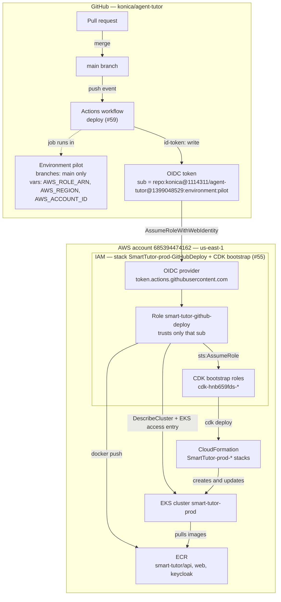
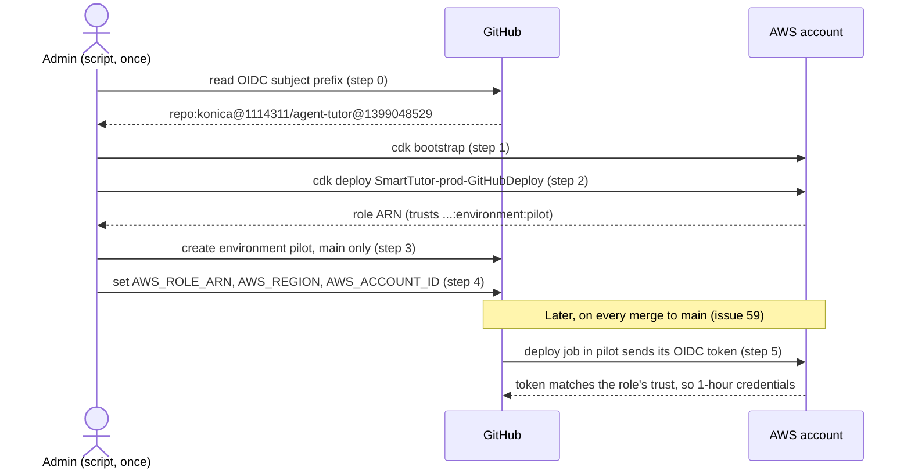
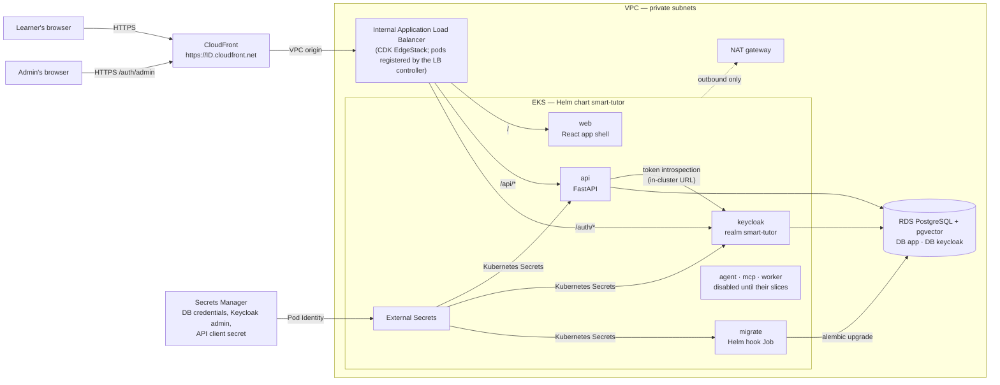
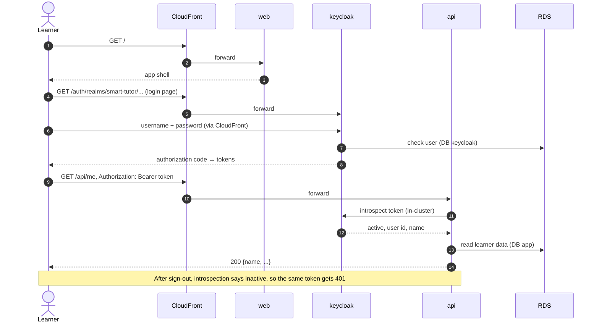
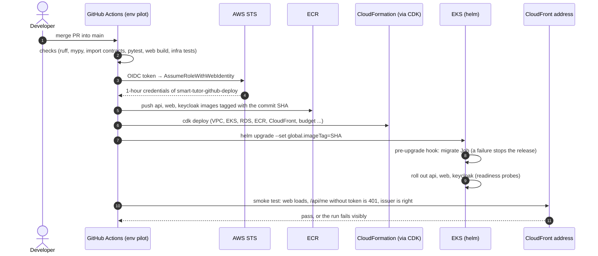

# Pilot environment on AWS: the big picture

How the pilot environment (#54) fits together across GitHub and AWS: who deploys what, how the pieces trust each other, and how a learner's request travels. It shows the **target** after #55–#59, per the decisions on #54 and PRD §9.11–§9.12. Today the CDK bootstrap and the deploy role exist (#55), and #56 adds the network, cluster, registry, edge (internal ALB and CloudFront), and budget stacks. The deploy steps are in [`pilot-deploy.md`](pilot-deploy.md). The human setup is in [`pilot-aws-prerequisites.md`](pilot-aws-prerequisites.md).

## 1. Platforms and trust

Nothing on GitHub holds an AWS key. A deploy job in the `pilot` environment gets a short-lived GitHub OIDC token. AWS STS swaps it for a one-hour session of the deploy role, and the role can only do the five things in its policy. CloudFormation, not the role, creates the infrastructure, through the CDK bootstrap roles.

### Setup order: AWS first, then GitHub

The only real dependency is that GitHub stores the role's ARN, so the role has to exist first. Trust is checked only when a deploy job signs in: the role trusts a subject string, so AWS doesn't need the GitHub environment when the role is created. The environment just has to exist before the first deploy. `pilot-aws-prerequisites.ps1` runs steps 0–4 in this order.

| # | Where | What | Needs |
|---|---|---|---|
| 0 | GitHub (read only) | Read the repository's OIDC subject prefix `repo:konica@1114311/agent-tutor@1399048529`; it must match `infra/cdk.json` | Nothing; GitHub fixes it for the repository |
| 1 | AWS | `cdk bootstrap` (`CDKToolkit` stack) | Admin credentials |
| 2 | AWS | Deploy `SmartTutor-prod-GitHubDeploy`: the OIDC provider, then the role that trusts `…:environment:pilot` | Step 1, and the prefix from step 0 |
| 3 | GitHub | Create the environment `pilot`, limited to `main` | Nothing (it can run before step 2) |
| 4 | GitHub | Set the variables `AWS_ROLE_ARN`, `AWS_REGION`, `AWS_ACCOUNT_ID` in `pilot` | The role ARN from step 2 |
| 5 | Both, from #59 on | A deploy job sends its token; AWS STS checks it against the role's trust and returns 1-hour credentials | Steps 2–4 |

## 2. Production runtime

There's a single public entry point: the AWS-generated CloudFront address, served over HTTPS. CloudFront routes by path. It reaches an **internal** load balancer through a VPC origin, so nothing inside the VPC has a public address, and tokens never cross the internet unencrypted. Because the browser, API and Keycloak share one origin, the API needs no CORS.

| Path | Service | Notes |
|---|---|---|
| `/` | web | Static app shell. Built with the API at `/api` and Keycloak at `/auth` on the same origin. |
| `/api/*` | api | Every call needs a valid bearer token; otherwise 401 with `WWW-Authenticate: Bearer`. |
| `/auth/*` | keycloak | Issuer `https://<id>.cloudfront.net/auth/realms/smart-tutor`. Self-registration is off until #47; the admin creates accounts. |

## 3. Sign-in and an API call

## 4. Deploy on merge

Merging to `main` runs one deployment at a time:

To roll back, run `helm upgrade` with an earlier commit SHA as the image tag (the #59 runbook).

## 5. Who builds which piece

| Piece | Built in | By | How |
|---|---|---|---|
| CDK bootstrap, OIDC provider, deploy role, GitHub environment `pilot`, quota checks, budget decision | #55 | Human (admin) runs one script, once | CDK `GitHubDeployStack`; `pilot-aws-prerequisites.ps1` for bootstrap and the GitHub environment |
| VPC, NAT, EKS + node group, Pod Identity, ECR, add-ons (load balancer controller, External Secrets, metrics-server), internal load balancer, CloudFront with VPC origin, `web`, budget alarm, ADR + PRD update | #56 | Agent; human runs the first deploy | CDK `NetworkStack`, `ClusterStack`, `RegistryStack`, `EdgeStack`, `BudgetsStack`; `deploy/helm/addons/`; chart `web` |
| RDS (DB app, DB keycloak), Secrets Manager entries, `keycloak` at `/auth`, production realm | #57 | Agent; human creates the client's account | CDK `DataStack`, `ConfigStack`; chart `keycloak` |
| `api` at `/api`, `migrate` hook Job, same-origin web build, probes | #58 | Agent; human runs the demo and hands over access | chart `api`, `values-prod.yaml` |
| Deploy-on-merge workflow, smoke test, rollback runbook | #59 | Agent; human merges and approves | `.github/workflows/` |
| S3 documents bucket, SQS, agent, MCP server, worker, Bedrock access | Later slices | — | `StorageStack`; charts stay disabled for now |

## Cost

About **$250–300 a month** while idle (EKS control plane, 2 nodes, NAT gateway, RDS, internal load balancer, CloudFront). The budget is **$400 a month**, with email alerts to the owner at 80% of actual and 100% of forecasted spend.
