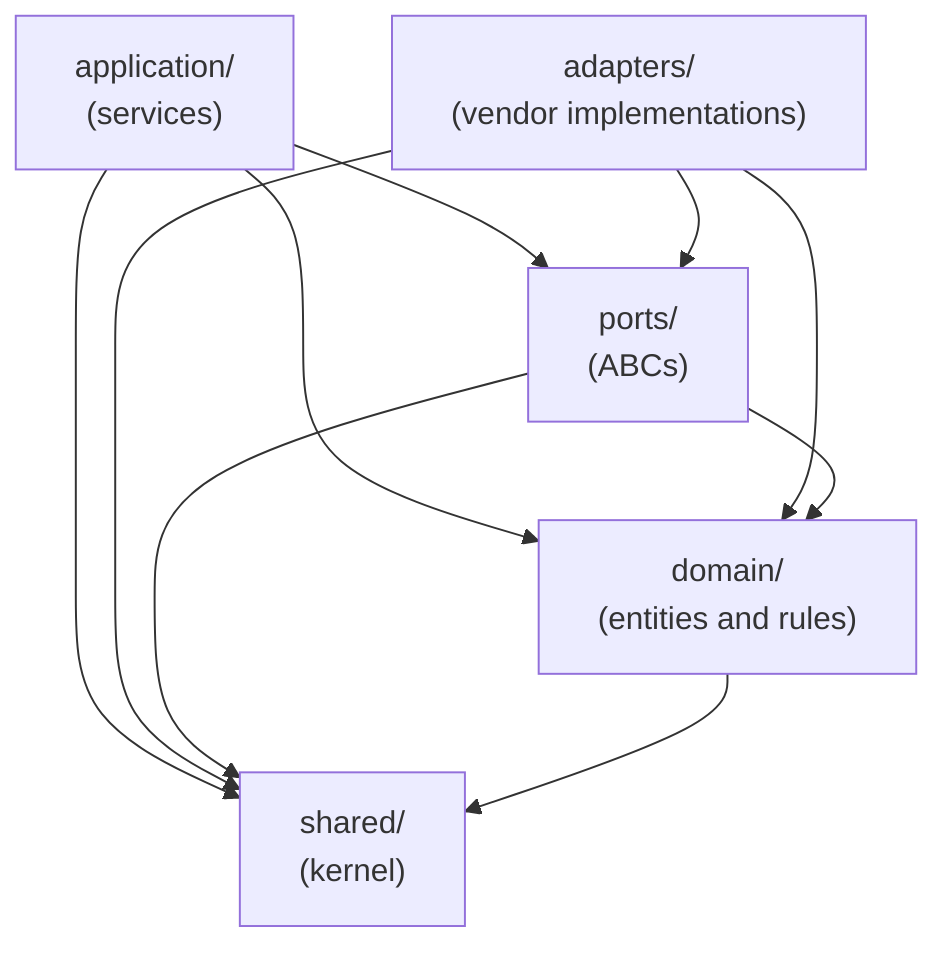

# Module and Layer Rules

The Smart Tutor backend is a **modular monolith**: one Python package (`smart_tutor`) shared by every deployable, organized **modules first** with `domain / application / ports / adapters` layers inside each module. Architectural boundaries are not just documented — they are enforced by `import-linter` in CI. See [ADR 0001](../../sdd/adr/0001-modular-monolith.md) for the rationale.

---

## Package layout

```
backend/src/smart_tutor/
├── shared/          # kernel: ids, TokenUsage, Citation, errors; ports ChatModel/EmbeddingModel/Clock;
│                    #   ModelFactory; bedrock, auth, postgres, aws adapters; config.py
├── knowledge/       # library: contents (SHA-256 dedupe, states, retry), documents, can_read,
│                    #   upload, ingestion, chunks, search
├── subjects/        # shared subject catalog, personal names, suggestion ranking, name checks
├── tutoring/        # threads (1–3 subjects, growth), subject detection, relevance gate, ask path
├── learning/        # Lesson Notes, learning records
├── accounts/        # learner profile and terms, rate limits and daily caps, token usage
├── insights/        # decline log (scrubbed, 90-day retention)
├── graph/           # (R2) research map: work links, timeline, reading order; (R5) deep graph
├── catalog/         # (R3) topic catalog from saved Docling output
├── quizzes/         # (R3) quiz generation and grading
├── recommendations/ # (R3) "what to learn next"
├── reports/         # (R3) daily/weekly learner reports
└── apps/            # api, agent, mcp_server, worker, jobs — one composition root per deployable
```

Every feature module has the same four-layer shape plus a README:

```
<module>/
├── README.md        # responsibility, public services, what it must not do, what it depends on
├── domain/          # entities and value objects with their rules; no I/O
├── application/     # services, one per use case; the module's public API
├── ports/           # abstract interfaces (ABCs) the module needs from the outside
└── adapters/        # implementations of ports; the only place vendor SDKs appear
```

> **Always read a module's `README.md` before editing it.** It states what the module owns, its key classes, what it may use, and its rules.

---

## Layer responsibilities

| Layer | Contains | Key invariant |
|---|---|---|
| `domain/` | Entities, value objects, domain rules, business logic | No I/O of any kind — no database calls, no HTTP, no vendor SDK imports |
| `application/` | One service class per use case; the module's **public API** | Services receive ports through their constructor (dependency injection); never import another module's non-`application` package |
| `ports/` | Abstract base classes (ABCs) that the module needs from its environment | Technology-agnostic; no vendor SDKs |
| `adapters/` | Concrete implementations of ports; vendor SDK usage is confined here | The **only** place vendor SDKs (boto3, langgraph, docling, etc.) may appear inside a module |

The `shared` kernel follows the same three-layer structure (`domain/`, `ports/`, `adapters/`) and is openly importable by all modules. It holds cross-cutting value objects (`UserId`, `ThreadId`, `TokenUsage`, `Citation`), model ports (`ChatModel`, `EmbeddingModel`, `Clock`), `ModelFactory`, authentication, and infrastructure clients. `shared` imports no feature module.

---

## Layer import flowchart

The arrows show permitted import directions within a module:



*Permitted import directions within a module. `application` and `adapters` may both import `ports` and `domain`; neither imports the other.*

---

## The `apps/` entrypoint pattern

`apps/` contains one **composition root** per deployable: `api`, `agent`, `mcp_server`, `worker`, and `jobs`. Each entrypoint follows a strict discipline:

- **Parse** the incoming request (HTTP, SQS message, graph node input, cron trigger).
- **Call one application service** from the appropriate module.
- **Format** the response.

No business rules live in `apps/`. Wiring (which concrete adapter to inject) happens here.

### Cross-module orchestration

The module dependency order is acyclic (see below). Flows that require calling a module that is *higher* in the order than the caller cannot be expressed as a direct import — they would create a cycle. These flows are **orchestrated in `apps/`** instead.

**Example — "Discuss this note":** A learner starts a tutoring thread from a Lesson Note. `learning` is higher than `tutoring` in the dependency order, so `tutoring` cannot import `learning`. The solution: `apps/api` reads the note via `learning.application.NoteService`, then starts the thread via `tutoring.application.AskService`. Neither module imports the other.

**Example — Agent retrieval path:** The agent never reads chunk tables directly. `tutoring`'s `Retriever` port is implemented by an MCP-client adapter that calls `apps/mcp_server`, which calls `knowledge.application.SearchService`. This keeps chunk-table access inside `knowledge` while the agent stays decoupled.

---

## Module dependency order

Modules are arranged in a strict top-to-bottom hierarchy. A module may only import the `application` layer of a module **below** it in this order. Lower modules never import higher ones, so cycles are impossible by construction.

```
reports
  ↓
recommendations
  ↓
quizzes  |  catalog        (siblings — independent of each other)
  ↓
learning
  ↓
tutoring
  ↓
graph
  ↓
knowledge
  ↓
subjects
  ↓
accounts  |  insights      (siblings — independent of each other)
```

Introducing a new cross-module dependency that requires changing this order must be done **intentionally**, with an explanation in the PR. The right fix for a broken contract is always to correct the dependency direction — move code to the right place — never to suppress the linter or relax the rule.

---

## Import-linter contracts

CI runs `PYTHONUTF8=1 uv run lint-imports` against 18 contracts declared in `backend/pyproject.toml` under `[tool.importlinter]`. **A broken contract fails the build.** The 18 contracts fall into five categories:

### Rule 1 — Layers inside every module

Two `layers` contracts:

1. One contract with `containers` set to all eleven feature modules. Enforces:

   ```
   adapters | application  →  ports  →  domain
   ```

   `adapters` and `application` are independent siblings — neither imports the other.

2. One separate contract for `shared`, where only `adapters` (not `application`) exists as the top layer:

   ```
   adapters  →  ports  →  domain
   ```

### Rule 2 — Module privacy (application-only access)

Twelve `forbidden` contracts — one per feature module (eleven modules) plus one for `shared`. Each forbids other modules from importing a module's `domain`, `ports`, or `adapters` packages directly. Cross-module communication is permitted only through `application`. `shared` additionally forbids importing any feature module or `apps`.

### Rule 3 — Apps are leaves

One `forbidden` contract: nothing (no feature module) imports `smart_tutor.apps`. Entrypoints are composition roots and must not be used as libraries.

### Rule 4 — Vendor SDK confinement

Two `forbidden` contracts:

- **Domain, application, and ports stay clean:** these layers across all modules may not import `smart_tutor.shared.adapters` or any vendor SDK (`boto3`, `botocore`, `docling`, `fastapi`, `langchain_aws`, `langgraph`, `mcp`, `psycopg`, `sqlalchemy`).
- **Docling only in `knowledge.adapters`:** `docling` (which pulls in PyTorch and is installed only in the `worker` image via the `[ingest]` extra) is forbidden everywhere else — including all other modules and `apps`.

`boto3`, `langgraph`, `langchain_aws`, and `mcp` may appear only in `adapters` or `apps` layers.

### Rule 5 — Acyclic module dependency graph

One `layers` contract with `containers = ["smart_tutor"]` and `layers` set to the ordered list above. Higher modules may use lower ones (through `application` only); lower ones may never use higher ones.

---

## Running the linter

```bash
PYTHONUTF8=1 uv run lint-imports
```

Run this from the `backend/` directory (where `pyproject.toml` lives). The `PYTHONUTF8=1` prefix is required on all platforms to ensure consistent UTF-8 output. The same command runs in CI as part of `make lint`.

### What a broken contract looks like

When a contract fails, `import-linter` prints output like:

```
============================================================
BROKEN CONTRACT: tutoring internals are private
------------------------------------------------------------
smart_tutor.learning.application.note_service -> smart_tutor.tutoring.domain.thread
------------------------------------------------------------
Contracts: 1 broken.
```

The output names the violated contract, then lists the exact import chain that broke it — showing which source module imported which forbidden target.

### How to fix a broken contract

**The rule is: fix the code, never the contract.**

| Broken contract | Correct fix |
|---|---|
| A module's `domain` or `ports` is imported from outside | Use only the module's `application` layer at the call site |
| A vendor SDK appears in `domain`, `application`, or `ports` | Move the SDK call into `adapters/`; expose it through a port |
| `docling` is used outside `knowledge.adapters` | Move the extraction logic into `knowledge.adapters`; call it via a port |
| `apps` is imported by a feature module | Extract the needed logic into a shared service or port; never import from `apps` |
| The module dependency order is violated | Orchestrate the flow in `apps/` or move the shared concept to `shared/`; only edit the module order in `pyproject.toml` as a last resort with a PR explanation |

Suppressing a contract or moving the rule boundary to accommodate a shortcut is not acceptable. If a genuinely new architectural pattern requires reordering modules, document the decision in the PR and update the order in `pyproject.toml` — but treat this as a deliberate architectural change, not a quick fix.

---

## Where does my change go?

| What you are adding or changing | Where it belongs |
|---|---|
| A business rule (validation, state transition, policy) | A method on the owning **domain class** (e.g. `Thread.add_subject()`, `Content.retry()`) |
| A use case or operation a client can invoke | A **service in the owning module's `application/`**, receiving its dependencies through constructor injection |
| Talking to Bedrock, PostgreSQL, S3, SQS, MCP, Docling, or the LangGraph store | A **port** (ABC) in `ports/` and its concrete implementation in `adapters/` |
| An HTTP route, agent graph node, MCP tool, SQS handler, or CronJob | In `apps/<app>/`: parse input → call one service → format output |
| A flow that crosses modules **against** the dependency order | Orchestrate it in **`apps/`**; do not add a reverse import |
| A model call | Ask `ModelFactory` for a role: `agent`, `judge`, or `embedding` |
| A cross-cutting value object, port, or infrastructure client used by many modules | In `shared/` (keep it small on purpose) |

---

## Module responsibilities summary

| Module | Release | Owns | Depends on (application of) |
|---|---|---|---|
| `knowledge` | R1 | Library: contents (SHA-256 dedupe), documents (1–3 subjects), `can_read`, upload, ingestion, chunks, search | `subjects`, `accounts` |
| `subjects` | R1 | Shared subject catalog, personal names, suggestion ranking, name checks | — |
| `tutoring` | R1 | Threads (1–3 subjects, growth), subject detection, relevance gate, ask path | `knowledge`, `subjects`, `accounts`, `insights` |
| `learning` | R1 | Lesson Notes, learning records, idle sweep | `tutoring` |
| `accounts` | R1 | Learner profile, terms, rate limits, daily caps, token usage | — |
| `insights` | R1 | Anonymized decline log, quality monitoring queries | — |
| `graph` | R2/R5 | Research map: work links, timeline, reading order, reading paths; R5 deep graph | `knowledge` |
| `catalog` | R3 | Topic catalog from saved Docling output | `knowledge` |
| `quizzes` | R3 | Quiz generation and grading | `learning` |
| `recommendations` | R3 | "What to learn next", reading order | `catalog`, `quizzes`, `learning`, `graph` |
| `reports` | R3 | Daily/weekly learner reports | `learning`, `quizzes`, `recommendations` |

---

## Related pages

- [Architecture Overview](overview.md) — deployment topology and service map
- [Shared Kernel](shared-kernel.md) — `shared/` module internals
- [Local Development](../operations/local-dev.md) — running `make lint` and the Compose stack
