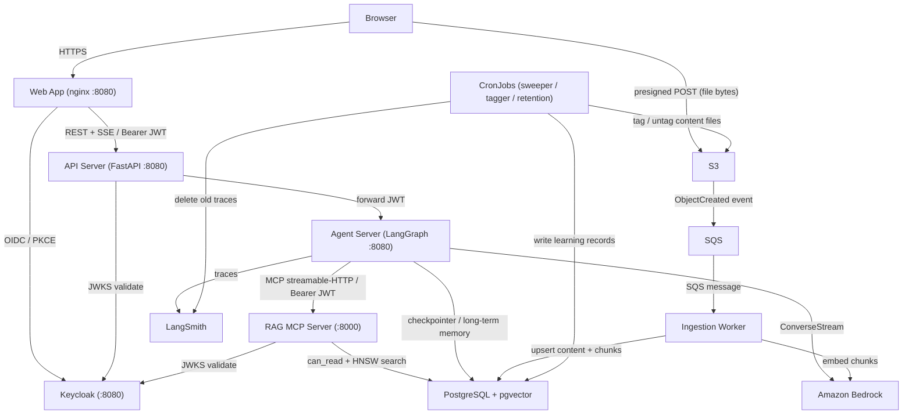
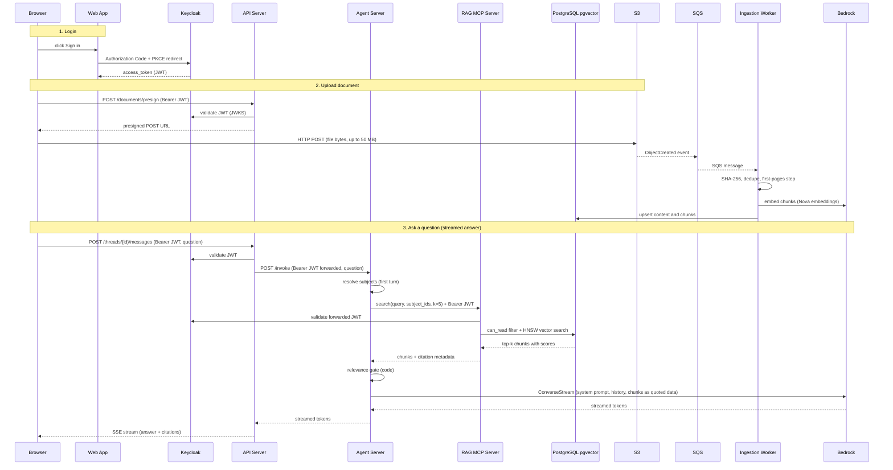

# System Architecture Overview

Smart Tutor is a RAG-based AI tutor that answers questions only from a learner's own uploaded documents. Six deployable components collaborate across two distinct network zones: public-facing (web and API) and internal-only (agent and MCP server), with an event-driven ingestion side-channel and three Kubernetes CronJobs for background maintenance.

The authoritative component description is **PRD §9.1**.

---

## Components at a glance

| Deployable | Docker target | Image extras | Port | Network zone |
|---|---|---|---|---|
| API server | `api` | _(none)_ | 8080 | Public (LoadBalancer) |
| Agent server | `agent` | _(none)_ | 8080 | Internal (ClusterIP) |
| RAG MCP server | `mcp` | _(none)_ | 8000 | Internal (ClusterIP) |
| Ingestion worker | `worker` | `[ingest]` | _(no port)_ | Internal (SQS consumer) |
| CronJobs (sweeper, tagger, retention) | reuse `api` | _(none)_ | _(no port)_ | Internal |
| Web app | own Dockerfile (nginx) | _(N/A)_ | 8080 | Public (LoadBalancer) |

The `worker` is the **only image** that installs the `[ingest]` extra, which pulls in Docling and CPU-only PyTorch. All other images share the base `deps` stage without those heavy packages.

---

## Deployable responsibilities

### API Server (`smart_tutor.apps.api`)

FastAPI application exposed on port 8080. At the scaffold stage it registers a single `GET /healthz` health probe; all route modules are wired in `routes/` and `deps.py` during M3.

Planned responsibilities (PRD §9.1):

- JWT validation against Keycloak JWKS (`iss`, `exp`, `aud`)
- Rate-limit and daily-cap enforcement (§11)
- Documents: browser duplicate check, presigned POST to S3, list/filter, subjects, display title, archive/restore, retry
- Subjects: catalog search, personal name management
- Conversations, notes, and token-usage views
- SSE streaming of agent responses to the browser
- **JWT forwarding**: the original bearer token is forwarded unchanged to the agent on every call

Entrypoint: `uvicorn smart_tutor.apps.api.main:app --host 0.0.0.0 --port 8080`

### Agent Server (`smart_tutor.apps.agent`)

Internal-only FastAPI application that wraps the LangGraph graph (`graph.py`, milestone M2). Runs on port 8080 but is exposed only as a Kubernetes ClusterIP service; no external ingress. At the scaffold stage it serves only `GET /healthz`.

Planned responsibilities (PRD §9.1, §9.2):

- **Ask path**: resolve subjects → search (fixed step) → relevance gate → growth check → streamed answer via `amazon.nova-2-lite-v1:0`
- **Summarize path**: generate or overwrite a Lesson Note (with edit-aware confirmation) and write the learning record
- **Idle-record path**: triggered by the record sweeper
- LangGraph checkpointer and long-term memory stored in PostgreSQL
- Token usage recorded per call
- Passes the forwarded JWT to every MCP request in an HTTP header — **never in the prompt**

Entrypoint: `uvicorn smart_tutor.apps.agent.server:app --host 0.0.0.0 --port 8080`

> **Scaffold note:** all body logic currently raises `NotImplementedError`; the LangGraph graph lives in `graph.py` and is wired in M2.

### RAG MCP Server (`smart_tutor.apps.mcp_server`)

Streamable-HTTP MCP server running on port 8000, exposed as a ClusterIP service accessible only from the agent. Implemented with the `mcp` library (`MCPServer("rag-mcp")`).

Responsibilities (PRD §9.1, §9.3):

- `search(query, subject_ids, k)` — validates the forwarded JWT, resolves the caller's readable, ready, non-archived documents in any of the requested subjects via `can_read(user, document)`, performs a pgvector HNSW vector search with iterative scans (pgvector ≥ 0.8) and falls back to exact search for small readable sets, and returns chunks with scores and citation metadata
- `get_chunk(chunk_id)` — resolves a specific chunk for citation display, subject to the same `can_read` check
- Implements the data-isolation boundary: the access predicate lives here in SQL, not in the LLM prompt (PRD D4)

Entrypoint: `python -m smart_tutor.apps.mcp_server.server` (calls `mcp.run(transport="streamable-http", host="0.0.0.0", port=8000)`)

> **Scaffold note:** tool bodies call `knowledge.application` in M1; JWT validation is in code per §9.3.

### Ingestion Worker (`smart_tutor.apps.worker`)

Long-running SQS consumer (no HTTP port). Triggered by S3 `ObjectCreated` events on the `uploads/` prefix. Runs with stricter OS-level isolation: non-root user, read-only root filesystem, and NetworkPolicy that limits egress to AWS endpoints and PostgreSQL only.

Responsibilities (PRD §9.1, §9.2):

1. Validate file type, size, page count, and parseability
2. Compute SHA-256 of the uploaded bytes; insert-or-get the content by hash (deduplicate)
3. If new: move to `contents/<sha256>.pdf`
4. **First-pages step** (fast, one model call): extract metadata and 3 subject candidates from pages 1–2
5. Compute subject suggestions for this learner (code, no model call)
6. Full Docling extraction, save `contents/<sha256>.docling.json`, extract references and work key, chunk, embed
7. Process uploads **fairly per user**: first-pages steps before full extractions, round-robin across users

Only this image installs `[ingest]` (Docling + CPU-only PyTorch). M0 includes a Docling CPU benchmark to size worker replicas.

> **Scaffold note:** `main()` raises `NotImplementedError("M1: ingestion worker")`.

### CronJobs

All three CronJobs reuse the **`api` Docker image** (no `[ingest]` extra needed).

| Job | Module | Schedule | Responsibilities |
|---|---|---|---|
| `record_sweeper` | `smart_tutor.apps.jobs.record_sweeper` | every minute | Selects threads where `last_learner_message_at < now − learning_record_idle_minutes` and `last_learner_message_at > record_written_at`; writes or updates the learning record (M2, PRD §9.2) |
| `glacier_tagger` | `smart_tutor.apps.jobs.glacier_tagger` | daily | Tags `contents/<sha256>.pdf` with `status=archived` in S3 when no non-archived document references that content; removes the tag when a document becomes active again; an S3 lifecycle rule then moves tagged PDFs to Glacier Flexible Retrieval after 30 days (M1, PRD §9.5) |
| `retention` | `smart_tutor.apps.jobs.retention` | daily | Deletes LangSmith traces older than 180 days and decline-log entries older than 90 days; threads, notes, and learning records are **kept** (M4, PRD D25, §9.6) |

> **Scaffold note:** all three `main()` functions raise `NotImplementedError` with their milestone label.

### Web App

React 19 + TypeScript application built with Vite, served from `nginxinc/nginx-unprivileged:1.29-alpine` on port 8080. Has its own `Dockerfile` (not part of the backend multi-stage image).

Responsibilities (PRD §9.1):

- Keycloak OIDC login (Authorization Code + PKCE) via `web/src/auth/`
- Library and upload UI with browser-side SHA-256 duplicate check
- Subject choice, personal subject rename
- Chat with streamed answers and subject-change notices
- Conversation and note management (filter by date and subject, archive/restore)
- Token usage view
- Future: R2 research map, R3 quizzes and reports, R4 sharing and imports

---

## Runtime topology

The diagram below shows every runtime component and the connections between them.



*Runtime components and their connections: public zone (Web App, API Server), internal zone (Agent, MCP Server, Worker, CronJobs), and external services (Keycloak, PostgreSQL, S3, SQS, Bedrock, LangSmith).*

---

## Network topology

```
Browser
  │  HTTPS
  ▼
Web App (nginx, port 8080)
  │  REST + SSE  (Authorization: Bearer <JWT>)
  ▼
API Server (FastAPI, port 8080)         ◄──── Keycloak (OIDC, JWKS)
  │  forwards JWT
  ▼
Agent Server (FastAPI/LangGraph, :8080, ClusterIP)
  │  MCP streamable-HTTP  (Authorization: Bearer <JWT>)
  ▼
RAG MCP Server (:8000, ClusterIP)
  │  pgvector HNSW
  ▼
PostgreSQL + pgvector (RDS)
  ▲
  │  chunk + embed, upsert
Ingestion Worker (SQS consumer)
  ▲
  │  S3 ObjectCreated → SQS
S3  uploads/<user_id>/<upload_id>.pdf

CronJobs (record_sweeper, glacier_tagger, retention)
  │  → PostgreSQL, S3, LangSmith
```

**NetworkPolicy rules (Kubernetes):**
- API → agent (allowed)
- Agent → MCP server (allowed)
- All other cross-service paths blocked at the network layer
- Worker egress limited to AWS endpoints (S3, SQS, SSM, Bedrock) and PostgreSQL

---

## Browser-to-answer sequence (happy path)

The diagram below shows login, a presigned upload, a chat question, JWT forwarding through the agent to the MCP server, and a streamed answer being returned.



*Happy-path sequence: login → presigned upload → question routed through agent and MCP server → streamed cited answer.*

---

## Identity propagation and access enforcement

1. The Web App obtains a Keycloak JWT (Authorization Code + PKCE) and attaches it as `Authorization: Bearer <token>` on every API call.
2. The API validates the token (JWKS, `iss`, `exp`, `aud`) and **forwards the same token** to the agent.
3. The agent attaches the token to every MCP request as an HTTP header — **never inside the prompt or tool arguments**.
4. The MCP server validates the JWT, reads `sub`, and builds a SQL predicate: chunks whose `content_id` belongs to a document that is `ready`, not archived, in one of the requested `subject_ids`, and satisfies `can_read(sub, document)` (Releases 1–3: `owner_id = sub`). An empty readable set returns an empty result; the agent surfaces the US-10 message rather than an error.

The `can_read` rule is implemented once (domain rule + SQL predicate) and reused by the API, the MCP server, and citation resolution.

Keycloak Realm: `smart-tutor`; clients: `smart-tutor-web`, `smart-tutor-api`, `rag-mcp`; an audience mapper adds `smart-tutor-api` and `rag-mcp` to tokens.

---

## Scaffold stage and milestone labels

The repository is currently at the **M0 scaffold** stage. All app entrypoints exist with correct routing and health checks, but body logic raises `NotImplementedError`. The milestone label in each file docstring indicates when the implementation is expected:

| Label | Milestone | What it delivers |
|---|---|---|
| M0 | Foundations | Repo, CI, Compose stack, CDK/Helm skeletons, Bedrock connectivity verified |
| M1 | Library and ingestion | Upload, dedupe, ingestion, MCP search with `can_read`, Glacier tagger |
| M2 | Tutor agent | LangGraph ask/summarize/idle-record paths, record sweeper |
| M3 | App (API + Web) | Auth, all REST routes, web UI, rate limits |
| M4 | Production launch | CDK/Helm in prod, trace/decline retention job, data-erasure review |

---

## Docker image build targets

```bash
# Build a specific target (from backend/):
docker build --target api|agent|mcp|worker -t smart-tutor-<target> backend/
```

The multi-stage `Dockerfile` uses two dependency stages:

- `deps` — base install without extras; used by `api`, `agent`, and `mcp`
- `deps-ingest` — installs `[ingest]` extra (Docling, CPU-only PyTorch); used only by `worker`

All images run as uid 10001. CronJobs run as Kubernetes `Job` or `CronJob` objects using the same image as the `api` target with a different `command`.

---

## Local development

`compose.yaml` provides two profiles:

```bash
# Default profile — dependencies only (pgvector, Keycloak, LocalStack):
docker compose up -d

# app profile — full stack (same images as production):
docker compose --profile app up -d
```

**Default profile services:**

| Service | Image | Host port |
|---|---|---|
| `postgres` | `pgvector/pgvector:pg17` | 5432 |
| `keycloak` | `quay.io/keycloak/keycloak:26.3` | 8080 |
| `localstack` | `localstack/localstack:4` | 4566 |

LocalStack emulates `s3`, `sqs`, `ssm`, and `secretsmanager`. Keycloak imports the realm from `local/keycloak/`. PostgreSQL is initialized with pgvector and both app and Keycloak schemas.

**App profile — additional services and port mappings:**

| Service | Docker target | Host port |
|---|---|---|
| `api` | `api` | 8001 → container 8080 |
| `agent` | `agent` | 8002 → container 8080 |
| `mcp` | `mcp` | 8000 → container 8000 |
| `worker` | `worker` | _(no port)_ |
| `web` | own Dockerfile | 5173 → container 8080 |

> **Bedrock and LangSmith have no local emulator.** App services call the real `us-east-1` endpoints using the developer's AWS profile even when running locally.

---

## Shared Python package

All backend deployables (API, agent, MCP server, worker, CronJobs) share a single Python package, `smart_tutor`, installed from `backend/`. The `apps/` sub-package is the composition root: each deployable has exactly one entry under `apps/` that wires together the domain modules and infrastructure adapters it needs. No business rules live in `apps/`; cross-module flows that do not fit the module dependency order are orchestrated there.

Module dependency order (top imports bottom, no cycles enforced by import-linter in CI):

```
reports → recommendations → quizzes | catalog → learning → tutoring → graph → knowledge → subjects → accounts | insights
```

---

## Related pages

- [Module Layer Rules](module-layer-rules.md)
- [Shared Kernel](shared-kernel.md)
- [MCP Retrieval](../integrations/mcp-retrieval.md)
- [Deployment](../operations/deployment.md)
- [Ask Flow](../workflows/ask-flow.md)
- [Ingestion Flow](../workflows/ingestion-flow.md)
