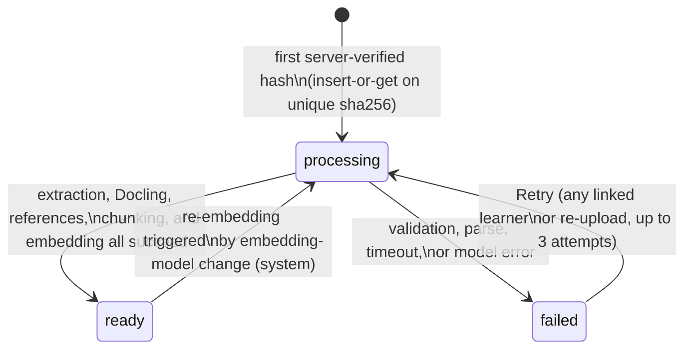
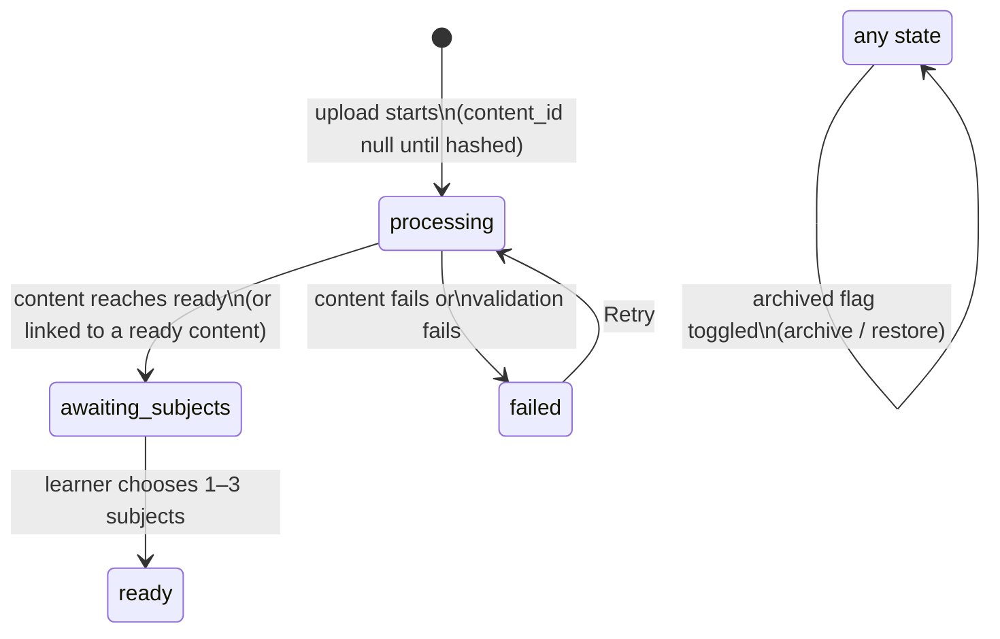
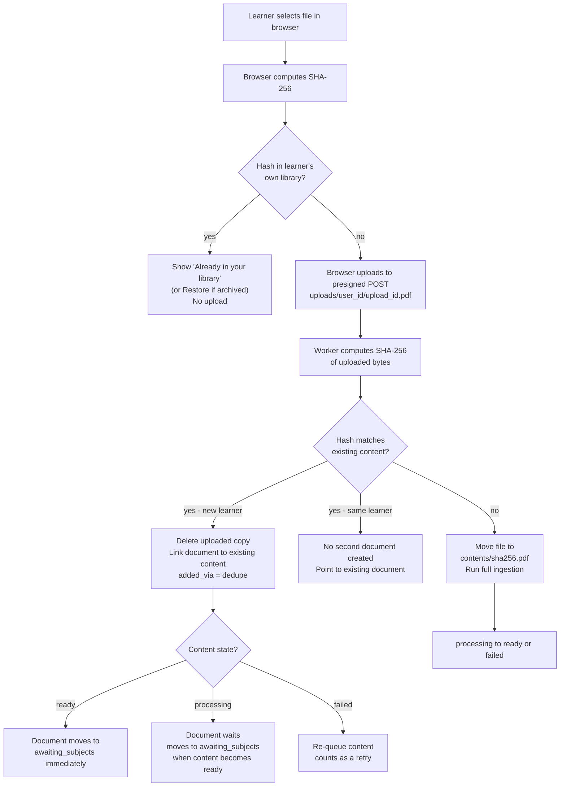
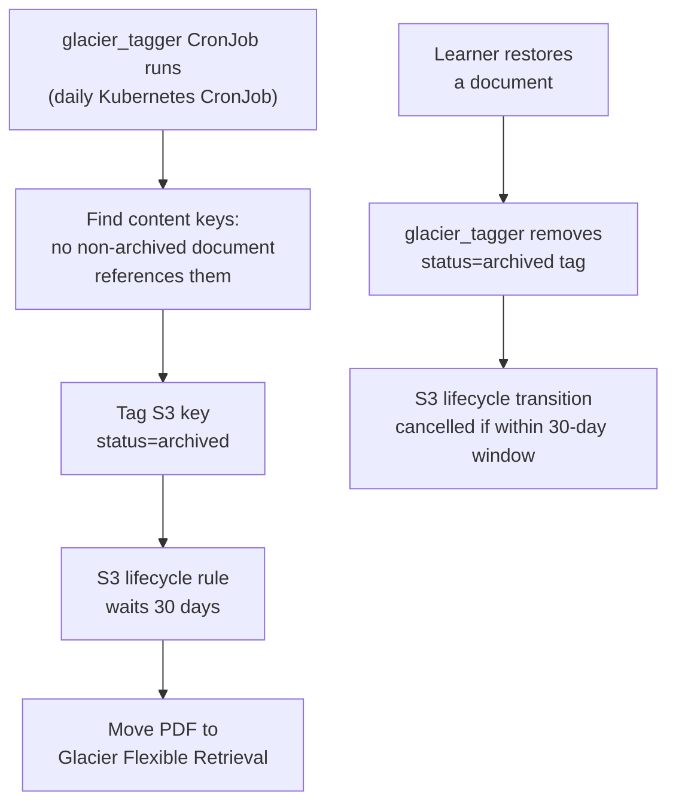

# Content and Document Lifecycles

The `knowledge` module splits what a learner uploads into two distinct concepts:

- **Content** — one unique file identified by the SHA-256 of its bytes, stored once at `contents/<sha256>.pdf`, extracted and embedded once across the entire system, and owned by no one.
- **Document** — a learner's private library entry that points to a content. Two learners holding the same file have two separate documents pointing to one shared content.

This separation means embedding cost is paid once per unique file. The retry, re-embedding, and Glacier archiving mechanics follow from this design (ADR 0002).

---

## Content State Machine

Content state is shared across all documents that reference it. When one learner's retry succeeds, every other learner linked to the same content benefits immediately.

*Content state transitions. The `ready→processing` re-embedding path is system-initiated only.*

### Transition rules

| Transition | Trigger | Notes |
|---|---|---|
| `[*]→processing` | First worker to insert the content row (insert-or-get on `sha256`) | Concurrent uploads of the same file share one row; only one proceeds to extraction |
| `processing→ready` | Full ingestion succeeds: Docling output saved, references extracted, chunks embedded | All linked documents can now progress to `awaiting_subjects` |
| `processing→failed` | Validation failure, parse error, per-file timeout, or model error | `failure_reason` and `attempts` counter recorded on the content row |
| `failed→processing` | **Retry** by any linked learner, or a re-upload of the same file | At most **3 attempts** total; after the third failure the content stays `failed` permanently ("This file could not be processed") |
| `ready→processing` | Embedding-model change — system-initiated, never learner-initiated | Re-embedding reads chunk text from PostgreSQL; **no Glacier restore needed**; search continues serving old vectors until new embeddings finish |

### Retry scope

Any learner whose document references a failed content can trigger a retry via the **Retry** button in the document management UI (PRD §9.5). A new upload of the same file (same SHA-256) by any learner also re-queues the content. The shared retry counter means three failed attempts by different learners still exhaust the limit.

---

## Document State Machine

Document state tracks a single learner's view of their library entry. It is separate from content state so that metadata changes (subjects, display title, archive) never require re-processing.

*Document state transitions. The `archived` flag is orthogonal to the processing state.*

### Transition rules

| Transition | Trigger | Notes |
|---|---|---|
| `[*]→processing` | Upload begins; `content_id` is null until the worker hashes the file | If the hash matches an existing content, `content_id` is set immediately and the document skips straight to `awaiting_subjects` or `ready` |
| `processing→awaiting_subjects` | The linked content reaches `ready` (or was already `ready` at link time) | Subject suggestions are shown to the learner; target within 10 s (p95) for deduplicated uploads |
| `awaiting_subjects→ready` | Learner selects 1–3 subjects | Document becomes searchable once `ready`, not archived, and its content is `ready` |
| `processing→failed` | Content fails, or upload-level validation fails | Learner sees reason and **Retry** button |
| `failed→processing` | Learner clicks **Retry** | Re-queues the content if it was the cause of failure |
| archived flag set | Learner archives the document | Hides it from search and library lists; content and chunks are unaffected (other learners may still use them) |
| archived flag cleared | Learner restores the document | Document re-enters active search; Glacier tag on the content S3 key is removed if the content had been tagged (see below) |

### Searchability invariant

A document is only served in RAG search when **all three** conditions hold:
1. Document state is `ready`.
2. `archived` flag is `false`.
3. Its linked content state is `ready`.

---

## SHA-256 Deduplication Flow

Deduplication operates on server-computed hashes only. The browser may compute a hash to give the learner an instant "already in your library" message, but that check is scoped strictly to the learner's own documents and never proves the learner has access to someone else's content (PRD D19, ADR 0002).

*SHA-256 deduplication decision tree from upload to document linkage.*

### Concurrent uploads

When two learners upload the same file simultaneously, both workers race to insert a content row. The `contents` table enforces a unique constraint on `sha256`, so only one `INSERT` succeeds; the other receives the existing row (insert-or-get). Both documents end up linked to the same content, and only one extraction run proceeds. This is the primary concurrency invariant for content creation.

### Deduplication security invariant

Linking a document to an existing content requires that **the server** re-hashes the uploaded bytes and finds a match. A browser-supplied hash is accepted only to skip an upload the learner already owns. This prevents any learner from gaining access to a file they have never uploaded by simply claiming to know its SHA-256.

---

## Glacier Archiving

Content PDF files (`contents/<sha256>.pdf`) that are no longer referenced by any active (non-archived) document are candidates for Glacier archiving. This is managed by the `glacier_tagger` CronJob and an S3 lifecycle rule.

### Flow

1. **`glacier_tagger` CronJob (daily):** scans for content S3 keys where **every** linked document either has `archived = true` or no document exists. Tags those keys with `status=archived`. When a document that references such a content is restored (unarchived), the tag is removed.
2. **S3 lifecycle rule:** moves PDFs tagged `status=archived` to **Glacier Flexible Retrieval** after **30 days**.
3. **Restoration trigger:** if a learner restores an archived document (clears the `archived` flag), the tagger removes the `status=archived` tag on the next daily run, halting the Glacier transition if the 30-day window has not elapsed.

*Glacier archiving flow: tagging, lifecycle transition, and tag removal on restore.*

### What moves to Glacier — and what does not

| Object | Storage class | Reason |
|---|---|---|
| `contents/<sha256>.pdf` | → Glacier after 30 days when unreferenced | Only needed for re-extraction (e.g. new Docling version) |
| `contents/<sha256>.docling.json` | S3 Standard (kept permanently) | Used by research map (R2), topic catalog (R3), knowledge graph (R5) — no restore needed |
| PostgreSQL chunks (`chunks` table) | PostgreSQL (kept) | Used by search, re-embedding, citations — no restore needed |

This design means that for all post-R1 features and for re-embedding on model upgrade, **no Glacier restore is ever required**. A restore is only needed to run a new version of Docling against the original PDF bytes.

### Scaffold status

`glacier_tagger.main()` is a `NotImplementedError` stub at the M1 scaffold stage. The CronJob manifest and S3 lifecycle rule are defined in the CDK stack, but the Python logic has not been implemented yet (PRD §9.5, M1 task).

---

## Re-embedding Path

When the embedding model is changed (e.g. upgrading from one Nova embedding version to another), the system triggers a `ready→processing` transition on affected contents:

1. The system enqueues affected contents for re-embedding.
2. Content transitions back to `processing`; its documents remain in their current states and are still served in search (using old vectors).
3. The worker reads chunk text from PostgreSQL — **no S3 access, no Glacier restore required**.
4. New embeddings replace old ones in the `chunks` table.
5. Content returns to `ready`; the `embedding_model` and `embedding_dim` columns are updated.

Token usage for re-embedding is recorded as `source = system` with a null `user_id`, so it does not count against any learner's usage budget.

---

## Service and Job Status (M1)

All services and jobs that implement these lifecycle transitions are pending M1 implementation. The following are currently scaffold stubs:

| Service / Job | Role |
|---|---|
| `UploadService` | Validates upload, issues presigned POST, creates the document row in `processing` |
| `DeduplicationService` | Server-side SHA-256 check after upload; insert-or-get on the `contents` table; links or discards the uploaded copy |
| `IngestionService` | Drives content from `processing` to `ready` or `failed`; runs first-pages step, Docling, references, chunking, and embedding |
| `glacier_tagger` CronJob | Daily Kubernetes CronJob; tags unreferenced content S3 keys `status=archived`; removes tags on restore |

---

## Relationships

- **[Data Model](../concepts/data-model.md):** the `contents`, `documents`, `document_subjects`, and `chunks` tables that back these state machines.
- **[Ingestion Flow](../workflows/ingestion-flow.md):** the worker steps that drive content from `processing` to `ready`.
- **[Storage: S3 and SQS](../integrations/storage-s3-sqs.md):** the S3 lifecycle rule, versioning, and SQS events that feed the ingestion worker and glacier tagger.
- **[Module Layer Rules](../architecture/module-layer-rules.md):** the `knowledge` module owns all domain logic for these state machines; other modules import only `knowledge.application`.
