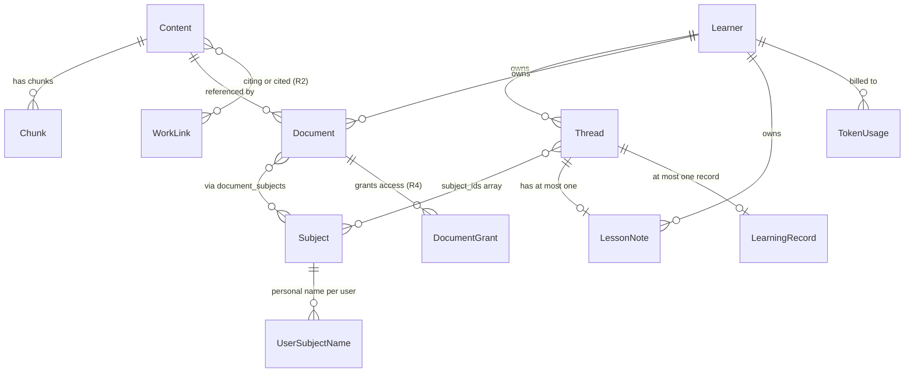
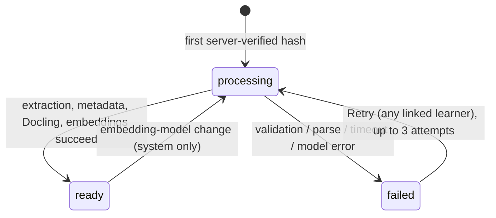
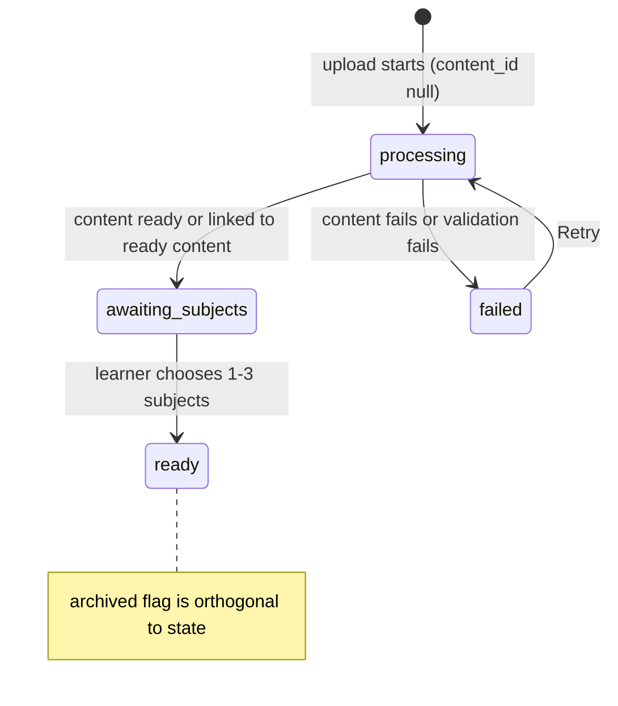

# Data Model

Smart Tutor persists state in **PostgreSQL** (tables below), the **LangGraph store** (learning records only), and **AWS SSM Parameter Store** (operational knobs). This page describes every table, the store namespace, the SSM parameters, and the three key derived values the application computes at read time.

---

## Why Content and Document are separate (ADR 0002)

The central deduplication invariant is: **one unique file is stored, extracted, chunked, and embedded exactly once in the whole system**. A file's identity is its SHA-256 hash. Separating these concerns drives two tables:

| Table | What it represents | Has an owner? |
|---|---|---|
| `contents` | One unique file keyed by `sha256`; holds extracted metadata, embeddings, and the saved Docling output | No |
| `documents` | A learner's library entry pointing to a content; holds owner, subjects, state, and visibility | Yes (`owner_id`) |

When a learner uploads a file whose server-computed SHA-256 matches an existing content, the uploaded copy is discarded and the new document row simply points at the existing content — no extraction or embedding runs. Two learners can hold the same content via two independent document rows, and neither can see the other's document (access is decided by `can_read(user, document)`, which in Releases 1–3 means `owner_id = sub`).

Chunked text (`chunks`) and the Docling JSON live with the content, so they are shared across all learners who hold that content without duplicating work or storage.

---

## Entity relationship diagram



*Key entities and their relationships: Content is shared and unowned; Document is per-learner. Threads carry a `subject_ids[]` array rather than a join table.*

---

## PostgreSQL tables

### `contents` — unique files (no owner)

`content_id` (PK), unique `sha256`

| Column | Notes |
|---|---|
| `s3_key` | Path in the documents bucket (`contents/<sha256>.pdf`) |
| `docling_key` | S3 path of the saved Docling JSON (`contents/<sha256>.docling.json`) |
| `bytes`, `pages` | File size and page count, validated on upload |
| `state` | `processing` / `ready` / `failed` |
| `failure_reason`, `attempts` | Populated on failure; max 3 attempts before permanently `failed` |
| `title`, `authors[]`, `year`, `doi` | Extracted by the first-pages step |
| `work_key` | DOI if present, otherwise normalized title + year; groups different files of the same work for the research map |
| `references[]` | Reference list extracted from the bibliography section |
| `summary`, `summary_embedding` | Two-sentence summary and its vector; used for subject suggestion ranking |
| `proposed_subject_names[]` | Three subject names proposed by the first-pages model call |
| `embedding_model`, `embedding_dim` | Which embedding model produced the chunk vectors (1024 dimensions) |
| `processed_by_user_id` | Keycloak `sub` of the learner who triggered first processing; used for usage attribution |
| `processed_at` | Timestamp of completion |

**No `owner_id`.** The `contents` table deliberately has no user association. Any learner may hold a document pointing to the same content. Personal data in this table is limited to `processed_by_user_id` (one user per content, not per learner holding it).

---

### `chunks` — pgvector embeddings (no owner)

`chunk_id` (PK)

| Column | Notes |
|---|---|
| `content_id` | FK → `contents` |
| `page` | Nullable; used in citations ("page unavailable" when absent) |
| `text` | Source text; preserved so chunks can be re-embedded when the embedding model changes without restoring the PDF from Glacier |
| `embedding` | 1024-dimensional vector, HNSW index |

Chunks belong to the content, not to any learner. Chunk writes during ingestion are idempotent per content, so concurrent or retried ingestion runs are safe.

---

### `documents` — learner library entries

`document_id` (PK), unique `(owner_id, content_id)` where `content_id` is non-null

| Column | Notes |
|---|---|
| `owner_id` | Keycloak `sub` |
| `content_id` | FK → `contents`; null until the upload has been hashed by the worker |
| `upload_id` | FK → `uploads`; links to the presigned-upload record |
| `state` | `processing` / `awaiting_subjects` / `ready` / `failed` |
| `archived` | Boolean flag; set by the learner; restorable; never hard-deleted |
| `archived_at` | Timestamp when archived |
| `visibility` | `private` (Releases 1–3); `shared` / `public` added in Release 4 |
| `title_override` | Learner-set display title; null means fall back to `contents.title` then the file name |
| `added_via` | `upload` / `dedupe`; R4 adds `share` / `public` / `import` |
| `created_at` | |

A document is searchable only when its `state = ready`, `archived = false`, and its content's `state = ready`. Archiving hides the document from search and library lists but old citations still resolve through it (the `Citation` domain type carries `archived: bool` so the UI can mark stale citations).

---

### `document_subjects` — document-to-subject mapping

`(document_id, subject_id)` — composite PK

One to three rows per ready document; enforced by the `Document.set_subjects()` domain method (1–3 invariant) and a database check constraint. Changing a document's subjects (`set_subjects`) updates only this table; no re-embedding is needed.

---

### `document_grants` — access grants *(R4 placeholder)*

`(document_id, grantee_id)` — composite PK

| Column | Notes |
|---|---|
| `grantee_type` | `user`; later `group` |
| `permission` | `read` |
| `granted_at` | |

The table is created in Release 1 so the schema is ready; it is unused until Release 4 extends `can_read(user, document)` to also return true for grantees and public documents.

---

### `subjects` — shared subject catalog

`subject_id` (UUID, PK), unique `normalized_name`

| Column | Notes |
|---|---|
| `canonical_name` | The name visible by default to all learners |
| `name_embedding` | Vector of the canonical name; used for near-duplicate detection and suggestion ranking |
| `created_at` | |

No creator is recorded and there is no `status` column — there are no admin moderation actions (rename, merge, hide) in Releases 1–4. Every other table stores only `subject_id`s; the human-readable name is resolved at read time (see [Subject name resolution](#subject-name-resolution) below). `subject_id` is stable for the account's lifetime.

---

### `user_subject_names` — personal subject names

`(user_id, subject_id)` — composite PK, unique `(user_id, normalized display_name)`

| Column | Notes |
|---|---|
| `display_name` | The learner's personal name for this subject |
| `updated_at` | |

A row is present only when the learner has renamed the subject. "Reset name" deletes the row. No other table is touched on rename; the `subject_id` and all its associated documents, threads, and notes are unaffected, and other learners continue to see the canonical name.

---

### `threads` — conversations

`thread_id` (PK)

| Column | Notes |
|---|---|
| `user_id` | Keycloak `sub` |
| `subject_ids[]` | 1–3 subject UUIDs; append-only (subjects are never removed from a thread); initially set on the first answerable turn |
| `title` | Short title derived from the first message |
| `status` | `active` / `archived` |
| `created_at` | |
| `last_learner_message_at` | Updated on every learner turn; used by the idle-record sweeper |
| `record_written_at` | Timestamp of the last learning record write; the sweeper only writes when `last_learner_message_at > record_written_at` |

Threads are kept indefinitely (PRD D25). The LangGraph checkpointer also writes the agent state for each thread into PostgreSQL (`checkpoints` / `writes` tables managed by LangGraph), keyed by `thread_id`.

---

### `lesson_notes` — per-thread Markdown summaries

`thread_id` (unique, PK)

| Column | Notes |
|---|---|
| `user_id` | Keycloak `sub` |
| `subject_ids[]` | Snapshot of the thread's subjects at note creation time |
| `markdown` | The note body |
| `status` | `active` / `archived`; "delete" sets `archived`, restorable |
| `edited_since_generated` | Boolean; set when the learner edits the note after the last generation; triggers a confirmation prompt before the next "Summarize lesson" overwrite |
| `archived_at` | |
| `source_note_id` | When a "Discuss this note" thread generated this note, references the note that started the conversation |
| `updated_at` | |

There is at most one `lesson_notes` row per `thread_id`. Notes are soft-deleted only; archiving does not affect the thread or the learning record.

---

### `declines` — anonymized decline log (no owner)

`decline_id` (PK)

| Column | Notes |
|---|---|
| `subject_ids[]` | Subjects active in the thread at the time of decline |
| `question_text` | Scrubbed: emails, phone numbers, and detected names removed by a PII filter |
| `best_score` | Highest retrieval similarity score from the search step |
| `reason` | `relevance_gate` / `growth_check` / `tool_decline` |
| `created_at` | |

**No `user_id` by design.** The decline log is used for evaluation dataset growth and online monitoring; dashboards show aggregates, not raw questions. Entries are deleted after **90 days** by the daily retention CronJob.

---

### `learners` — learner profiles

`user_id` (PK)

| Column | Notes |
|---|---|
| `time_zone` | IANA timezone string; used for daily/weekly report scheduling in Release 3 |
| `terms_accepted_at` | Timestamp of terms of use acceptance; must be set before the learner can use the app |

---

### `token_usage` — per-call token accounting

`usage_id` (PK)

| Column | Notes |
|---|---|
| `user_id` | Keycloak `sub`; **nullable** for system work such as re-embedding after a model change |
| `source` | `chat` / `document_processing` / `background` / `system` |
| `ref_id` | Thread ID (chat) or content ID (document_processing, system) |
| `input_tokens`, `output_tokens` | Normalized counts from `TokenUsage`; `total_tokens` is derived |
| `created_at` | |

The `TokenUsage` domain value object (frozen dataclass) enforces non-negative counts and provides addition. Linking to existing content via deduplication (D18) costs the learner nothing; the `user_id` is null for re-embedding runs initiated by a model change.

---

### `uploads` — upload rate-limiting records

`upload_id` (PK)

| Column | Notes |
|---|---|
| `user_id` | Keycloak `sub` |
| `bytes` | File size at upload time |
| `created_at` | |
| `outcome` | Result of the upload (accepted, duplicate, failed, etc.) |

Used exclusively for rate limiting and daily caps (20 uploads/hour, 100/day). Duplicate and failed uploads both count against the cap.

---

### `work_links` — research map citation links *(R2)*

`(citing_work_key, cited_work_key)` — composite PK

| Column | Notes |
|---|---|
| `content_id` | The content whose references produced this link |
| `page` | Page of the citing passage |
| `match_method` | `doi` or `title_year` |

Computed once per content from the saved Docling output and shared across all learners. A learner's research map includes only links between works they can read. The table is created in Release 1 (the references and work key are extracted from the first upload) and populated from Release 2 onwards, with a backfill pass over saved Docling output for older contents.

---

### `quizzes`, `quiz_questions`, `quiz_attempts` *(R3)*

| Table | Key | Notes |
|---|---|---|
| `quizzes` | `quiz_id` | `user_id`, `source note_ids[]`, `status` |
| `quiz_questions` | `question_id` | Subject, topic, four options, correct index (hidden until submission), explanation |
| `quiz_attempts` | `attempt_id` | Learner's answers, score, per-topic scores |

Generated from 1–10 selected active notes; graded in code. The answer key is not exposed until the learner submits the attempt.

---

### `reports` *(R3)*

`report_id` (PK), unique `(user_id, period_type, period_start)` for scheduled reports

| Column | Notes |
|---|---|
| `user_id` | Keycloak `sub` |
| `period_type` | `daily` / `weekly` / `on_demand` |
| `period_start` | Start of the reporting period in the learner's time zone |
| `summary` | Model-generated text |
| `stats` | JSON: thread counts, quiz scores, etc. |
| `recommendations[]` | Array of recommendation objects |
| `trigger` | `scheduled` / `on_demand` |
| `status` | `active` / `archived` |

The uniqueness constraint on `(user_id, period_type, period_start)` makes scheduled report generation idempotent; "Generate now" creates an `on_demand` row with no period constraint.

---

## Content and document state machines

### Content states (shared, keyed by SHA-256)



*Content state transitions: a single content row is shared by all learners who uploaded the same file; retries by any linked learner count toward the per-content attempt limit.*

### Document states (per learner)



*Document state transitions: the `archived` boolean is a separate, orthogonal flag on any state. A document is searchable only when `state = ready`, `archived = false`, and its content's `state = ready`.*

---

## LangGraph store — learning records

**Namespace:** `("learning", user_id)`  
**Key:** `thread_id`

| Field | Notes |
|---|---|
| `subject_ids[]` | Subjects the thread covered when the record was written |
| `topics[]` | Topics extracted from the conversation |
| `key_points[]` | Key points the learner encountered |
| `note_id` | ID of the linked Lesson Note, if one was created |
| `trigger` | `note` (learner requested) or `idle` (sweeper) |
| `learned_at` | Timestamp of first write |
| `updated_at` | Timestamp of most recent upsert |

At most one record exists per thread. Both triggers (the "Summarize lesson" note path and the idle sweeper) **upsert** the record. The idle sweeper runs every minute and writes a record only when `last_learner_message_at > record_written_at`, preventing duplicate writes for inactive threads.

The LangGraph PostgreSQL store and checkpointer use their own internal tables alongside the application tables; the store is accessed through the `LearningMemory` port.

---

## S3 layout

All data lives in a single **documents bucket** (`smart-tutor-documents` by default):

| Prefix | Contents | Notes |
|---|---|---|
| `contents/<sha256>.pdf` | Processed content PDFs, content-addressed | Moved here from `uploads/` by the worker after hashing; Glacier lifecycle applies |
| `contents/<sha256>.docling.json` | Saved Docling structured output | Stays in S3 Standard; never moved to Glacier |
| `uploads/<user_id>/<upload_id>.pdf` | Presigned-POST upload staging area | Expires after **1 day**; an S3 `ObjectCreated` event triggers SQS → ingestion worker |

**Glacier lifecycle:** a daily CronJob tags `contents/<sha256>.pdf` with `status=archived` when no non-archived document references the content, and removes the tag when a new document references it again. An S3 lifecycle rule moves tagged content PDFs to **Glacier Flexible Retrieval** after 30 days. Because chunks (`text` column) and Docling JSON remain in PostgreSQL and S3 Standard, search, citations, re-embedding, and the research map never require a Glacier restore. Only a full re-extraction (e.g. a new Docling version) would require a restore (hours). Bucket versioning is on to protect against accidental overwrites.

---

## SSM Parameter Store

All parameters live under the `/smart-tutor/` prefix:

| Parameter | Default | Purpose |
|---|---|---|
| `/smart-tutor/learning-record-idle-minutes` | `10` | Minutes of no learner activity before the sweeper writes a learning record. A changed value takes effect from the next sweeper sweep. |
| File limits | e.g. 50 MB, 500 pages | Per-upload validation thresholds |
| Rate limits and daily caps | e.g. 20 msgs/min, 500 msgs/day | Chat and upload throttling |
| Detection thresholds | `detect_threshold`, `detect_margin`, `multi_margin`, `answer_floor` | Tuned on the detection dataset at M2; stored here so they can be adjusted without a deployment |
| Retry attempts | `3` | Maximum processing attempts per content |

In local development (Docker Compose), SSM is emulated by LocalStack. The application loads the idle-minutes parameter via the `learning_record_idle_minutes_param` key configured in `Settings`.

---

## Derived values

### Display title

```
coalesce(documents.title_override, contents.title, <original file name>)
```

Per-learner. A learner can edit `title_override` without affecting other learners or re-embedding anything. Citations use the display title at read time, so an edit is immediately reflected everywhere.

### Subject name resolution

```
coalesce(user_subject_names.display_name, subjects.canonical_name)
```

Every other table stores only `subject_id`s. Names are resolved at read time by this coalesce. A learner's rename writes a single `user_subject_names` row; no document, thread, note, learning record, or chunk is touched.

### Learner's subjects ("My subjects")

```sql
SELECT DISTINCT ds.subject_id
FROM   document_subjects ds
JOIN   documents d ON d.document_id = ds.document_id
WHERE  d.owner_id    = :user_id
  AND  d.state       = 'ready'
  AND  d.archived    = false
```

Subject detection, the tutor's search scope, and the thread growth check all operate over this derived set. A subject disappears from "My subjects" when the learner archives every ready document tagged with it; it reappears when they restore one.

---

## Retention rules

| Data | Retention |
|---|---|
| LangSmith traces | Deleted after **180 days** (PRD D25) by the daily retention CronJob |
| `declines` rows | Deleted after **90 days** (PRD §9.6) by the same CronJob |
| Threads, notes, learning records | Kept **indefinitely** for the account's lifetime (PRD D25) |
| Documents | Never hard-deleted; archive only (PRD D10) |
| Content PDFs | Glacier Flexible Retrieval after 30 days when no non-archived document references the content; restored to S3 Standard when a new document references it |

The `backend/src/smart_tutor/apps/jobs/retention.py` CronJob (daily) handles both the trace purge and the decline-log purge. Chunks and Docling JSON remain in PostgreSQL and S3 Standard regardless of Glacier state, so search, citations, re-embedding, and the research map never require a Glacier restore.

---

## Tables without a `user_id`

Three tables are intentionally unowned:

- **`contents`** — a unique file belongs to no one; `processed_by_user_id` is attribution for usage only.
- **`chunks`** — embedded fragments of a content; shared by all learners who hold the content.
- **`declines`** — anonymized records; storing a user id would contradict the privacy guarantee of the decline log.
