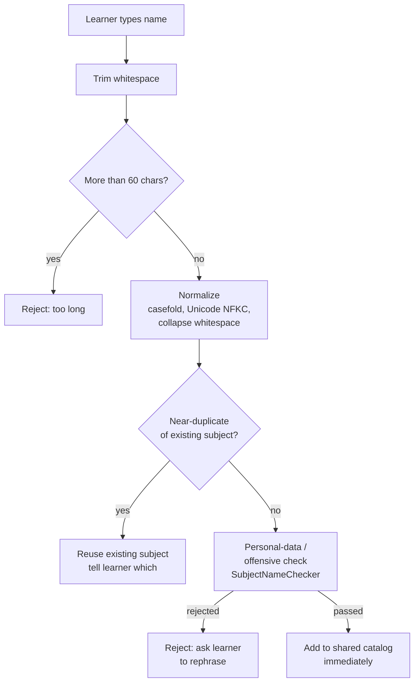
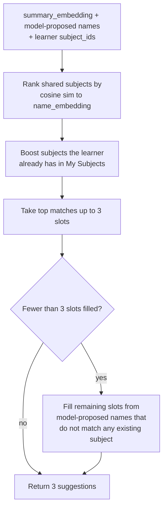

# Subject Catalog and Personal Names

The `subjects` module owns the shared catalog of academic subjects, the per-learner vocabulary layer on top of it, and the ranking logic that suggests subjects when a new document is uploaded. It was split out of `knowledge` in PRD v2.2 (ADR 0004) so that every other module — `tutoring`, `learning`, `accounts`, and the API — can resolve subject names without depending on the library.

## Module responsibilities

`subjects` owns four things (PRD §9.15, ADR 0003, ADR 0004):

| Responsibility | Description |
|---|---|
| **Shared catalog** | One global `subjects` table with a stable `subject_id` (UUID), `canonical_name`, `name_embedding`, and `created_at`. |
| **Name pipeline** | Normalization, near-duplicate detection, personal-data/offensive-content check, and catalog insertion for every new name typed by a learner. |
| **Personal names** | Per-learner display names in `user_subject_names`; coalesced at read time; never affect other learners. |
| **Suggestion ranking** | Ranks three subject suggestions for a specific learner from a content's summary embedding and the model's proposed names. |

The module has no dependencies on any other business module. Its `application` layer is what every higher module imports.

```
smart_tutor/subjects/
├── domain/          # Subject, SubjectName, PersonalSubjectName
├── application/     # SubjectCatalogService, SubjectSuggester, SubjectNameChecker  ← public API
├── ports/           # SubjectRepository, PersonalNameRepository (ABCs)
└── adapters/        # PostgreSQL implementations
```

Other modules import **only** `subjects.application`. This boundary is enforced by import-linter in CI (contract 2, §6 of the project structure spec).

## Shared catalog design

Each row in `subjects` has three columns that matter for correctness:

| Column | Semantics |
|---|---|
| `subject_id` | UUID primary key. **Never changes, never reused.** This is what every other table stores. |
| `canonical_name` | The normalized text the system displays when a learner has not set a personal name. |
| `name_embedding` | Embedding of `canonical_name`; used by suggestion ranking and near-duplicate detection. |

There is no `creator_id`, no status flag, no admin-only field. By design (ADR 0003, PRD D21) there is **no admin rename, merge, or hide** operation. The only way a subject can change is when a near-duplicate check at creation time reuses an existing one.

> **Why no admin moderation?** Subject ids are stable references used by documents, threads, notes, and learning records. A rename or merge would require updating those tables or silently breaking links. The accepted trade-off is a small risk of near-duplicates created in the same moment (ADR 0003 §Consequences).

## The new-name pipeline

Every name a learner types — either as a new subject when choosing subjects for a document or as a personal rename — passes through the following steps before anything is written.



*New-name pipeline: every typed subject name follows this path before entering the catalog or being reused.*

**Step by step:**

1. **Trim.** Leading and trailing whitespace removed.
2. **60-character limit.** Enforced on the trimmed string (PRD US-2b).
3. **Normalize.** `SubjectName` value object applies case-folding, Unicode NFKC normalization, and whitespace collapsing. The `subjects` table has a unique index on `normalized_name`; the result of normalization is what goes in that column.
4. **Near-duplicate reuse.** `SubjectCatalogService` compares the name embedding of the candidate against existing subjects. If a close match exists, the **existing subject is returned** and the learner is told which name it mapped to. No new row is created.
5. **Personal-data / offensive check.** `SubjectNameChecker` (defined as a stub; implementation due at M1) calls the LLM (`amazon.nova-2-lite-v1:0`) via the `check_subject_name` tool. If the name contains personal data or offensive content, it is **rejected** and the learner is asked to rephrase.
6. **Catalog insertion.** If all checks pass, the name is added to `subjects` immediately. No approval queue; no delay.

The same pipeline applies when a learner **renames a subject for themselves** (personal name), except the outcome of a successful check is a row in `user_subject_names`, not a new `subjects` row, and the new name must also differ from that learner's other personal names (US-10b).

## Personal names

Renaming a subject is a learner-private operation. It does **not** change the `subject_id`, the `canonical_name`, any documents, threads, notes, or learning records, and other learners are never affected (ADR 0003, PRD D21).

The `user_subject_names` table is keyed by `(user_id, subject_id)` with a unique constraint on `(user_id, normalized display_name)`. A learner cannot give two different subjects the same personal name.

**Name resolution at read time:**

```
display name = COALESCE(user_subject_names.display_name, subjects.canonical_name)
```

This coalesce is applied wherever a name is shown — in the API, the agent system prompt, thread and note subject lists, and citations. No table other than `user_subject_names` stores names; every other table stores only `subject_id`s.

**"Reset name"** deletes the `user_subject_names` row. The learner then sees the canonical name again, and the `subject_id` is unchanged.

### My Subjects

> **My subjects** = the set of distinct `subject_id` values over a learner's `ready`, non-archived documents.

This is not a stored field; it is derived at query time from `document_subjects` joined with `documents` where `state = 'ready'` and `archived = false`. Subject detection in the tutor agent and vector search both operate within this set.

## Subject suggestion ranking

When a document's fast first-pages step completes (PRD §9.2, step 4–5), the ingestion worker calls `SubjectSuggester` to compute three ranked suggestions for the uploading learner. The suggester (defined as a stub; implementation due at M1) applies the following algorithm:



*Subject suggestion ranking: shared catalog similarity first, boosted by the learner's existing subjects, filled out with model-proposed names.*

**Details:**

- **Similarity:** cosine similarity between the content's `summary_embedding` (stored on `contents`) and each subject's `name_embedding`.
- **Boosting:** subjects the learner already has in their library (My Subjects) are ranked higher, encouraging consistent tagging across a learner's documents.
- **Preference order:** matching shared subjects first → learner's own subjects → new proposed names. This mirrors the PRD D20 statement: "matching shared subjects first, then the learner's subjects, then new names."
- **Remaining slots:** if fewer than 3 slots are filled by catalog subjects, the model's proposed names (from the `describe_document` tool call) that do not match any existing subject are appended. These become new catalog entries only if the learner keeps them (they pass the new-name pipeline at that point).

The learner sees **exactly 3 suggestions** and keeps one to three of them, optionally adding or substituting their own typed names (total 1–3 subjects per document, PRD D20, US-2b).

## Key classes

| Class / Service | Layer | Role |
|---|---|---|
| `Subject` | `domain` | Entity: `subject_id`, `canonical_name`, `name_embedding`. Enforces that `subject_id` is a stable UUID. |
| `SubjectName` | `domain` | Value object for a normalized name. Performs trim, 60-char check, and normalization. |
| `PersonalSubjectName` | `domain` | Value object for a per-learner display name. Unique per learner; never stored in the shared catalog. |
| `SubjectCatalogService` | `application` | `get_or_create(name)` runs the new-name pipeline and either returns an existing subject or creates one. Also resolves names for a learner (coalesce). |
| `SubjectSuggester` | `application` | Ranks 3 suggestions for a learner. **Stub; M1 milestone for implementation.** |
| `SubjectNameChecker` | `application` | Calls the LLM to check for personal data and offensive content. **Stub; M1 milestone for implementation.** |
| `SubjectRepository` | `ports` | Abstract interface for `subjects` table access. |
| `PersonalNameRepository` | `ports` | Abstract interface for `user_subject_names` table access. |

## Invariants

These are the system-wide truths that make `subject_id` safe as a stable identifier:

1. **A `subject_id` never changes and is never reused.** Once assigned, it permanently identifies one canonical subject.
2. **No creator is stored in the shared view.** The `subjects` table has no `owner_id` or `created_by`. Subjects belong to everyone.
3. **Every other table stores only `subject_id`s.** Documents (`document_subjects`), threads (`subject_ids[]`), lesson notes (`subject_ids[]`), learning records, decline log, reports, and quiz questions all hold raw UUIDs. Names are resolved at read time by `subjects.application`.
4. **Personal names are unique per learner.** The unique constraint on `(user_id, normalized display_name)` in `user_subject_names` prevents ambiguity within a learner's view.
5. **Renaming never touches documents, threads, notes, or learning records.** A rename only writes (or deletes) a row in `user_subject_names`.
6. **No admin rename, merge, or hide.** This is a deliberate non-goal (PRD D21, ADR 0003). Catalog moderation is in the backlog for a future release.

## Risk: subject names in the shared catalog

Because any learner can add a name and the name check is the only safeguard, there is an accepted residual risk that a subject name could contain sensitive or misleading text (PRD §9.10). Mitigations are the 60-char limit, normalization, near-duplicate reuse, the LLM check, and the absence of a creator field. Admin tooling for catalog moderation is a known backlog item.

An additional accepted risk is **concurrent near-duplicate creation**: because there is no merge operation, two learners who type near-identical names within the same moment may create two separate catalog entries. This is rare and accepted as a consequence of the stable-id design (ADR 0003 §Consequences).

## Module ordering and dependencies

`subjects` sits near the bottom of the module dependency graph:

```
reports → recommendations → quizzes | catalog → learning → tutoring → graph → knowledge → subjects → accounts | insights
```

`subjects` depends on **nothing** from other business modules; it only uses `shared` (the `EmbeddingModel` port and infrastructure clients). `knowledge` calls `subjects.application` for `SubjectCatalogService.get_or_create` during ingestion, and `SubjectSuggester` for ranked suggestions. `tutoring` calls `subjects.application` to resolve names when constructing the agent system prompt and thread views. This ordering is enforced by import-linter contract 5 in CI.

## Related design records

- **ADR 0003** (`sdd/adr/0003-shared-subject-catalog.md`): decision to have one shared catalog with stable ids and personal names; consequences and trade-offs.
- **ADR 0004** (`sdd/adr/0004-subjects-module.md`): decision to split the catalog out of `knowledge` into a dedicated `subjects` module; module ordering.
- **PRD §9.4** (`sdd/prd.md`): data model for `subjects` and `user_subject_names` tables.
- **PRD D1, D20, D21** (`sdd/prd.md`): key product decisions on the shared catalog, suggestion flow, and personal renaming.
