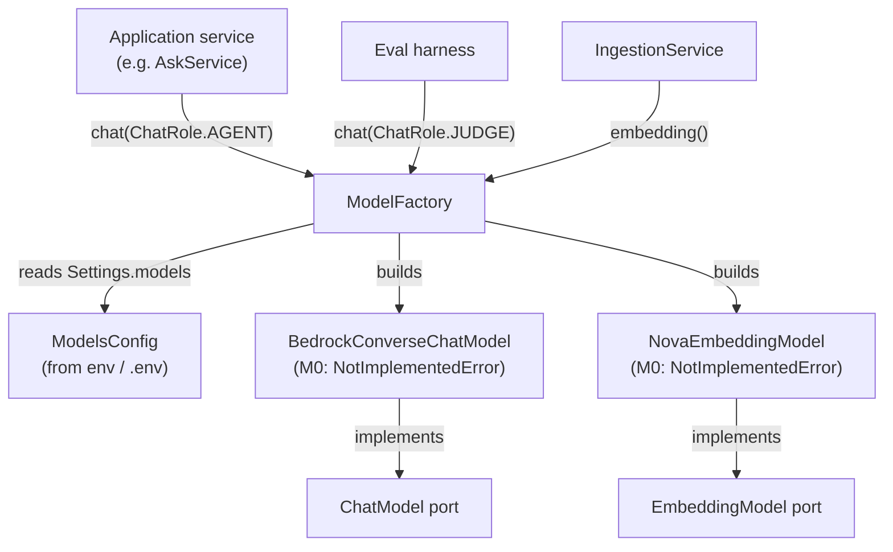
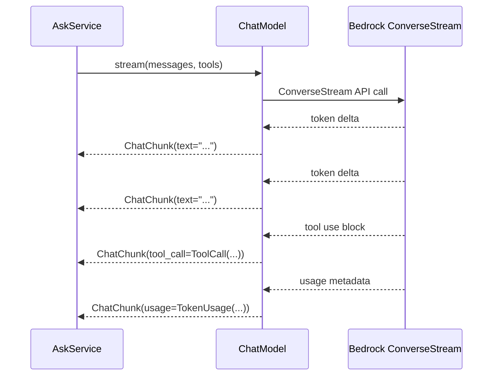

# AWS Bedrock Model Integration

Smart Tutor accesses all language models and embedding models through AWS Bedrock. The integration is built on two port abstractions (`ChatModel`, `EmbeddingModel`), a configuration-driven `ModelFactory`, and Bedrock adapters that will implement those ports. At milestone M0 every adapter method raises `NotImplementedError`; the scaffold verifies reachability before the adapters are written.

## Model roles

The system defines three model roles, each mapped to a specific Bedrock model in `Settings.models`:

| Role | Model ID (config) | Notes |
|---|---|---|
| `agent` | `us.amazon.nova-2-lite-v1:0` | Inference profile for Nova 2 Lite; used for all agent turns, document description, subject name checks |
| `judge` | `qwen.qwen3-32b-v1:0` | LLM-as-judge and synthetic-data generation; `temperature=0` |
| `embedding` | `amazon.nova-2-multimodal-embeddings-v1:0` | Chunk indexing and query embedding; 1024 dimensions |

The agent role's config stores `us.amazon.nova-2-lite-v1:0` (the inference profile), not the underlying `amazon.nova-2-lite-v1:0` model ARN. This distinction matters for IAM: the agent's Pod Identity role must allow invoke on both the inference profile ARN and the underlying model ARNs in every destination region (see PRD Appendix A).

### Why the `us.` inference profile for Nova 2 Lite

The `us.amazon.nova-2-lite-v1:0` inference profile routes requests within US regions only (PRD §9.14). This satisfies the retention requirement that LLM requests stay in US regions (PRD §11). Using the cross-region inference profile rather than a single-region endpoint also lets Bedrock redistribute load across `us-east-1`, `us-east-2`, and `us-west-2` automatically, improving availability without any application-layer change.

### Why Qwen for the judge

The judge uses a different model family (Qwen) from the agent (Nova). This reduces correlated bias: a judge from a different family is less likely to favour the same answer patterns as the model being evaluated. Judges are calibrated against human annotations; when agreement drops below ~80%, the judge prompt is revised (PRD §10.2).

## Configuration

Model configuration lives in `Settings.models`, a `ModelsConfig` instance composed of three `ModelConfig` objects:

```python
class ModelConfig(BaseModel):
    provider: str = "bedrock"
    model_id: str
    params: dict[str, float | int | str] = {}

class ModelsConfig(BaseModel):
    agent:     ModelConfig = ModelConfig(model_id="us.amazon.nova-2-lite-v1:0")
    judge:     ModelConfig = ModelConfig(model_id="qwen.qwen3-32b-v1:0", params={"temperature": 0})
    embedding: ModelConfig = ModelConfig(
        model_id="amazon.nova-2-multimodal-embeddings-v1:0", params={"dimension": 1024}
    )
```

Settings are read from environment variables with the prefix `SMART_TUTOR_` and nested delimiter `__`, so individual model IDs or params can be overridden without redeploying: e.g. `SMART_TUTOR_MODELS__AGENT__MODEL_ID=...` overrides the agent model. The `.env` file is also read in local development.

## ModelFactory

`ModelFactory` is the single place that translates configuration into adapter instances. Business code names a role; it never references a model ID or a vendor SDK directly (PRD D15).

```python
class ChatRole(StrEnum):
    AGENT = "agent"
    JUDGE = "judge"

class ModelFactory:
    def __init__(self, settings: Settings) -> None: ...

    def chat(self, role: ChatRole) -> ChatModel:
        config = getattr(self._settings.models, role.value)
        raise NotImplementedError(f"M0: build the {config.provider} chat adapter for {config.model_id}")

    def embedding(self) -> EmbeddingModel:
        config = self._settings.models.embedding
        raise NotImplementedError(f"M0: build the {config.provider} embedding adapter for {config.model_id}")
```

`chat(ChatRole.AGENT)` and `chat(ChatRole.JUDGE)` each return a `ChatModel`. `embedding()` returns an `EmbeddingModel`. The factory reads the provider from `ModelConfig.provider` (default `"bedrock"`) so a future non-Bedrock provider can be added by changing configuration and adding an adapter, not by touching business code.



*ModelFactory reads configuration and builds Bedrock adapters; callers depend only on the port interfaces.*

## The ChatModel port

`ChatModel` is an abstract base class in `smart_tutor.shared.ports.chat_model`. It defines three call patterns:

### `stream` — async token-by-token

```python
def stream(
    self,
    messages: Sequence[Message],
    tools: Sequence[ToolSpec] = (),
) -> AsyncIterator[ChatChunk]:
    ...
```

Returns an `AsyncIterator[ChatChunk]`. Each `ChatChunk` carries a text delta (`text: str`), a completed tool call (`tool_call: ToolCall | None`), or the final token counts (`usage: TokenUsage | None`). The last chunk in a stream carries the usage. Used by the agent's answer step to stream responses to the learner.

### `invoke` — complete non-streaming response

```python
async def invoke(
    self,
    messages: Sequence[Message],
    tools: Sequence[ToolSpec] = (),
) -> ChatResult:
    ...
```

Returns a `ChatResult` with a complete `text`, a list of `ToolCall` objects (may be empty), and a `TokenUsage`. Used for single-call paths such as summarize, quiz generation, and report writing where streaming is not needed.

### `structured` — validated output object

```python
async def structured[T: BaseModel](
    self,
    messages: Sequence[Message],
    schema: type[T],
) -> StructuredResult[T]:
    ...
```

Returns a `StructuredResult[T]` wrapping a validated Pydantic model instance and its `TokenUsage`. Adapters may implement this using a forced tool call (the approach for Nova) or native structured output. Used for paths that must return a typed response: `describe_document`, `check_subject_name`, learning-record generation.

### Supporting types

| Type | Purpose |
|---|---|
| `Message` | Immutable dataclass; `role` is one of `system`, `user`, `assistant`, `tool`; carries optional `tool_call_id` |
| `ToolSpec` | Tool declaration: `name`, `description`, JSON Schema `parameters` |
| `ToolCall` | Completed call: `id`, `name`, `arguments` dict |
| `ChatChunk` | One streamed piece: text delta, completed tool call, or final usage |
| `ChatResult` | Complete response: `text`, `tool_calls`, `usage` |
| `StructuredResult[T]` | Validated Pydantic object + `usage` |
| `TokenUsage` | Immutable `input_tokens` / `output_tokens`; supports `+` for accumulation |



*Streaming call pattern: the last chunk carries usage; tool calls are delivered as completed `ToolCall` objects.*

## The EmbeddingModel port

`EmbeddingModel` is an abstract base class in `smart_tutor.shared.ports.embedding_model`.

```python
class EmbeddingModel(ABC):
    @property
    @abstractmethod
    def model_id(self) -> str:
        """Recorded on every chunk as `embedding_model`."""

    @property
    @abstractmethod
    def dimension(self) -> int:
        """Recorded on every chunk as `embedding_dim`."""

    @abstractmethod
    async def embed_documents(self, texts: Sequence[str]) -> list[list[float]]:
        """Embed chunks for indexing (Nova: GENERIC_INDEX)."""

    @abstractmethod
    async def embed_query(self, text: str) -> list[float]:
        """Embed a search query (Nova: TEXT_RETRIEVAL)."""
```

### Nova embedding semantics

The Nova multimodal embedding model distinguishes two input types:

- **`GENERIC_INDEX`** — used by `embed_documents`; signals that the text is a passage being indexed. Used when embedding content chunks, subject name embeddings, and content summary embeddings.
- **`TEXT_RETRIEVAL`** — used by `embed_query`; signals that the text is a search query. Used by the MCP `search` tool when embedding the learner's question before the pgvector HNSW lookup.

Using the correct input type matters for retrieval quality; asymmetric embedding (different types for passage and query) is how the model was trained.

### Operational constraints

| Constraint | Value |
|---|---|
| Dimensions | 1024 (set via `params.dimension` in config) |
| Max characters per call | ≤ 8,192 |
| Recommended chunk size | 1,500–3,000 characters |
| Truncation mode | `NONE` (caller is responsible for respecting the character limit) |

The `model_id` and `dimension` properties are recorded on every `chunks` row and on the `contents.embedding_model` / `contents.embedding_dim` columns. When the embedding model changes, these stored values identify which chunks need re-embedding.

## Bedrock adapter structure (M0)

The Bedrock adapter package lives at `smart_tutor.shared.adapters.bedrock`. At M0 it contains only the module docstring declaring the two planned adapter classes:

```
BedrockConverseChatModel  — will implement ChatModel
NovaEmbeddingModel        — will implement EmbeddingModel
```

Both classes raise `NotImplementedError` for every method, so the full dependency graph can be assembled and wired in tests and the Compose stack before the actual Bedrock calls are implemented.

The M0 milestone exit criterion is to verify reachability of the real Bedrock endpoint before the adapters are written: synchronous `InvokeModel` for Nova embeddings (verified at M0), and `ConverseStream` with tool calls for Nova 2 Lite. The Nova embedding model uses `InvokeModel` rather than `Converse`; this is confirmed at M0 and the adapter is written accordingly (PRD §9.14).

## Local development

Bedrock and LangSmith have no local emulator. In local development the real `us-east-1` endpoint is used with a developer AWS profile. The developer's IAM identity must be allowed to invoke all three models. The Docker Compose stack provides LocalStack for S3/SQS/SSM, Keycloak, and PostgreSQL, but Bedrock calls go directly to AWS.

From PRD §9.12:
> Bedrock and LangSmith are real (developer AWS profile, separate LangSmith project).

The AWS region is set via `Settings.aws_region` (default `"us-east-1"`). The Bedrock client in the adapter will be constructed with this region and the ambient AWS credentials (profile or Pod Identity in production).

## Model-switch policy

### Switching a chat model (agent or judge)

Switching either chat model is a **configuration change** (update `SMART_TUTOR_MODELS__AGENT__MODEL_ID` or `SMART_TUTOR_MODELS__JUDGE__MODEL_ID`) but it is **gated on the full evaluation split** passing (PRD §9.15, `ModelsConfig` docstring). A release with a model swap must pass all §10.1 evaluator targets before it is deployed. The evaluation split covers answer relevance, decline correctness, injection resistance, subject detection, thread growth, and isolation — the same criteria as a feature release.

### Switching the embedding model

Changing the embedding model has a deeper operational consequence: every embedded passage was indexed under the old model's vector space, which is incompatible with the new model's vectors. The switch therefore triggers **re-embedding of all content chunks from stored chunk text** (no PDF restore from Glacier is needed). The process is:

1. The new model ID is set in configuration.
2. A system job re-embeds each `content`'s chunks from the stored `chunks.text` column, writing new vectors and updating `chunks.embedding_model` and `chunks.embedding_dim`.
3. Re-embedding is recorded as `system` usage (no `user_id`).
4. Search keeps serving old vectors until each content's chunks are updated; the HNSW index is refreshed as the new vectors land.
5. `content.embedding_model` and `content.embedding_dim` columns track which model version was used, so the re-embedding job can resume after interruption.

The PRD notes this state machine transition explicitly: `ready → processing` (system only) when the embedding model changes (PRD §9.5).

## Relationships to other components

- **Shared kernel** — `ChatModel`, `EmbeddingModel`, `ModelFactory`, `Settings`, and `TokenUsage` all live in `smart_tutor.shared` and are imported by every application module. See [Shared Kernel](../architecture/shared-kernel.md).
- **Fakes and unit tests** — Application services that depend on `ChatModel` or `EmbeddingModel` are tested with in-memory fakes that implement the same port interfaces without calling Bedrock. See [Fakes and Unit Tests](../testing/fakes-and-unit-tests.md).
- **Evals** — The judge model (`ChatRole.JUDGE`) is used by the LLM-as-judge evaluators for retrieval relevance, answer relevance, learning record quality, and injection resistance. See [Evals](../testing/evals.md).
- **Local dev** — The Compose stack wires the real Bedrock endpoint; no mock is provided. See [Local Dev](../operations/local-dev.md).
