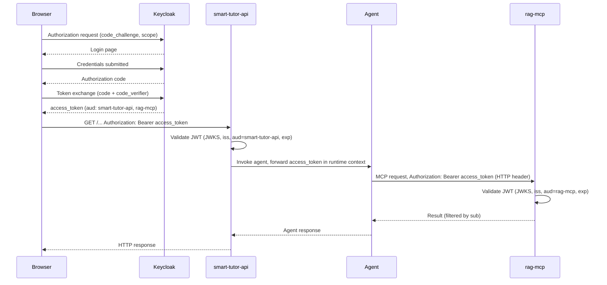

# Keycloak Authentication and Identity

Smart Tutor uses [Keycloak 26.3](https://www.keycloak.org/) as its identity provider. All services (API, MCP server, web app) participate in a single OIDC realm called `smart-tutor`. Authentication is enforced at every service boundary; the LLM is never the access boundary.

---

## Realm Structure

The realm is defined in `local/keycloak/realm-smart-tutor.json` and imported automatically when Keycloak starts. Key settings:

| Setting | Value |
|---|---|
| Realm name | `smart-tutor` |
| Self-registration | Enabled (`registrationAllowed: true`) |
| Email as username | Yes |
| Email verification | Disabled in local dev |
| SSL required | None in local dev (`sslRequired: "none"`) |
| Access token lifespan | 900 s (15 min) |

### Clients

Three clients are defined in the realm:

| Client ID | Type | Purpose |
|---|---|---|
| `smart-tutor-web` | Public (PKCE) | Browser SPA — initiates the Authorization Code + PKCE flow |
| `smart-tutor-api` | Bearer-only resource server | API — validates incoming tokens; never initiates a flow |
| `rag-mcp` | Bearer-only resource server | RAG MCP server — validates forwarded tokens from the agent |

`smart-tutor-api` and `rag-mcp` are bearer-only clients with `standardFlowEnabled: false`; they only validate tokens, never issue them.

### Audience Mappers

The `smart-tutor-web` client carries two protocol mappers that add audience claims to every access token issued to the web app:

| Mapper name | Audience added to `aud` |
|---|---|
| `audience-smart-tutor-api` | `smart-tutor-api` |
| `audience-rag-mcp` | `rag-mcp` |

Both mappers target the access token only (`access.token.claim: true`, `id.token.claim: false`). This means a single token issued at login is valid for both the API and the MCP server.

---

## OIDC Flow

Smart Tutor uses the **Authorization Code flow with PKCE** (S256). The web app is a public client; client secrets are not involved.



*Authorization Code + PKCE flow: one token issued by Keycloak travels from the browser to the API, is forwarded in-process to the agent, and then forwarded in HTTP headers to the MCP server.*

Step-by-step:

1. The **web app** performs Authorization Code + PKCE against the `smart-tutor` realm (`redirect_uri: http://localhost:5173/*` in local dev). The resulting access token contains `aud: ["smart-tutor-api", "rag-mcp"]`.
2. The **API** (`smart-tutor-api`) validates the token (see [JWT Validation](#jwt-validation) below), applies rate limits, and invokes the agent.
3. The **agent** attaches the token as an HTTP `Authorization` header on every MCP request. The token travels only in HTTP headers and runtime context — **never in a prompt, log, or trace** (see [Token-Privacy Invariant](#token-privacy-invariant)).
4. The **MCP server** validates the forwarded token against `aud=rag-mcp`, reads `sub`, and builds an SQL predicate restricting all chunk searches to documents the caller owns (`owner_id = sub` in Releases 1–3).

---

## JWT Validation

JWT validation is performed by the `auth` adapter in `backend/src/smart_tutor/shared/adapters/auth/__init__.py`. The module docstring describes its responsibilities as: JWKS retrieval, `iss` check, `aud` check, and `exp` check.

| Check | API service | MCP server |
|---|---|---|
| JWKS | Fetched from `{keycloak_issuer}/protocol/openid-connect/certs` | Same |
| `iss` | Must equal `keycloak_issuer` from `Settings` | Same |
| `aud` | Must contain `keycloak_audience` = `smart-tutor-api` | Must contain `rag-mcp` |
| `exp` | Token must not be expired | Same |

Configuration is read from `Settings` (env prefix `SMART_TUTOR_`, nested with `__`):

```python
keycloak_issuer: str = "http://localhost:8080/realms/smart-tutor"
keycloak_audience: str = "smart-tutor-api"
```

The `keycloak_issuer` is also set explicitly for the `api` container in `compose.yaml`:
```yaml
SMART_TUTOR_KEYCLOAK_ISSUER: http://localhost:8080/realms/smart-tutor
```

Unauthenticated calls to the API, agent, or MCP server return `401`.

> **M0 stub:** The JWT verifier is currently a stub (as noted in the `auth/__init__.py` docstring, M0 task). Full JWKS-backed validation is scheduled as part of milestone M0 foundations work.

---

## Role Model

The realm defines two application roles:

| Role | Description | Assignment |
|---|---|---|
| `learner` | Default role for all self-registered users | Assigned automatically at sign-up via `default-roles-smart-tutor` composite role |
| `admin` | Operations only: cost/budget alerts, evaluation annotation — **no product admin functions** | Assigned manually |

Self-registration is enabled on the realm, so any user who signs up via the web app immediately receives the `learner` role. The `default-roles-smart-tutor` composite role bundles `learner`, `offline_access`, and `uma_authorization`, so no manual role assignment is needed for new learners.

The `admin` role grants access to operational functions only (budget alerts, evaluation annotation). There are no product admin functions (no subject catalog moderation, no account-deletion tooling) in Releases 1–3.

---

## Test Users

The realm import pre-creates three test users for local development:

| Email | Password | Roles |
|---|---|---|
| `learner@example.com` | `learner` | `learner` (via default) |
| `learner2@example.com` | `learner2` | `learner` (via default) |
| `admin@example.com` | `admin` | `learner` + `admin` |

The Keycloak admin console is available at `http://localhost:8080` with credentials `admin` / `admin`.

---

## Local Development and Realm Import

Keycloak is started by `docker compose up -d` and listens on port `8080`. The realm file is mounted as a read-only volume:

```yaml
volumes:
  - ./local/keycloak:/opt/keycloak/data/import:ro
command: ["start-dev", "--import-realm"]
```

**Import behavior:** Keycloak only imports `realm-smart-tutor.json` when the `smart-tutor` realm **does not yet exist** in its database. If you edit the JSON after the first `up`, the changes will not take effect until you destroy and recreate the volumes:

```bash
docker compose down -v
docker compose up -d
```

> Keep the built-in roles `offline_access` and `uma_authorization` present in the JSON at all times; removing them breaks the composite `default-roles-smart-tutor` role and therefore breaks self-registration.

---

## Token-Privacy Invariant

Tokens must travel only in HTTP headers and runtime context. They must **never appear** in prompts, logs, or traces. This is a project-level invariant enforced in code reviews and documented in both `AGENTS.md` and PRD §9.3:

> "The agent attaches the token to every MCP request (HTTP header, runtime context — never in the prompt)."

Violating this invariant would expose bearer tokens to LLM traces and potentially to the LLM itself, undermining the access-control boundary.

---

## Related Pages

- [Shared Kernel](../architecture/shared-kernel.md) — the `Settings` class and adapter boundaries that host the JWT verifier
- [Access Control](../concepts/access-control.md) — how `sub` from the validated token is used to enforce `can_read(user, document)`
- [Local Dev](../operations/local-dev.md) — full Compose stack setup, including Keycloak startup
