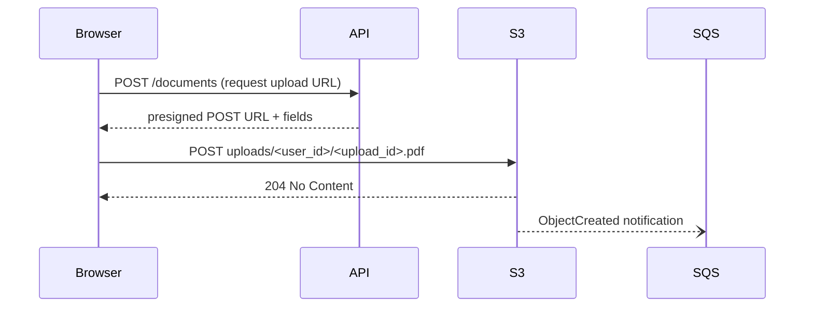
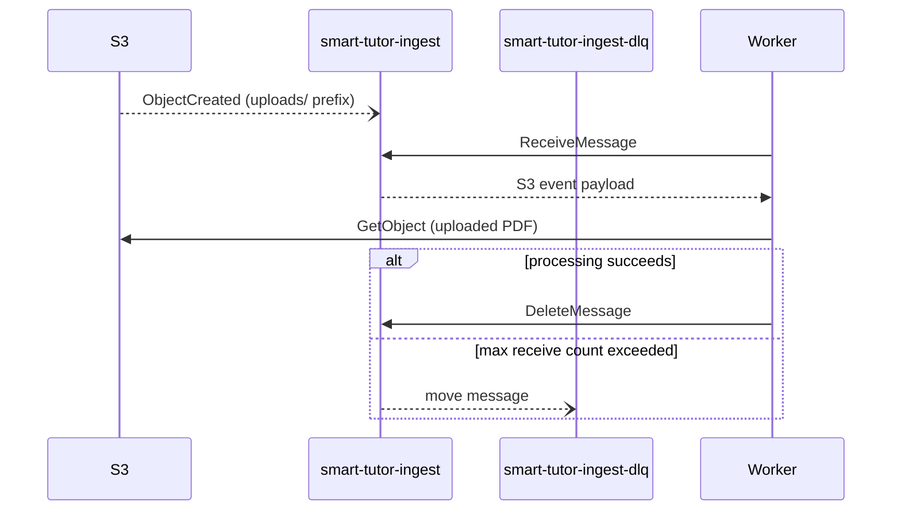

# S3 Storage and SQS Ingestion Queue

Smart Tutor stores all uploaded and processed PDF files in a single S3 bucket (`smart-tutor-documents`). That bucket is divided into two logical prefixes with different access patterns, lifecycle rules, and event semantics. An S3 event notification fires on every new upload and delivers a message to an SQS queue where the ingestion worker picks it up.

## Bucket layout

```
smart-tutor-documents/
  uploads/<user_id>/<upload_id>.pdf   # raw learner upload; short-lived
  contents/<sha256>.pdf               # deduplicated content file; permanent
  contents/<sha256>.docling.json      # saved Docling extraction output
```

**`uploads/` prefix** — holds the raw file that the browser POSTs directly to S3 using the presigned POST URL issued by the API. The key embeds the user's ID and a server-generated upload ID, binding the object to the authenticated learner. An S3 lifecycle rule expires objects under this prefix after 1 day; after the ingestion worker processes the file (hashes it, moves or deduplicates it), the uploaded copy is deleted by the worker and the lifecycle rule is a safety net.

**`contents/<sha256>.pdf`** — the permanent, deduplicated copy of a unique file. After the worker computes the SHA-256 of uploaded bytes and confirms the content is new, it writes the file here. Because the key is the hash, every unique PDF is stored exactly once regardless of how many learners uploaded it. S3 versioning is enabled on the bucket to protect against accidental overwrites.

**`contents/<sha256>.docling.json`** — the structured Docling extraction output saved alongside the content PDF. This file lives in S3 Standard and is never moved to Glacier; it is used by the research map, topic catalog, and knowledge graph without needing the original PDF.

## Presigned POST upload flow

The API generates a presigned POST policy for `uploads/<user_id>/<upload_id>.pdf` with the following constraints:

- `content-length-range` condition: maximum 50 MB (enforces the per-file size limit without server-side streaming).
- `Content-Type` condition: `application/pdf` (rejects non-PDF uploads at the S3 layer).
- Policy expires after **1 day**.

The browser submits the file directly to S3 using the returned URL and fields; the API is not in the data path. CORS is configured on the bucket to allow `POST` from the web origin (`http://localhost:5173` in local development).



*Presigned POST flow: the browser uploads directly to S3; the API is not in the data path.*

## S3 → SQS event notification

An S3 bucket notification configuration sends an `s3:ObjectCreated:*` event for every object created under the `uploads/` prefix to the **`smart-tutor-ingest`** SQS queue. Objects written under `contents/` are intentionally excluded — only raw learner uploads trigger ingestion.

The ingestion worker (`apps/worker/main.py`) polls `smart-tutor-ingest`, reads each S3 event message, downloads the uploaded PDF, and runs the processing pipeline (validation, SHA-256, deduplication or content creation, Docling extraction, chunking, and embedding). On unrecoverable failures the message is moved to **`smart-tutor-ingest-dlq`** (dead-letter queue) after a configurable number of receive attempts (5 in local development).



*S3→SQS→Worker message flow with DLQ on repeated failure.*

## Configuration keys

The `Settings` class (loaded from environment variables prefixed `SMART_TUTOR_`, nested with `__`) exposes two keys relevant to storage:

| Key | Default | Purpose |
|---|---|---|
| `documents_bucket` | `smart-tutor-documents` | S3 bucket name used by the worker, API, and glacier tagger |
| `ingest_queue_url` | `http://localhost:4566/000000000000/smart-tutor-ingest` | Full SQS queue URL polled by the ingestion worker |

In the `app` Docker Compose profile the worker overrides `SMART_TUTOR_INGEST_QUEUE_URL` to `http://localstack:4566/000000000000/smart-tutor-ingest` and sets `AWS_ENDPOINT_URL_S3` and `AWS_ENDPOINT_URL_SQS` to point at LocalStack.

## Glacier lifecycle

Content PDF files that are no longer referenced by any active (non-archived) document are candidates for cold storage. The lifecycle management involves two components:

1. **`glacier_tagger` CronJob** (`apps/jobs/glacier_tagger.py`) — runs daily; queries the database for `contents/<sha256>.pdf` objects where no non-archived document references the content, then applies the S3 tag `status=archived` to those objects. When a document referencing the content becomes active again (a learner restores an archived document), the job removes the tag.

2. **S3 lifecycle rule** — moves objects tagged `status=archived` under the `contents/` prefix to **Glacier Flexible Retrieval** after **30 days**. Tagged objects that have the tag removed (content becomes referenced again within the 30-day window) are not transitioned.

The Docling JSON, chunks (in PostgreSQL), and summary embeddings are kept in S3 Standard / PostgreSQL and are never moved to Glacier. The research map, topic catalog, knowledge graph, and re-embedding from stored chunk text therefore never require a Glacier restore. Only a full re-extraction (for example, upgrading the Docling version) would need to retrieve the archived PDF, which takes hours under Glacier Flexible Retrieval.

This policy implements PRD decision D10: documents are never deleted, only archived; the content file reaches Glacier only when no learner holds an active copy.

## AWS adapter stubs

`shared/adapters/aws/__init__.py` is a placeholder for the planned S3, SQS, and SSM client wrappers. All three client types are listed in the module docstring; no implementation exists yet (M0). Per the project structure design, `boto3`/`botocore` calls are permitted only from `adapters` or `apps` packages (import-linter contract S4).

## CDK infrastructure stub

`StorageStack` in `infra/smart_tutor_infra/stacks/storage.py` is an empty CDK stack whose docstring documents the intended resources: presigned POST, versioning, `uploads/` event notifications to SQS with a DLQ, a 1-day expiry lifecycle for `uploads/`, the 30-day Glacier transition for tagged content PDFs, and CORS for the web origin. The actual CDK constructs are a milestone 1 (M1) task; the class currently only calls `super().__init__()`.

## LocalStack emulation

In local development, LocalStack (image `localstack/localstack:4`) emulates S3, SQS, SSM, and Secrets Manager on a single port (`4566`). Bedrock has no LocalStack emulator; the worker and agent call real AWS Bedrock endpoints using the developer's AWS profile. The Compose service mounts `local/localstack/init/ready.d/` as LocalStack's `ready.d` init directory; scripts there run once after LocalStack is ready.

The init script `local/localstack/init/ready.d/10-smart-tutor.sh` creates all required resources in order:

1. **S3 bucket** `smart-tutor-documents` with versioning enabled.
2. **Dead-letter queue** `smart-tutor-ingest-dlq` (SQS).
3. **Ingestion queue** `smart-tutor-ingest` (SQS) with a redrive policy pointing at the DLQ (`maxReceiveCount: 5`).
4. **S3 bucket notification** — `s3:ObjectCreated:*` on the `uploads/` prefix forwarded to the `smart-tutor-ingest` queue ARN.
5. **CORS configuration** — allows `POST` from `http://localhost:5173` (the local Vite dev server) with all headers.
6. **SSM parameter** `/smart-tutor/learning-record-idle-minutes` set to `10`.

The script uses `awslocal` (the LocalStack-aware wrapper for the AWS CLI) and is idempotent on re-creation of the Compose stack.

The `worker` service in the `app` Compose profile connects to LocalStack by setting `AWS_ENDPOINT_URL_S3` and `AWS_ENDPOINT_URL_SQS` to `http://localstack:4566`, so no code change is needed between local and production environments for S3 and SQS. Only the four services — S3, SQS, SSM, and Secrets Manager — are started by LocalStack; Bedrock is not emulated.

## Worker security isolation

Because the ingestion worker parses untrusted, learner-supplied PDF files, it runs under stricter isolation than other services (PRD §9.10):

- **Non-root user ID** — the container process does not run as root.
- **Read-only root filesystem** — the container filesystem is mounted read-only.
- **NetworkPolicy egress restriction** — outbound traffic is limited to AWS service endpoints (S3, SQS, Bedrock) and the PostgreSQL database; no arbitrary internet access.
- **Resource limits** — CPU and memory limits are set on the worker pod.
- **Per-file timeout** — a timeout is enforced per processed file to prevent a malformed PDF from blocking the queue indefinitely.

## Related pages

- [Content–Document Lifecycle](../concepts/content-document-lifecycle.md) — document and content state machines, deduplication, and archiving rules that drive when the glacier tagger acts.
- [Ingestion Flow](../workflows/ingestion-flow.md) — the worker's processing pipeline triggered by SQS messages from this queue.
- [Local Development](../operations/local-dev.md) — how to start the full Compose stack including LocalStack.
- [Deployment](../operations/deployment.md) — CDK stacks, Helm workloads, and the production S3/SQS setup.
