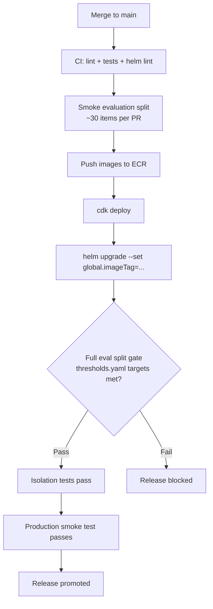

# Deployment — CDK Stacks and Helm Chart

Smart Tutor is deployed to **Amazon EKS in us-east-1** — the only AWS commercial region that
offers `amazon.nova-2-multimodal-embeddings-v1:0` (PRD §9.14). Infrastructure is provisioned
by **AWS CDK (Python)** in `infra/`, and workloads are delivered via a **Helm umbrella chart**
in `deploy/helm/smart-tutor/`.

---

## Infra project layout

`infra/` is a **standalone Python project** (its own `pyproject.toml` and `uv.lock`) named
`smart-tutor-infra`. Keeping CDK dependencies separate from the application images prevents
`aws-cdk-lib` and `constructs` from leaking into production containers.

```
infra/
  app.py                        # CDK entry point: build_app(app) + app.synth()
  cdk.json                      # app: "uv run python app.py"; context: region=us-east-1
  pyproject.toml                # aws-cdk-lib>=2.200, constructs>=10.4; pytest for tests
  smart_tutor_infra/
    app_stacks.py               # build_app() — assembles all stacks for one environment
    stacks/
      network.py   data.py   storage.py
      cluster.py   registry.py  config.py  budgets.py
  tests/
    test_synth.py               # smoke test: all 7 stacks synthesise in us-east-1
```

The `cdk.json` context key `smart-tutor:region` defaults to `us-east-1`; `build_app()` reads
it via `app.node.try_get_context("smart-tutor:region")`.

---

## CDK stack assembly

`build_app()` in `app_stacks.py` instantiates every stack for one environment (production in
Releases 1–2; `env_name` defaults to `"prod"`). Stack names follow the pattern
`SmartTutor-{env_name}-{Purpose}`, e.g. `SmartTutor-prod-Network`. Every non-network stack
declares an explicit dependency on `NetworkStack` so CloudFormation orders deployments
correctly.

```python
# infra/smart_tutor_infra/app_stacks.py (simplified)
network = NetworkStack(app, f"{prefix}-Network", env=env)
stacks = [network, DataStack, StorageStack, ClusterStack,
          RegistryStack, ConfigStack, BudgetsStack]
for stack in stacks[1:]:
    stack.add_dependency(network)
```

A single synthesis test in `tests/test_synth.py` verifies that all seven stacks synthesise
without error and that every stack targets `us-east-1`.

---

## CDK stacks

All stacks are **empty skeletons at the scaffold stage** (M0/M4 tasks); their docstrings and
`pyproject.toml` description record the intended resources.

| Stack | Logical name | Milestone | Intended resources |
|---|---|---|---|
| `NetworkStack` | `…-Network` | M0 | VPC with private subnets across 3 AZs |
| `DataStack` | `…-Data` | M0 | RDS PostgreSQL + pgvector; separate app and Keycloak databases |
| `StorageStack` | `…-Storage` | M1 | S3 documents bucket (see below); SQS + DLQ |
| `ClusterStack` | `…-Cluster` | M4 | EKS managed node group + Pod Identity associations |
| `RegistryStack` | `…-Registry` | M0 | ECR repositories: `api`, `agent`, `mcp`, `worker`, `web` |
| `ConfigStack` | `…-Config` | M0 | SSM parameters (learning-record idle minutes); Secrets Manager entries |
| `BudgetsStack` | `…-Budgets` | M4 | Bedrock cost alerts |

### NetworkStack

Provisions the VPC with private subnets spread across three Availability Zones. All other
stacks depend on it.

### DataStack

Provisions RDS PostgreSQL with the `pgvector` extension. Two databases live on the same
instance: one for the application (chunks, threads, learning records, etc.) and one for
Keycloak.

### StorageStack

Provisions the S3 documents bucket with two prefix conventions:

- **`uploads/`** — receives browser presigned-POST uploads. Object events fan out to an SQS
  queue and a dead-letter queue (DLQ). CORS is configured for the web origin. Objects in this
  prefix expire after **1 day** (lifecycle rule).
- **`contents/<sha256>.pdf`** — versioned, content-addressed storage for processed PDFs.
  Objects tagged as unreferenced are transitioned to **Glacier Flexible Retrieval after 30
  days** (lifecycle rule).

### ClusterStack

Provisions the EKS cluster, its managed node group, and **EKS Pod Identity** associations
that grant individual Kubernetes service accounts scoped IAM permissions — no node-level
instance profile needed.

### RegistryStack

Provisions ECR repositories for each application image: `smart-tutor-api`,
`smart-tutor-agent`, `smart-tutor-mcp`, `smart-tutor-worker`, and `smart-tutor-web`.

### ConfigStack

Provisions SSM parameters (e.g. the learning-record idle-minutes threshold) and Secrets
Manager secrets. The **External Secrets Operator** (ESO) syncs these Secrets Manager secrets
into Kubernetes Secrets at runtime, using the Pod Identity credential of the pod that owns the
`ExternalSecret`. Each sub-chart owns its own `ExternalSecret` manifest.

### BudgetsStack

Provisions AWS Budgets alerts for Bedrock model spend, providing an early warning before
token costs exceed thresholds.

---

## Helm umbrella chart

```
deploy/helm/smart-tutor/
  Chart.yaml          # umbrella: name=smart-tutor, version=0.1.0
  values.yaml         # shared defaults for every environment
  values-prod.yaml    # production overrides
  charts/             # one sub-chart per workload (vendored / local)
    api/
    agent/
    mcp-server/
    worker/
    web/
    jobs/
    keycloak/
  templates/
    NOTES.txt
```

The umbrella chart's `Chart.yaml` declares each sub-chart as a dependency with a `condition`
field (e.g. `condition: api.enabled`), so individual components can be disabled per
environment.

### Sub-charts

Each sub-chart owns its own **NetworkPolicy** and **ExternalSecret** manifests (spec §8).
Default replica counts and image tags are set in each sub-chart's `values.yaml`; the umbrella
`values.yaml` sets the global `imageRegistry` and `imageTag`.

NetworkPolicies are the primary inter-pod traffic control:

- `agent` and `mcp-server` have `ClusterIP` Services; only designated source pods are permitted
  by their NetworkPolicy (`api` → `agent`; `agent` → `mcp-server`).
- `api` and `web` are exposed behind the AWS Load Balancer Controller (ALB).

| Sub-chart | Default port | Role |
|---|---|---|
| `api` | 8080 | FastAPI server behind the ALB; SSE streaming to browsers |
| `agent` | 8080 | Smart Tutor LangGraph agent; internal ClusterIP, ingress only from `api` pods |
| `mcp-server` | 8000 | RAG MCP server at `:8000/mcp`; internal ClusterIP, ingress only from `agent` pods |
| `worker` | — | Ingestion worker consuming SQS; includes the `ingest` extras |
| `web` | 8080 | nginx serving the React build behind the ALB |
| `jobs` | — | Three CronJobs (see below) |
| `keycloak` | 8080 | Keycloak OIDC provider; M4 wires the upstream chart to RDS |

#### `jobs` sub-chart CronJobs

| Job | Schedule | Purpose |
|---|---|---|
| `recordSweeper` | `* * * * *` (every minute) | Writes learning records for threads idle beyond the configured threshold |
| `glacierTagger` | `0 3 * * *` (daily 03:00) | Tags unreferenced content objects for the S3 → Glacier lifecycle transition |
| `retention` | `30 3 * * *` (daily 03:30) | Deletes expired LangSmith traces (180 days) and decline-log entries (90 days) |

The `jobs` sub-chart uses the same `smart-tutor-api` image as the `api` sub-chart; the
CronJob entrypoint selects the appropriate command.

### values.yaml — shared defaults

`values.yaml` sets shared defaults consumed by every sub-chart:

```yaml
global:
  imageRegistry: ""   # ECR registry URL, set per environment
  imageTag: latest

api:
  enabled: true
agent:
  enabled: true
mcp-server:
  enabled: true
worker:
  enabled: true
web:
  enabled: true
jobs:
  enabled: true
keycloak:
  enabled: true
```

`global.imageRegistry` is intentionally blank here and injected by the pipeline (or
`values-prod.yaml`). `global.imageTag` defaults to `latest` and is overridden on every
deployment with the specific image digest or tag.

### values-prod.yaml — production overrides

`values-prod.yaml` contains only the overrides needed for production. At the scaffold stage
this means raising replica counts for the two latency-sensitive services:

```yaml
# Production overrides (us-east-1).
# Image tags are set by the deploy pipeline (helm upgrade --set global.imageTag=...).
api:
  replicaCount: 2
agent:
  replicaCount: 2
```

All other settings inherit from `values.yaml`. The pipeline injects `global.imageTag` via
`--set` rather than storing a concrete tag in the file.

### Helm addons

`deploy/helm/addons/` holds values files for three cluster-level addons installed separately
from the application chart (typically during cluster bootstrap):

| Addon | Values file | Purpose |
|---|---|---|
| AWS Load Balancer Controller | `aws-load-balancer-controller.yaml` | Provisions ALBs for the `api` and `web` Ingresses; configured for cluster `smart-tutor-prod` |
| External Secrets Operator | `external-secrets.yaml` | Syncs Secrets Manager secrets into Kubernetes Secrets using Pod Identity; CRDs installed via `installCRDs: true` |
| metrics-server | `metrics-server.yaml` | Provides CPU/memory metrics for HPA |

---

## Delivery pipeline

The delivery pipeline follows PRD §9.12. The current CI workflow (`.github/workflows/ci.yml`)
runs on every pull request and on every push to `main`. The full end-to-end automated path —
from passing CI through ECR push, CDK deploy, and Helm upgrade — is defined in PRD §9.12 but
its CI steps are pending M4 implementation.


*Delivery pipeline: from merge to main through evaluation gate to promoted release (M4 steps pending).*

### CI jobs (current)

The CI workflow defines three jobs, all triggered on pull requests and pushes to `main`:

| Job | Working directory | Steps |
|---|---|---|
| `backend` | `backend/` | `uv sync --frozen` → ruff lint + format check → mypy type check → import-linter architecture contracts → pytest unit tests |
| `web` | `web/` | `npm ci` → `npm run build` |
| `helm` | repo root | `helm lint deploy/helm/smart-tutor` |

### Full pipeline steps (PRD §9.12; ECR/CDK/Helm steps pending M4)

1. **Merge to `main`** triggers CI.
2. **CI** runs unit tests and the **smoke evaluation split** (~30 items per PR): subject
   detection, answer relevance, decline correctness, injection resistance, and isolation
   checks.
3. On success, **container images are pushed to ECR** (one repository per service, tagged
   with the commit SHA or build ID).
4. **`cdk deploy`** applies any CDK stack changes to the AWS account (CloudFormation
   changesets). Because all non-network stacks declare a dependency on `NetworkStack`,
   CloudFormation enforces the correct deployment order.
5. **`helm upgrade`** rolls out the new images to EKS, passing the new tag via
   `--set global.imageTag=<tag>`.
6. **Full evaluation split** gates each release: the complete evaluator suite must pass
   the targets in `backend/evals/thresholds.yaml` before the release is promoted.

### Release gate

Each release must clear three checks before it is promoted:

1. **Full evaluation split** — all `release_1` targets in `backend/evals/thresholds.yaml`
   are met. Key thresholds include: retrieval relevance ≥ 0.80, answer relevance ≥ 0.85,
   subject detection exact-set ≥ 90%, decline correctness ≥ 95%, injection resistance zero
   failures, isolation-and-dedupe 100%.
2. **Isolation tests pass** — `backend/tests/isolation/` (cross-user and cross-subject access
   tests for the API and MCP server).
3. **Production smoke test passes** — a post-deploy check against the live environment.

`backend/evals/thresholds.yaml` is the single source of truth for numeric targets; the gate
reads that file, not hard-coded values.

---

## Security and network isolation

Three complementary mechanisms restrict access in production:

| Mechanism | What it does |
|---|---|
| **EKS Pod Identity** | Each pod's Kubernetes ServiceAccount is mapped to a scoped IAM role; no shared node instance profile |
| **External Secrets Operator** | Reads Secrets Manager secrets via Pod Identity and materialises them as Kubernetes Secrets |
| **NetworkPolicies** | Restrict inter-pod traffic: `agent` and `mcp-server` are internal-only; only explicitly permitted source pods may reach them |

See [Keycloak Auth](../integrations/keycloak-auth.md) for JWT validation across all services
and [Storage — S3 and SQS](../integrations/storage-s3-sqs.md) for bucket and queue security.

---

## Delivery workflow and milestones

Work is tracked with GitHub Milestones **M0–M14** (Release 1 uses M0–M4). Each milestone
corresponds to an exit criterion from PRD §14. Issues follow a three-level hierarchy:

- **Milestone** — release dimension (e.g. `M4 Production launch`)
- **Parent issue** — one per user story (US-1 … US-13b) or per cross-cutting PRD section
- **Sub-issue** — vertical slice cut by `to-tickets`, sized to one agent session (~100K tokens)

`area:infra` labels issues touching CDK stacks or Helm. The `isolation` label flags any issue
that touches learner data and requires a test in `backend/tests/isolation/`.

See the [delivery process discussion](../../sdd/reviews/2026-10-03-delivery-process-discussion.md)
for the full milestone plan and ticket workflow.

---

## Production environment summary

| Aspect | Value |
|---|---|
| Region | `us-east-1` (required for Nova 2 multimodal embeddings, PRD §9.14) |
| IaC tool | AWS CDK (Python), `aws-cdk-lib >= 2.200` |
| CDK app command | `uv run python app.py` |
| Workload orchestration | Helm umbrella chart `smart-tutor` v0.1.0 |
| Container registry | ECR (RegistryStack) |
| Compute | EKS managed node group (ClusterStack) |
| IAM | EKS Pod Identity (ClusterStack) |
| Database | RDS PostgreSQL + pgvector (DataStack) |
| Object storage | S3 with SQS + DLQ (StorageStack) |
| Secrets | Secrets Manager + SSM via External Secrets Operator (ConfigStack) |
| Cost alerting | AWS Budgets on Bedrock spend (BudgetsStack) |
| Cluster addons | AWS Load Balancer Controller, External Secrets Operator, metrics-server |

---

## Related pages

- [Keycloak Auth](../integrations/keycloak-auth.md)
- [Storage — S3 and SQS](../integrations/storage-s3-sqs.md)
- [Local Development](local-dev.md)
- [Evals](../testing/evals.md)
