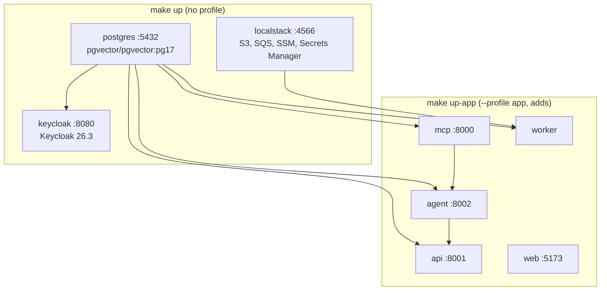

# Local Development

This guide covers everything needed to work on Smart Tutor locally: starting the Docker Compose stack, installing backend dependencies, running lint and tests, executing one-off jobs, and performing the full pre-commit check sequence.

## Prerequisites

- **Docker Desktop** (or Docker Engine + Compose plugin)
- **`make`** – on Windows, use Git Bash or WSL; alternatively run each Makefile command directly
- **`uv`** – Python package manager (backend)
- **`npm`** – for the React web app
- **`helm`** – for Helm chart linting
- **AWS credentials** for a developer profile in `us-east-1` – required for Bedrock and LangSmith (no local emulator)

## Environment Setup

Copy the example environment file before starting any service:

```bash
cp .env.example .env
```

Edit `.env` to supply your AWS profile name and any LangSmith API key. Do **not** commit `.env`. The app containers load it via `env_file: [{path: .env, required: false}]`, so missing values are tolerated when running dependency-only mode.

## Docker Compose Modes

The `compose.yaml` defines two operating modes controlled by the `app` profile.



*Compose service topology – left group is always started; right group requires `--profile app`.*

### Dependency-only mode (default)

```bash
make up
# equivalent: docker compose up -d
```

Starts three infrastructure services:

| Service | Image | Host port | Purpose |
|---|---|---|---|
| `postgres` | `pgvector/pgvector:pg17` | `5432` | App database + Keycloak database; `vector` extension and `keycloak` DB created by `local/postgres/init/01-init.sql` |
| `keycloak` | `quay.io/keycloak/keycloak:26.3` | `8080` | OIDC identity provider; realm imported from `local/keycloak/realm-smart-tutor.json` |
| `localstack` | `localstack/localstack:4` | `4566` | Emulates S3 (`smart-tutor-documents`), SQS (`smart-tutor-ingest` + DLQ), SSM, and Secrets Manager; provisioned by `local/localstack/init/ready.d/10-smart-tutor.sh` |

Use this mode for backend development when running the API, agent, or worker processes directly from your shell.

### Full-app mode

```bash
make up-app
# equivalent: docker compose --profile app up -d --build
```

Adds the application containers (built from `backend/Dockerfile` targets and `web/`):

| Service | Target / port | Notes |
|---|---|---|
| `api` | `:8001` | FastAPI REST API; depends on postgres, keycloak, agent |
| `agent` | `:8002` | LangGraph agent; connects to MCP at `http://mcp:8000/mcp` |
| `mcp` | `:8000` | RAG MCP server; depends on postgres |
| `worker` | (no host port) | Ingestion worker; pulls from SQS via LocalStack |
| `web` | `:5173` | Vite/React frontend; built from `web/` |

> **Bedrock and LangSmith** have no local emulator. App containers call the real AWS `us-east-1` endpoint using the credentials in `.env`. This means `make up-app` (or running the agent/evaluators locally) requires valid AWS credentials.

## Makefile Targets

All targets live in the root `Makefile`. On Windows, run from Git Bash/WSL or execute the underlying commands directly.

| Target | Command run | Description |
|---|---|---|
| `up` | `docker compose up -d` | Start dependency services (pgvector, Keycloak, LocalStack) |
| `down` | `docker compose down` | Stop and remove containers (volumes retained) |
| `up-app` | `docker compose --profile app up -d --build` | Start dependency + app services, rebuilding images |
| `sync` | `cd backend && uv sync` | Install / sync Python dependencies |
| `lint` | `cd backend && uv run ruff check . && uv run ruff format --check . && uv run mypy && uv run lint-imports` | Ruff lint + format check + mypy strict + architecture import contracts |
| `test` | `cd backend && uv run pytest` | Unit tests only (no I/O; integration tests excluded by default marker) |
| `test-integration` | `cd backend && uv run pytest -m integration` | Integration tests against the live Compose stack; requires `make up` first |
| `sweep` | `cd backend && uv run python -m smart_tutor.apps.jobs.record_sweeper` | Run the learning-record sweeper once (PRD §9.2) |
| `glacier-tag` | `cd backend && uv run python -m smart_tutor.apps.jobs.glacier_tagger` | Run the Glacier tagger once (PRD §9.5) |
| `retention` | `cd backend && uv run python -m smart_tutor.apps.jobs.retention` | Run the retention job once: traces expire after 180 days, decline log after 90 days (PRD D25, §9.6) |
| `evals-smoke` | `cd backend && uv run --extra eval python -m evals.run --split smoke` | Run the ~30-item smoke eval split against LangSmith |
| `web` | `cd web && npm run dev` | Start the Vite dev server (hot reload) |
| `infra-synth` | `cd infra && uv run cdk synth` | Synthesize the CDK infrastructure stacks |
| `helm-lint` | `helm lint deploy/helm/smart-tutor` | Lint the `smart-tutor` umbrella Helm chart |

Run `make help` to list all target names.

## Lint in Detail

`make lint` runs four tools in sequence inside `backend/`:

1. **`ruff check .`** – fast Python linter (rules: E, F, I, B, UP, SIM; line length 120)
2. **`ruff format --check .`** – formatting check
3. **`mypy`** – strict type checking of `src/` against Python 3.12
4. **`lint-imports`** (import-linter) – validates 18 architectural import contracts defined in `backend/pyproject.toml` under `[tool.importlinter]`

The import contracts enforce: layers inside each module (`adapters | application → ports → domain`); module privacy (cross-module access only through `application`); `apps` as a leaf; vendor SDK isolation; and the module dependency order.

> **Windows note:** `lint-imports` requires `PYTHONUTF8=1` to handle UTF-8 file paths correctly. The Makefile sets `export PYTHONUTF8 := 1` globally, but if running the command directly set it in your shell first.

## Tests in Detail

### Unit tests

```bash
make test
# or: cd backend && uv run pytest
```

Runs `tests/unit/` only (the default `pytest` configuration excludes the `integration` marker). Tests are async-compatible without decorators (`asyncio_mode = auto`). All I/O is replaced by fakes from `tests/fakes/` (e.g. `FakeChatModel`).

### Integration tests

```bash
make up          # ensure the stack is running first
make test-integration
# or: cd backend && uv run pytest -m integration
```

Integration tests in `tests/integration/<module>/` hit real PostgreSQL, LocalStack S3/SQS, and Keycloak. Tests in `tests/isolation/` verify cross-user access and deduplication guarantees.

### Evals (smoke)

```bash
make evals-smoke
```

Runs the ~30-item smoke dataset against the live agent (calls real Bedrock in `us-east-1`). Results are pushed to a LangSmith experiment and compared against thresholds in `backend/evals/thresholds.yaml`. The `full` split runs before a release. Eval datasets are versioned in LangSmith; seed corpus PDFs live in `data/seed_corpus/` (not committed).

## Keycloak Test Users

The realm `smart-tutor` is imported from `local/keycloak/realm-smart-tutor.json` when the Keycloak container starts with an empty volume. Three users are pre-created:

| Username | Password | Roles |
|---|---|---|
| `learner@example.com` | `learner` | `learner` (default) |
| `learner2@example.com` | `learner2` | `learner` (default) |
| `admin@example.com` | `admin` | `learner`, `admin` |

The Keycloak admin console is at `http://localhost:8080` (username: `admin`, password: `admin`).

The realm is imported **only once** (when the volume does not exist). To force a re-import after editing `local/keycloak/realm-smart-tutor.json`:

```bash
docker compose down -v   # destroys the pgdata volume too
make up
```

Keep the built-in roles `offline_access` and `uma_authorization` defined in the realm JSON; Keycloak requires them.

## Web App Dev Server

```bash
make web
# or: cd web && npm run dev
```

Starts the Vite hot-reload server. The Keycloak client `smart-tutor-web` (PKCE public client) is already configured with redirect URIs for `http://localhost:5173/*`.

## Pre-Commit Check Sequence

Before committing, run the same checks that CI (`.github/workflows/ci.yml`) will run:

```bash
# Backend (always)
cd backend && uv run ruff check . && uv run ruff format --check . && uv run mypy && PYTHONUTF8=1 uv run lint-imports && uv run pytest

# Web (when web/ changed)
cd web && npm ci && npm run build

# Infra (when infra/ changed)
cd infra && uv run pytest

# Helm chart (when deploy/ changed)
helm lint deploy/helm/smart-tutor
```

## Windows Caveats

- **`PYTHONUTF8=1`** – required when running `lint-imports` directly (the Makefile sets it automatically via `export PYTHONUTF8 := 1`).
- **`MSYS_NO_PATHCONV=1`** – required for commands that take SSM parameter paths like `/smart-tutor/...` (e.g. `awslocal ssm put-parameter`); otherwise Git Bash silently converts the leading `/` to a Windows path.
- **`make`** – not installed by default on Windows. Use Git Bash with `make` available, WSL, or run the equivalent commands shown in the Makefile directly.

## Related Pages

- [Keycloak Auth](../integrations/keycloak-auth.md) – JWT validation, realm roles, and OIDC client configuration
- [Storage: S3 & SQS](../integrations/storage-s3-sqs.md) – document upload flow and LocalStack resource layout
- [Deployment](./deployment.md) – Helm chart, CDK stacks, and production configuration
- [Fakes and Unit Tests](../testing/fakes-and-unit-tests.md) – test fake implementations and unit test patterns
