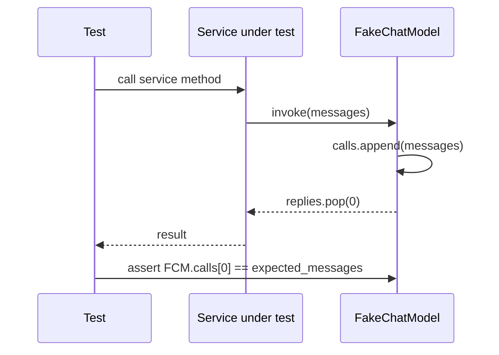

# Fakes and Unit Tests

The backend test suite separates **unit tests** (fast, no I/O, default `pytest` run) from
**integration tests** (adapters against the Docker Compose stack) and **isolation tests**
(cross-user access and deduplication guarantees). Unit tests achieve determinism by
substituting real model adapters with two purpose-built fakes that live in `tests/fakes/`.

---

## Test layout

```
tests/
├── conftest.py               # shared fixtures (embedding_model, etc.)
├── fakes/
│   ├── __init__.py           # re-exports FakeChatModel, FakeEmbeddingModel
│   └── models.py             # implementations
├── unit/
│   └── <module>/             # domain and application tests with fakes
├── integration/
│   ├── README.md             # Compose requirement docs
│   └── <module>/             # adapter tests against pgvector / Keycloak / LocalStack
└── isolation/
    └── README.md             # US-11/US-12 cross-user and dedupe guarantee docs
```

| Tier | Location | Marked? | Default run? | Dependencies |
|---|---|---|---|---|
| Unit | `tests/unit/<module>/` | — | yes | fakes only |
| Integration | `tests/integration/<module>/` | `@pytest.mark.integration` | no | Docker Compose stack (`make up`) |
| Isolation | `tests/isolation/` | — | — | API and MCP server |

Integration tests require the Docker Compose stack (pgvector, Keycloak, LocalStack) and
are documented in `tests/integration/README.md`. They are excluded from the default run
and must be launched explicitly with `uv run pytest -m integration` after `make up`.

---

## pytest configuration

`pyproject.toml` configures pytest under `[tool.pytest.ini_options]`:

```toml
[tool.pytest.ini_options]
testpaths = ["tests"]
asyncio_mode = "auto"
addopts = "-m 'not integration' --import-mode=importlib"
pythonpath = ["tests"]
markers = ["integration: needs the Docker Compose stack (make up)"]
```

Key points:

- **`asyncio_mode = "auto"`** — every `async def test_*` runs under asyncio automatically.
  The `@pytest.mark.asyncio` decorator is never needed.
- **`addopts = "-m 'not integration'"`** — integration tests are excluded from plain
  `pytest` / `uv run pytest`. To run them: `uv run pytest -m integration`.
- **`pythonpath = ["tests"]`** — adds the `tests/` directory to `sys.path`, so all test
  files and fakes can be imported with bare names: `from fakes import FakeChatModel`.

---

## Shared fixtures (`tests/conftest.py`)

`tests/conftest.py` provides a single shared fixture used across unit tests:

```python
@pytest.fixture
def embedding_model() -> FakeEmbeddingModel:
    return FakeEmbeddingModel()
```

Because `tests/` is on `pythonpath`, this fixture is available to every test without
additional imports.

---

## FakeChatModel

`FakeChatModel` is a scripted, record-keeping implementation of the `ChatModel` port
(`smart_tutor.shared.ports.chat_model.ChatModel`).

### Construction

```python
from fakes import FakeChatModel
from smart_tutor.shared.ports.chat_model import ChatResult
from smart_tutor.shared.domain.token_usage import TokenUsage

model = FakeChatModel(
    replies=[
        ChatResult(text="Hello there", usage=TokenUsage(input_tokens=10, output_tokens=5)),
        ChatResult(text="Goodbye"),
    ]
)
```

- **`replies`** — a sequence of `ChatResult` objects returned by `invoke` and `stream` in
  order (FIFO, popped on each call).
- **`structured_values`** — a sequence of `BaseModel` instances returned by `structured`
  calls, validated against the requested schema.
- **`calls`** — a public `list[list[Message]]` that records every message list passed to
  `invoke` or `structured`. Inspection of `.calls` lets a test assert exactly what
  messages the service sent to the model.

### Methods

| Method | Behaviour |
|---|---|
| `invoke(messages, tools)` | Appends `messages` to `.calls`; pops and returns the next `ChatResult`. |
| `stream(messages, tools)` | Delegates to `invoke`; yields word-by-word `ChatChunk(text=…)` chunks, then one `ChatChunk(tool_call=…)` per tool call, and finally `ChatChunk(usage=…)`. |
| `structured(messages, schema)` | Appends `messages` to `.calls`; pops the next structured value, validates it with `schema.model_validate(…)`, and returns a `StructuredResult` with an empty `TokenUsage`. |

The `stream` implementation splits the response text on spaces, so the concatenation of all
text chunks omits the separating spaces (e.g. `"hello there"` yields `"hello"` then
`"there"`). Tests that check the joined output should account for this, as the existing
test suite does:

```python
assert "".join(c.text for c in chunks if c.text) == "hellothere"
```

### Calling sequence diagram



_Control flow for a unit test using `FakeChatModel.invoke`._

---

## FakeEmbeddingModel

`FakeEmbeddingModel` implements the `EmbeddingModel` port
(`smart_tutor.shared.ports.embedding_model.EmbeddingModel`) with a fully deterministic,
fast embedding strategy.

### Construction

```python
from fakes import FakeEmbeddingModel

model = FakeEmbeddingModel(dimension=4)   # default dimension is 4
```

- **`dimension`** — controls both the reported `dimension` property and the length of every
  vector produced. The default is `4`.
- **`model_id`** — always returns `"fake-embedding"`.

### Embedding algorithm

Each vector component `i` is the sum of the Unicode code points of every character at
position `i` modulo `dimension` (i.e. `text[i::dimension]`). This means:

- Identical texts always produce identical vectors.
- Texts that differ in content produce different vectors in most cases, making the fake
  useful for ranking and similarity tests.
- No network or file I/O is involved.

```python
def _embed(self, text: str) -> list[float]:
    return [float(sum(ord(c) for c in text[i :: self._dimension])) for i in range(self._dimension)]
```

Both `embed_documents` (batch) and `embed_query` (single) delegate to `_embed`, so a
query and an indexed chunk derived from the same text will receive the same vector.

---

## Writing a unit test

### Minimal example

```python
from fakes import FakeChatModel
from smart_tutor.shared.domain.token_usage import TokenUsage
from smart_tutor.shared.ports.chat_model import ChatResult, Message


async def test_service_sends_correct_prompt() -> None:
    model = FakeChatModel(replies=[ChatResult(text="Paris", usage=TokenUsage(8, 3))])
    service = MyService(chat_model=model)   # inject via constructor

    answer = await service.answer("What is the capital of France?")

    assert answer == "Paris"
    # verify the service sent the right messages
    assert model.calls[0][0].role == "system"
    assert "capital" in model.calls[0][1].content
```

### Rules (from `AGENTS.md`)

1. **Every behaviour change comes with tests.** A PR that changes domain or application
   logic must include a corresponding unit test.
2. **Unit tests use fakes.** Real Bedrock calls belong only in the `evals/` suite; they
   must never appear in `tests/unit/`.
3. **Async tests need no decorator.** `asyncio_mode = "auto"` handles all `async def
   test_*` functions automatically.
4. **Import fakes with bare names.** `from fakes import FakeChatModel` works because
   `tests/` is on `pythonpath`.

---

## Port contracts

The fakes are authoritative implementations of the ports, not shortcuts. The test file
`tests/unit/shared/test_fake_models.py` verifies that the fakes honour the same contracts
a real adapter must satisfy:

- The last chunk emitted by `stream` carries the `TokenUsage`.
- `structured` returns a value that passes `schema.model_validate`.
- `embed_documents` and `embed_query` return vectors whose length matches the declared
  `dimension`, and identical inputs produce identical vectors.

A service tested with a fake therefore behaves as it would with a real adapter, so
breaking a fake's contract is equivalent to breaking the port itself.

---

## Related pages

- [Shared Kernel](../architecture/shared-kernel.md) — `ChatModel`, `EmbeddingModel`, and `TokenUsage` port definitions
- [Evals](evals.md) — real Bedrock evaluation runs; the only place real model calls belong
- [Isolation Tests](isolation-tests.md) — cross-user access and deduplication guarantees
- [Local Dev](../operations/local-dev.md) — running the Compose stack for integration tests
