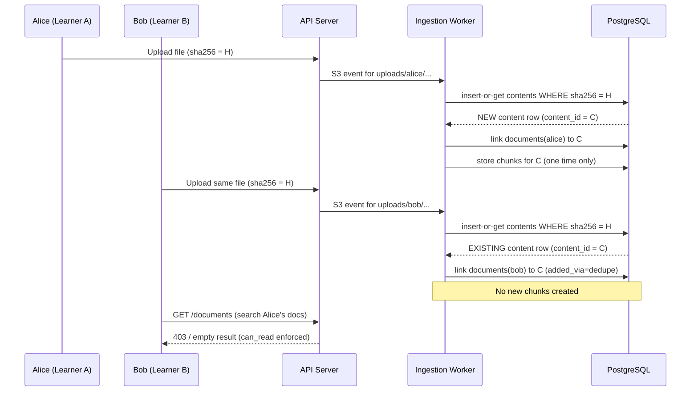

# Isolation and Deduplication Tests

The `tests/isolation/` directory is the dedicated test suite for Smart Tutor's two non-negotiable security properties: **data isolation** (a learner can never access another learner's data) and **deduplication integrity** (SHA-256 deduplication never becomes a pathway for unauthorized access). Both properties are specified in PRD US-11 and US-12, and both carry a hard release-gate threshold of 100% in `evals/thresholds.yaml`.

Unlike unit tests (which use fakes in memory) or integration tests (which test adapters against the Compose stack), isolation tests run against the **live API and MCP server**. They require the full Compose stack to be running; bring it up with `make up`, then run the isolation tests alongside the integration suite via `make test-integration` (which invokes `uv run pytest -m integration` — isolation tests are not marked with that marker but depend on the same stack). The tests are code-based, not judge-based, and every failure blocks release.

---

## Why this suite exists

Smart Tutor stores a shared subject catalog and deduplicates content by SHA-256 across all users. These design choices create deliberate sharing of infrastructure — subjects, contents, and chunks — while keeping each learner's library, conversations, notes, and records strictly private. Because the sharing is structural, isolation can only be proven by testing the behavior of real endpoints and MCP tools with two or more distinct authenticated users, not by reviewing code.

PRD D4 states the access rule plainly: access is decided by `can_read(user, document)`, implemented in code and SQL, never by the prompt. But the suite is required because every surface that returns learner data must be verified empirically. AGENTS.md makes the requirement explicit:

> Every endpoint and MCP tool that returns learner data must have a test in `isolation/`.

The 100% threshold means any regression in cross-user access or deduplication semantics is an immediate release blocker — there is no acceptable failure rate.

---

## What the suite asserts

### Cross-user isolation (US-12)

Given two learners — call them Alice and Bob — who have both uploaded documents, including at least one pair where Alice and Bob hold **documents in the same shared subject**, the suite verifies that Alice can never:

- **read** Bob's documents (list, get, or view metadata);
- **list** Bob's threads, notes, learning records, quizzes, reports, or usage;
- **retrieve** chunks from Bob's documents through the MCP `search` tool;
- **cite** Bob's content via `get_chunk` (citation resolution);
- **download** Bob's files via the document download endpoint.

The same assertions hold in reverse (Bob cannot access Alice's data) and hold even when Alice and Bob share the same subject — a scenario where the access boundary is most likely to be blurred, since their documents are both linked to the same subject catalog entries and the same content chunks when files happen to be identical.

Every endpoint and MCP tool that returns learner data requires at least one test in `isolation/`. The enforcement obligation comes from AGENTS.md.

### Deduplication isolation (US-11)

When two learners upload the same file, the system deduplicates by server-computed SHA-256: the uploaded copy is discarded and the second learner's document is linked to the existing content row. No new extraction or embedding runs. The suite verifies three specific guarantees about this process:

1. **A duplicate upload links to existing content without creating new chunks.** When Bob uploads a file whose hash already exists because Alice previously uploaded it, the `chunks` table receives no new rows. Embedding cost is paid once; the second learner's document points to the same `content_id`.

2. **A browser-sent hash alone never grants access to another learner's content.** The browser may compute the SHA-256 client-side and send it to the API as an optimization — but this is only used to check whether the file is already in *the caller's own* library (or, from Release 4, a published document). Supplying a hash that matches a file already uploaded by another learner does not cause the system to link the caller's document to that content. Linking only happens after the server recomputes the hash from the uploaded bytes. PRD D19 captures this design decision precisely; the suite tests the enforcement.

3. **Concurrent identical uploads create exactly one content row.** If Alice and Bob upload the same file at the same moment, the `insert-or-get` on the `contents` table's unique `sha256` index ensures exactly one content row is created, even under a race. Both learners' documents are linked to that single row, and no duplicate extraction runs.


*Deduplication links both learners to one content row; isolation prevents Bob from seeing Alice's document.*

---

## Relationship to access-control enforcement

The isolation suite is the **automated proof** that the access-control design described in [Access Control and Identity Propagation](../concepts/access-control.md) is correctly implemented end-to-end. That page documents how `can_read(user, document)` is expressed as a SQL predicate and how the MCP server uses the JWT `sub` claim to scope every vector search. The isolation tests confirm that this machinery holds at every API surface and MCP tool.

The suite's scope is intentionally wider than the MCP server alone. Cross-user access could theoretically slip through the REST API (document listing, thread history, note retrieval, usage display) or through citation resolution (`get_chunk`), so the suite covers both transports.

---

## Relationship to the eval pipeline

In `evals/thresholds.yaml`, the isolation and deduplication evaluator is:

```yaml
isolation_and_dedupe: {type: code, min: 1.00}   # integration tests (US-11, US-12)
```

The entry `type: code` means these are not LLM-as-judge evaluations; they are deterministic code assertions run as integration tests. The release gate reads `thresholds.yaml` directly; the `min: 1.00` value means the gate requires every isolation and deduplication test to pass — a single failure blocks release.

Isolation tests are part of the **release gate for every release** (not just Release 1). The PRD states the gate explicitly:

> Release gate (every release): full evaluation split meets that release's §10.1 targets; **isolation tests pass**; production smoke test passes.

This means the suite must be updated when new endpoints or MCP tools that return learner data are introduced — for example, when Release 4 adds sharing grants and makes `can_read` broader, the isolation tests must be extended to cover the new sharing cases (`M10` milestone exit criterion explicitly requires this).

See [LangSmith Evaluations and Release Gates](evals.md) for how thresholds are loaded and checked during a release run.

---

## Current status: scaffold stubs

At the M1 scaffold stage, the `tests/isolation/` directory contains only the README. The test files themselves are **empty stubs** — an M1 task. The README documents the intended scope:

> A learner can never read, list, retrieve, cite, or download another learner's documents, threads, notes, learning records, quizzes, reports, or usage — including two learners whose documents are in the same shared subject. MCP search returns only chunks of contents behind documents the caller can read (`can_read`).

Once implemented, the tests run against the API and MCP server (the same Compose stack as integration tests). They are a distinct tier because their purpose is behavioral proof of a security property, not adapter-level verification.

---

## Where to add new tests

New isolation tests belong in `tests/isolation/`, following existing patterns. The coverage obligation is broad: **every endpoint and MCP tool that returns learner data** needs at least one isolation test. This explicitly includes:

- All REST API routes for documents, threads, notes, learning records, quizzes, reports, and usage.
- The MCP `search` tool (must return only chunks of contents behind documents the caller can `can_read`).
- The MCP `get_chunk` tool (citation resolution must be scoped to the caller's readable documents).
- Any new endpoint or tool added in a later release — Release 4 sharing grants and the Release 5 knowledge graph endpoints will both require additions.

---

## Relationship to other test tiers

| Tier | Location | Marked | Runs against | Purpose |
|---|---|---|---|---|
| Unit | `tests/unit/<module>/` | — | Fakes in memory | Domain rules and application logic |
| Integration | `tests/integration/<module>/` | `@pytest.mark.integration` | Compose stack (adapters) | Adapter correctness against real pgvector / Keycloak / LocalStack |
| **Isolation** | **`tests/isolation/`** | — | **Live API + MCP server** | **Cross-user access and deduplication guarantees** |

Unit and integration tests are documented in [Fakes and Unit Tests](fakes-and-unit-tests.md). The isolation suite is a separate tier precisely because it cannot be satisfied with fakes — the guarantees it tests emerge from the interaction between authentication middleware, SQL predicates, and the MCP server's JWT validation, none of which are meaningfully exercised by in-process test doubles.

---

## Summary of invariants the suite must enforce

| Invariant | PRD reference |
|---|---|
| No learner can read, list, retrieve, cite, or download another learner's documents | US-12 |
| No learner can access another learner's threads, notes, or learning records | US-12 |
| No learner can access another learner's quizzes, reports, or usage | US-12 |
| The above hold even when both learners share the same subject | US-12 |
| MCP search returns only chunks of contents behind documents the caller can read (`can_read`) | US-12 / D4 |
| Duplicate upload links to existing content; no new chunks created | US-11 |
| Browser-supplied hash never causes linking without a server-side hash verification | US-11 / D19 |
| Concurrent identical uploads produce exactly one content row | US-11 |
