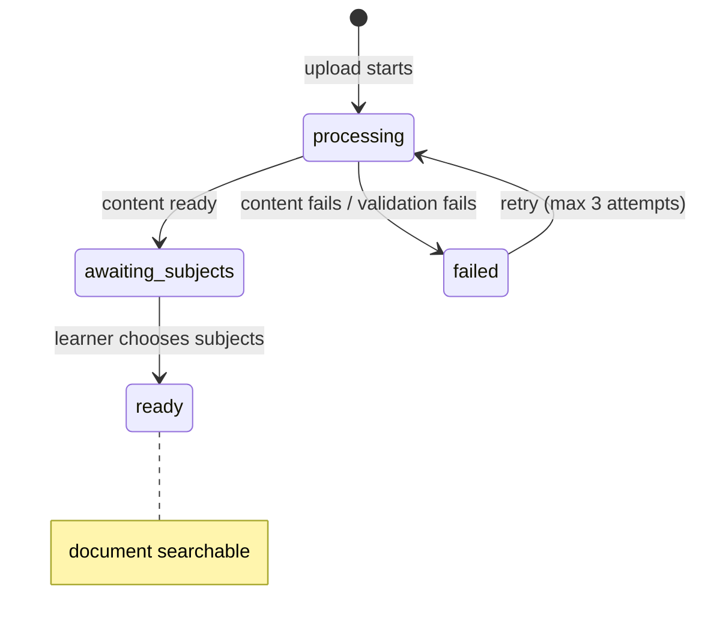

# Ingestion Flow

The ingestion pipeline converts a learner-uploaded PDF into searchable, embedded chunks stored in PostgreSQL (pgvector). It is designed around two invariants from [ADR 0002](../../sdd/adr/0002-content-document-split-sha256-dedupe.md):

- **One `Content` per unique file.** A file is extracted, chunked, and embedded exactly once across all learners, keyed by the SHA-256 of its bytes.
- **Server-side hash only.** Deduplication linking a document to an existing content happens only after the worker computes the hash from the uploaded bytes; a browser-sent hash alone is never sufficient (PRD D19).

---

## Sequence Diagram

```mermaid
sequenceDiagram
    participant Browser
    participant API as API Server
    participant S3
    participant SQS
    participant Worker as Worker (apps/worker)
    participant DS as DeduplicationService
    participant IS as IngestionService
    participant Bedrock
    participant PG as PostgreSQL

    Browser->>Browser: compute SHA-256 of file bytes
    Browser->>API: GET /documents/check?sha256=... (own library only)
    API-->>Browser: already_in_library / not_found
    Browser->>API: POST /documents/upload (request presigned URL)
    API-->>Browser: presigned POST for uploads/<user_id>/<upload_id>.pdf
    Browser->>S3: POST uploads/<user_id>/<upload_id>.pdf
    S3->>SQS: ObjectCreated event
    SQS->>Worker: deliver message
    Worker->>S3: download uploaded bytes
    Worker->>Worker: validate type, size, pages; compute server-side SHA-256
    Worker->>DS: insert-or-get content by sha256
    alt New hash
        DS->>PG: insert content row (state=processing)
        DS-->>Worker: new content
        Worker->>IS: ingest new content
        IS->>S3: move to contents/<sha256>.pdf; delete upload
        IS->>Bedrock: first-pages (describe_document, pages 1-2)
        Bedrock-->>IS: title, authors, year, DOI, summary, 3 proposed subject names
        IS->>Bedrock: embed summary
        Bedrock-->>IS: summary_embedding (1024-dim)
        IS->>PG: store metadata + summary_embedding + proposed names
        IS->>PG: compute + store subject suggestions for this learner
        Note over IS,PG: Learner can now choose subjects (p95 within 30s)
        IS->>Bedrock: Docling full PDF extraction
        IS->>S3: save contents/<sha256>.docling.json
        IS->>PG: store references, work_key, chunks + chunk embeddings
        IS->>PG: content state to ready; documents to awaiting_subjects
    else Existing content (ready)
        DS->>S3: delete uploaded copy
        DS->>PG: link document (added_via=dedupe)
        DS->>PG: compute subject suggestions for this learner
        Note over DS,PG: Learner reaches choose-subjects p95 within 10s
    else Existing content (processing)
        DS->>S3: delete uploaded copy
        DS->>PG: link document; document waits for in-progress extraction
    else Existing content (failed)
        DS->>S3: delete uploaded copy
        DS->>PG: link document; re-queue for retry (counts as attempt)
    end
```

*End-to-end ingestion: browser duplicate check, presigned POST, S3 event delivery, server-side deduplication, first-pages metadata, and full Docling extraction through to `ready` state.*

---

## Browser Duplicate Check

Before issuing any network request to upload bytes, the browser computes the **SHA-256** of the selected file. It then calls the API to check whether that hash already appears in the **learner's own library**. If a match is found (including an archived document), the browser displays "Already in your library" (or "Restore" if archived) and no upload takes place.

This check is an optimisation for the learner's own files only. It does not involve other learners' documents and cannot be used to infer the existence of another learner's file (PRD D19). Server-side deduplication is always performed independently, regardless of what the browser reports.

> **File constraints checked before upload (client-side):** PDF only, ≤ 50 MB. Page count (≤ 500) and parseability are checked server-side after upload.

---

## S3 / SQS Event Path

The API issues a **presigned POST** to `uploads/<user_id>/<upload_id>.pdf` with a `content-length-range` cap of 50 MB and content type `application/pdf`. The key binds the object to the uploading user. After the file lands in S3, an `ObjectCreated` event notification delivers a message to an SQS queue (with a dead-letter queue for undeliverable events). The worker consumes that message.

The `uploads/` prefix has a lifecycle rule that expires objects after 1 day. The worker reads from `uploads/` and, for new content, writes to `contents/`. Both prefixes are in the same documents bucket; the worker's Pod Identity role has read on `uploads/*` and write/tag on `contents/*`.

---

## Rate Limits

Upload rate limits are configured in SSM Parameter Store (`/smart-tutor/*`) and enforced by the `accounts` module (`UsageService`). The defaults are:

| Limit | Default |
|---|---|
| Uploads per hour per learner | 20 |
| Uploads per day per learner | 100 |
| Processing retries per content | 3 |

Exceeding a rate limit or daily cap returns `429` with a retry-after message. Both successful uploads and failed or duplicate uploads count toward the limits. Upload usage is recorded in the `uploads` table with the outcome.

---

## The Six Processing Steps (PRD §9.2)

### Step 1 — Validate and hash

The worker reads the uploaded bytes and:

1. Checks file type (PDF) and size (≤ 50 MB).
2. Checks page count (≤ 500) and parseability.
3. Computes the **SHA-256** of the uploaded bytes.

Validation failures put the document in `failed` with the reason recorded; the learner sees the reason and a **Retry** button (up to 3 attempts per content).

### Step 2 — Insert-or-get the content by hash

The worker calls `DeduplicationService`, which performs an atomic insert-or-get on the `contents` table's unique `sha256` column:

| Outcome | What happens |
|---|---|
| **Existing content, state `ready`** | Uploaded copy deleted; document linked (`added_via = dedupe`); subject suggestions computed for this learner (step 5) and processing stops — no re-extraction. |
| **Existing content, state `processing`** | Uploaded copy deleted; document linked and left in `processing` state; it waits for the in-progress extraction to finish. |
| **Existing content, state `failed`** | Uploaded copy deleted; document linked; content re-queued for extraction (counts as a retry). |
| **New hash** | Proceed to step 3. |

Deduplication means embedding cost is paid once per unique file system-wide. When a duplicate of a `ready` content is found, the document reaches *awaiting subjects* within 10 s p95 (PRD §11).

### Step 3 — Move the file to content-addressed storage

For a new content the worker moves the file from `uploads/<user_id>/<upload_id>.pdf` to `contents/<sha256>.pdf` in S3. The upload copy is deleted. S3 versioning is on to protect against accidental overwrites.

### Step 4 — First-pages step (fast metadata extraction)

The worker calls `IngestionService` → `FirstPagesReader` port with the text of pages 1–2. This triggers a **single model call** to `amazon.nova-2-lite-v1:0` using the `describe_document` tool, which returns a structured payload containing:

- title, authors, year, DOI (if present)
- a two-sentence summary
- 3 proposed subject names

The summary is immediately embedded (`amazon.nova-2-multimodal-embeddings-v1:0`, 1024 dimensions, `GENERIC_INDEX`) and stored as `contents.summary_embedding`. The proposed names and the other metadata fields are persisted on the content row. This step completes within 30 s p95 of upload (the subject-suggestion latency target), unblocking the learner's subject-choice screen.

### Step 5 — Subject suggestion ranking

`SubjectSuggester` (in `subjects.application`) ranks suggestions for the uploading learner:

1. **Similarity:** compare `summary_embedding` against `subjects.name_embedding` for all subjects in the shared catalog; boost subjects the learner already has and check their personal names.
2. **Fill remaining slots:** if fewer than 3 matching shared subjects are found, append proposed names from step 4 that do not match any existing subject (after normalization and near-duplicate check).

The learner is shown exactly 3 suggestions and keeps 1–3. Any typed name that does not match an existing subject joins the shared catalog immediately after a personal-data / offensive-content check via `check_subject_name` (`nova-2-lite-v1:0`).

### Step 6 — Full Docling extraction

Runs concurrently while the learner chooses subjects:

1. **Docling** converts `contents/<sha256>.pdf` to structured JSON and saves the result to `contents/<sha256>.docling.json` in S3 Standard (not Glacier — search, the research map, and the topic catalog all read it directly).
2. **References** are extracted from the bibliography section.
3. The **`work_key`** is computed: DOI if present, otherwise normalized title + year. This identifies the intellectual work across different file versions (e.g. preprint vs. published) for the Release 2 research map.
4. The content is **chunked** (~1,500–3,000 characters) and each chunk is **embedded** (`GENERIC_INDEX`); chunk writes are idempotent per content.
5. The content state transitions to `ready`; all documents linked to this content transition from `processing` to `awaiting_subjects`.

The Research map (Release 2) back-fills `work_links` from saved references without reprocessing.

---

## Fair Scheduling

The worker processes uploads fairly across learners (PRD §9.1):

- **First-pages steps before full extractions.** Step 4 (fast metadata + embedding) for any user is always processed before any full Docling extraction. This keeps the 30 s p95 suggestion latency achievable even when the queue contains many large PDFs.
- **Round-robin across users.** When multiple learners have files waiting for full extraction, the worker alternates between them rather than draining one learner's queue first. This prevents a single learner uploading hundreds of files from starving other users.

---

## Worker Isolation

Because the worker parses untrusted PDF files, it runs with stricter security controls than other services (PRD §9.11):

| Control | Detail |
|---|---|
| Non-root UID | Runs as UID 10001 |
| Read-only root filesystem | Container filesystem is mounted read-only |
| NetworkPolicy egress | Egress only to AWS endpoints (S3, SQS, Bedrock, SSM) and PostgreSQL; no open internet access |
| Per-file timeout | A configurable deadline per PDF; timeout records `failed` and releases the worker |
| Resource limits | CPU and memory limits set on the Kubernetes pod |

The worker image installs the `[ingest]` optional dependency (`docling>=2.40`, which pulls in PyTorch). The API, agent, and MCP server images do **not** install `[ingest]`, keeping PyTorch out of those images.

---

## Docling and PyTorch Containment

Docling (and its PyTorch transitive dependency) is confined to the worker by two complementary mechanisms:

1. **Packaging:** `docling` is listed only under `[project.optional-dependencies] ingest` in `backend/pyproject.toml`. Only the worker Docker build target installs this extra.
2. **Import-linter (CI-enforced):** the contract `"Docling only in knowledge.adapters"` in `backend/pyproject.toml` forbids importing `docling` from any package other than `smart_tutor.knowledge.adapters`. A violation fails `make lint` in CI.

Full Docling extraction runs on CPU-only PyTorch nodes, sized from M0 benchmarks. Large PDFs (up to 500 pages) may take several minutes; the first-pages step keeps suggestions fast regardless.

---

## Content and Document State Machines

**Content states** (shared, keyed by SHA-256):

| Transition | Trigger |
|---|---|
| `processing` | First server-verified hash (insert-or-get) |
| `processing` → `ready` | Extraction, saved Docling output, references, work key, and embeddings all succeed |
| `processing` → `failed` | Validation, parse, timeout, or model error |
| `failed` → `processing` | Retry by any linked learner or re-upload of the same file (max 3 attempts) |
| `ready` → `processing` | System only: embedding-model change triggers re-embedding from stored chunk text |

**Document states** (per learner):

| Transition | Trigger |
|---|---|
| `processing` | Upload starts (`content_id` null until hashed) |
| `processing` → `awaiting_subjects` | Linked content becomes `ready` |
| `awaiting_subjects` → `ready` | Learner chooses 1–3 subjects |
| `processing` → `failed` | Content fails or validation fails |
| `archived` flag | Set/cleared independently of state; archived documents are excluded from search |

A document is **searchable** only when it is `ready`, not archived, and its content is `ready`.



*Document state machine (per learner); content states are shared across all learners who hold the same file.*

---

## Performance Targets (PRD §11)

| Scenario | p95 target |
|---|---|
| Subject suggestions shown (new content) | ≤ 30 s from upload completion |
| Duplicate of a ready content reaches choose-subjects | ≤ 10 s from upload completion |
| New content searchable — ≤ 200 pages | ≤ 5 min from upload completion |
| New content searchable — 201–500 pages | ≤ 15 min from upload completion |

---

## Glacier Lifecycle

The `glacier_tagger.py` CronJob (daily) implements PRD §9.5: it applies the S3 tag `status=archived` to `contents/<sha256>.pdf` when no non-archived document references that content, and removes the tag when a document is restored. An S3 lifecycle rule transitions tagged PDFs to **Glacier Flexible Retrieval** after 30 days.

`contents/<sha256>.docling.json` and the PostgreSQL `chunks` table are kept in S3 Standard and PostgreSQL respectively, so search, citations, re-embedding, the Release 2 research map, and the Release 3 topic catalog never require a Glacier restore. Only a full re-extraction from the PDF (e.g. a new Docling version) would require restoring the PDF from Glacier (hours).

> **M1 status.** `apps/worker/main.py` and `apps/jobs/glacier_tagger.py` are both `NotImplementedError` stubs; the full implementation is the M1 milestone exit criterion.

---

## Key Classes and Ports

| Symbol | Layer | Role |
|---|---|---|
| `Content` | `knowledge.domain` | Entity; owns state transitions and `retry()` |
| `Document` | `knowledge.domain` | Entity; owns `set_subjects()`, `archive()`, `restore()`, `can_be_read_by()` |
| `Chunk` | `knowledge.domain` | Value object; belongs to a content, not a learner |
| `UploadService` | `knowledge.application` | Issues presigned POST; validates upload metadata |
| `DeduplicationService` | `knowledge.application` | Insert-or-get by SHA-256; controls content linking |
| `IngestionService` | `knowledge.application` | Orchestrates steps 3–6; calls ports |
| `PdfExtractor` | `knowledge.ports` | Port for Docling-based full extraction (implemented in `knowledge.adapters`) |
| `FirstPagesReader` | `knowledge.ports` | Port for the fast first-pages model call (implemented in `knowledge.adapters`) |
| `ObjectStore` | `knowledge.ports` | Port for S3 object operations |
| `SubjectSuggester` | `subjects.application` | Ranks subject suggestions by embedding similarity |

Other modules call only `knowledge.application`; `knowledge.domain`, `knowledge.ports`, and `knowledge.adapters` are private (enforced by import-linter Rule 2).

---

## Related Pages

- [Content/Document Lifecycle](../concepts/content-document-lifecycle.md)
- [Subject Catalog](../concepts/subject-catalog.md)
- [Bedrock Models](../integrations/bedrock-models.md)
- [Storage: S3 and SQS](../integrations/storage-s3-sqs.md)
- [Module Layer Rules](../architecture/module-layer-rules.md)
