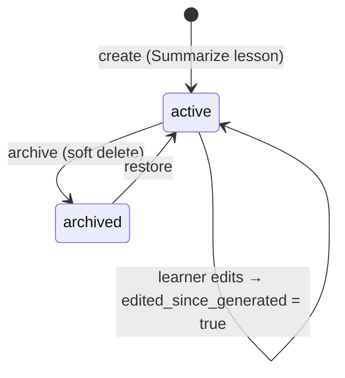
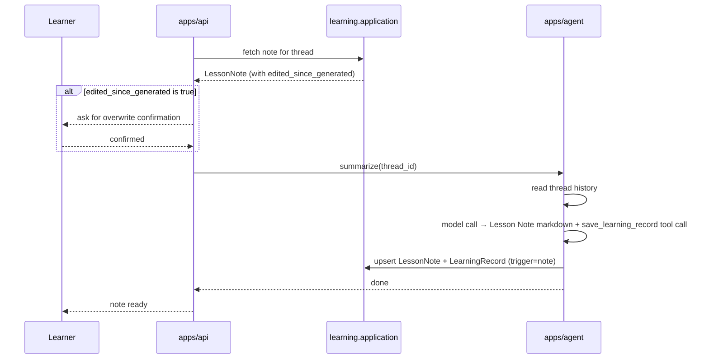

# Lesson Notes and Learning Records

The `learning` module owns two closely related artifacts: **Lesson Notes** (Markdown summaries of a thread, stored in PostgreSQL) and **learning records** (lifetime entries stored in the LangGraph store). Together they form the learner's long-term knowledge capture layer. Both are Release 1 features, but their service classes (`NoteService`, `LearningRecordService`) and the idle-record sweeper are stubs marked `NotImplementedError` pending Milestone 2 (M2).

## Module responsibilities and layer layout

The module follows the standard four-layer shape used by every Smart Tutor module:

```
learning/
├── README.md
├── domain/       # LessonNote, LearningRecord entities and invariants
├── application/  # NoteService, LearningRecordService — the module's public API
├── ports/        # NoteRepository, LearningMemory ABCs
└── adapters/     # PostgreSQL adapter (NoteRepository), LangGraph store adapter (LearningMemory)
```

Other modules may only call `learning.application`; they never import `learning.domain` or its adapters directly (import-linter contract 2, enforced in CI). The dependency order puts `learning` above `tutoring` in the module graph, so `tutoring` never imports `learning`.

`learning` itself may use `tutoring` (for thread content), but **only through `tutoring.application`**. This boundary is also what makes the "Discuss this note" flow possible without creating a cycle (see [Cross-module orchestration](#cross-module-orchestration-discuss-this-note)).

## Lesson Notes

### Invariants

| Invariant | Source |
|---|---|
| Exactly one Lesson Note per thread (`thread_id` is the unique key on `lesson_notes`) | PRD D8, §9.4 |
| No hard delete — "Delete" archives the note; `restore()` reverses it | PRD D8 |
| `edited_since_generated` flag is set whenever the learner edits the note manually | PRD D8 |
| "Summarize lesson" on a note where `edited_since_generated = true` must ask for confirmation before overwriting | PRD D8 |
| Archiving a note has no effect on the thread or its learning record | PRD US-7 |

### Storage

Lesson Notes are stored in the PostgreSQL `lesson_notes` table. The table is keyed on `thread_id` (unique), so there is never more than one note per thread. Relevant columns:

| Column | Purpose |
|---|---|
| `user_id` | Owner; notes are private to their creator |
| `subject_ids[]` | Denormalized for filtering (filter by subject matches any of the note's subjects) |
| `markdown` | The note body |
| `status` | `active` or `archived` |
| `edited_since_generated` | Boolean; set on any manual edit, cleared on a fresh generation |
| `archived_at` | Timestamp set by `archive()` |
| `source_note_id` | The note a "Discuss this note" thread was started from (nullable) |
| `updated_at` | Last write time |

### Lifecycle



*Lesson Note lifecycle. Archiving is the only delete operation; restore brings the note back to `active`.*

## Learning records

### What a record captures

A learning record is a **lifetime entry** describing what was learned in a single thread. The schema (stored in the LangGraph store) is:

| Field | Description |
|---|---|
| `subject_ids[]` | The thread's subjects at record-write time |
| `topics[]` | Topics covered in the thread |
| `key_points[]` | Key points extracted by the model |
| `note_id` | The `lesson_notes` row for this thread, if one exists |
| `trigger` | `note` (manual) or `idle` (automatic) |
| `learned_at` | Timestamp of first write |
| `updated_at` | Timestamp of most recent update |

### Storage

Learning records live in the **LangGraph store** (backed by PostgreSQL), not in the `lesson_notes` table:

- **Namespace:** `("learning", user_id)`
- **Key:** `thread_id`

This separates them from both the agent's checkpointer state (thread message history) and the relational note table.

### The two triggers — and only two

At most one record exists per thread, and it is **updated in place** by either trigger. No other code path may write a learning record.

| Trigger | When | How |
|---|---|---|
| **Note trigger** (`note`) | The learner clicks "Summarize lesson" | The summarize path in the agent calls `save_learning_record` as a tool; note and record are upserted together in one agent run |
| **Idle trigger** (`idle`) | The thread has been idle for `learning_record_idle_minutes` (default 10 minutes) with new unrecorded learner activity | The record sweeper CronJob detects eligible threads and calls `learning.application.LearningRecordService` to write or update the record |

Only **learner messages** reset the idle timer — tutor responses do not. The relevant columns on `threads` are `last_learner_message_at` and `record_written_at`.

The idle timeout is read from the SSM Parameter Store at `/smart-tutor/learning-record-idle-minutes` (default `10`). A changed value takes effect on the next sweeper run.

## The summarize path (note trigger)

When the learner triggers "Summarize lesson" the flow involves both `apps/api` and the agent:



*Summarize path. The `edited_since_generated` check happens in `apps/api` before the agent is called, so the model never sees a confirmation prompt.*

The model returns both the note markdown and a `save_learning_record` tool call payload containing `subject_ids`, `topics`, and `key_points`. The tool payload is validated in code before the upsert runs (PRD §9.9).

## Cross-module orchestration: "Discuss this note"

The "Discuss this note" action creates a new thread using the note's content as context. Because `tutoring` must not import `learning`, this flow is orchestrated entirely in `apps/api`:

1. `apps/api` calls `learning.application` to fetch the Lesson Note.
2. `apps/api` calls `tutoring.application` to start a new thread, passing the note markdown as the opening context and recording the `source_note_id` on the new thread.

Neither module imports the other; the cross-module call is made by the entrypoint layer, which is the only place such lateral orchestration is permitted (project structure design §5).

## The idle-record sweeper CronJob

### Purpose

The sweeper writes learning records for threads that have gone idle without a manually triggered note. It runs as a Kubernetes CronJob every minute.

### Selection query

The sweeper selects threads matching:

```
last_learner_message_at < now() − learning_record_idle_minutes
AND last_learner_message_at > record_written_at
```

- **First condition:** the thread has been idle long enough.
- **Second condition:** there is new unrecorded learner activity (the learner sent messages after the last record write). Threads with no new activity since their last record are skipped.

For each selected thread the sweeper calls `learning.application.LearningRecordService` to write or update the record with `trigger = "idle"`. No Lesson Note is created or modified.

### Implementation status

`apps/jobs/record_sweeper.py` raises `NotImplementedError` and is scheduled for M2:

```python
# apps/jobs/record_sweeper.py
"""CronJob (every minute): write learning records for idle threads via learning.application (M2, PRD §9.2)."""

def main() -> None:
    raise NotImplementedError("M2: learning-record sweeper")
```

`NoteService` and `LearningRecordService` in `learning.application` are likewise stubs at this stage.

### Configuration

| SSM parameter | Default | Effect |
|---|---|---|
| `/smart-tutor/learning-record-idle-minutes` | `10` | Minutes of learner-message inactivity before a thread's record is written by the sweeper |

A changed value is picked up on the next sweeper run without a deployment.

### Helm placement

The sweeper is deployed as part of the `jobs` sub-chart in the `smart-tutor` umbrella Helm chart (`deploy/helm/smart-tutor/charts/jobs`), alongside the Glacier tagger and retention CronJobs.

## Data isolation and retention

- Learning records are keyed by `(user_id, thread_id)` in the LangGraph store namespace, so one learner can never read another's records (US-12).
- Lesson Notes are owned by `user_id` and filtered by that column on every read.
- Notes and learning records are kept for the account's lifetime; threads are never deleted (PRD D25). Traces are deleted after 180 days, but note and record links survive because they reference `thread_id`, not trace ids.

## Relationship to other pages

- **Data model details:** [Data Model](../concepts/data-model.md)
- **Module layer rules and import contracts:** [Module Layer Rules](../architecture/module-layer-rules.md)
- **Ask flow and agent graph:** [Ask Flow](ask-flow.md)
